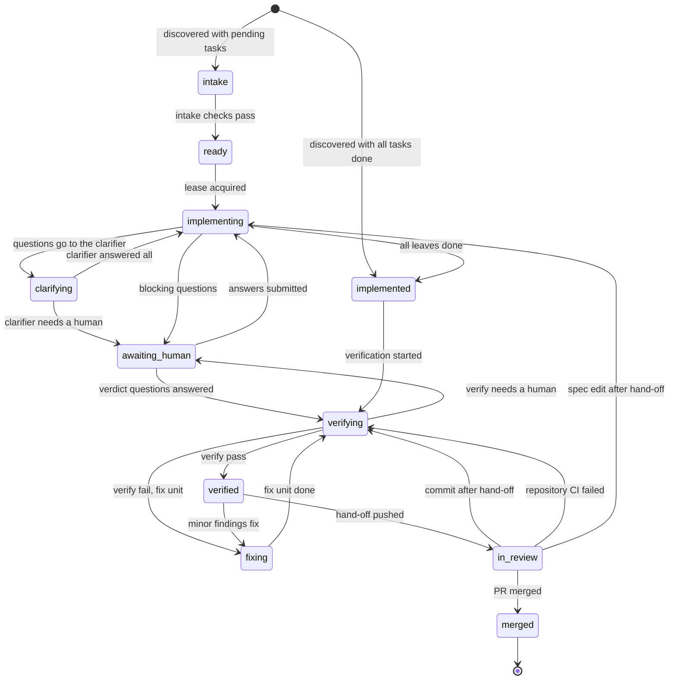

# L4 Harness

A portable, CI-native harness that adds **level-4 agentic development** to any repository: it detects the spec
framework (OpenSpec or Kiro), implements unfinished spec tasks **test-first** with a configurable coding agent
(Claude Code, Codex CLI, OpenCode, Kiro CLI, …) after checking which agents are actually available, asks
clarifying questions in `questions.md` next to the spec, verifies the result adversarially and deterministically,
turns findings into new specs, archives verified specs and hands a merge-ready PR/MR with an evidence package to a
human.

Status: the harness runs end to end on GitLab with a self-hosted shell runner; GitHub Actions support is written by
`l4 init --ci github`, but its forge setup (secret, runner) is manual.

## Getting started

```bash
git clone https://github.com/ciprianiacobescu/l4.git ~/l4
cd /path/to/your-project
~/l4/scripts/adopt.sh
```

`adopt.sh` installs what is missing (`uv`), adopts the project (`.l4/`, the CI file), checks it with a dry run of your
gates, and prints the exact remaining steps. A second run is safe. The runner and forge steps are in the
[quickstart](docs/quickstart.md).

### The `l4` skill for coding agents

The repository is also a Claude Code plugin marketplace with one skill, `l4`. It covers asking for changes with
`l4 feedback`, answering questions, reading state, resuming a unit, and adopting L4. It needs read access to this
repository:

```
/plugin install l4 --marketplace ciprianiacobescu/l4
```

The repository was renamed from `agent-supervisor` to `l4` on 2026-10-14. Git URLs and links redirect.
A workflow line `uses: <owner>/agent-supervisor/.github/actions/l4@…` does not: run
`l4 upgrade --action-repo <owner>/l4` once to rewrite it.

On older Claude Code, use `/plugin marketplace add ciprianiacobescu/l4`, then `/plugin install l4@l4-harness`.
For Codex, copy `plugins/l4/skills/l4` to `~/.agents/skills/l4`.

* [Quickstart](docs/quickstart.md)
* [Operations runbook](docs/runbook.md): the states of a unit, why a unit stops, and how to resume or retry
* [Delivery plans](docs/yolo-mode.md): order units by dependency and, with two opt-ins, merge them automatically into the integration branch
* [Architecture](docs/architecture.md)
* [Specification](docs/SPEC.md)
* [Research evidence](docs/research/README.md)

## How a unit moves

A unit is one spec change. The harness moves it through the phases below; each move is one `phase.changed` ledger
event, written only by `transition()` in `src/l4/state/lifecycle.py`, which refuses an edge its table does not have.
Waiting for capacity, halt, escalation and resume are left out here.



The full diagram, with the parking edges and a table of every phase, is in [docs/state-diagram.md](docs/state-diagram.md).
