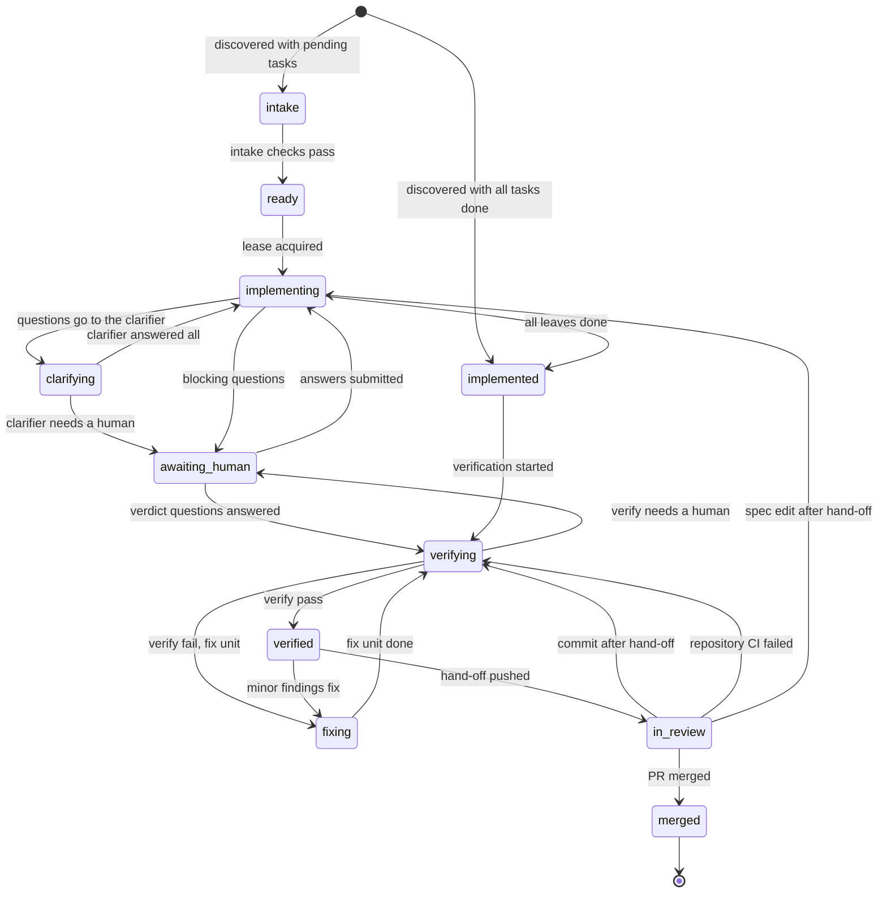

# L4 Harness

A portable, CI-native harness that adds **level-4 agentic development** to any repository: it detects the spec
framework (OpenSpec or Kiro), implements unfinished spec tasks **test-first** with a configurable coding agent
(Claude Code, Codex CLI, OpenCode, Kiro CLI, …) after checking which agents are actually available, asks
clarifying questions in `questions.md` next to the spec, verifies the result adversarially and deterministically,
turns findings into new specs, archives verified specs and hands a merge-ready PR/MR with an evidence package to a
human.

Status: the harness runs end to end on GitLab with a self-hosted shell runner, and on GitHub Actions with GitHub-hosted
runners. `l4 init --ci github` writes the workflow, and `l4 setup github` does the forge setup (the environment, its
secrets and branch rules, the workflow permissions, the labels and a first run).

What changed in each release: [CHANGELOG.md](CHANGELOG.md).

## Getting started

Install `l4` and give your coding agents the `l4` skill, in one line:

```bash
uv tool install git+https://github.com/ciprianiacobescu/l4@v0.4.24 && l4 skills install
```

`l4 skills install` copies the skill that ships inside the package, with no network, into the skill folder of every
coding agent it finds on the machine (Claude Code, Codex, OpenCode, Kiro CLI); `--project` writes it into the
repository to commit for a team, `--agent` names one, `l4 skills status` shows what is installed. Then adopt a
repository:

```bash
git clone https://github.com/ciprianiacobescu/l4.git ~/l4
cd /path/to/your-project
~/l4/scripts/adopt.sh
```

`adopt.sh` installs what is missing (`uv`), adopts the project (`.l4/`, the CI file), checks it with a dry run of your
gates, and prints the exact remaining steps. A second run is safe. The runner and forge steps are in the
[quickstart](docs/quickstart.md).

A model can answer the questions of a unit in CI (the delegate, off by default; `l4 init` writes it as a commented-out block; see
[docs/yolo-mode.md](docs/yolo-mode.md#the-delegate)).

### The `l4` skill for coding agents

The `l4` skill covers asking for changes with `l4 feedback`, answering questions, reading state, resuming a unit, and
adopting L4. It ships inside the `l4` package: `l4 skills install` (above) puts it where each agent looks:

| Agent | User scope (default) | `--project` |
|---|---|---|
| Claude Code | `~/.claude/skills/l4` | `.claude/skills/l4` |
| Codex | `~/.agents/skills/l4` (and `~/.codex/skills/l4` when that folder exists) | `.agents/skills/l4` |
| OpenCode | `~/.config/opencode/skills/l4` | `.opencode/skills/l4` |
| Kiro CLI | `~/.kiro/skills/l4` | `.kiro/skills/l4` |

`--agent auto` (the default) takes the agents whose home folder or CLI is present. A rerun after installing a newer `l4`
updates an untouched copy and refuses one you edited unless `--force`; `l4 doctor` warns (SKL-003) when an installed
copy is older than `l4`.

The repository is also a Claude Code plugin marketplace with the same skill. It needs read access to this repository:

```
/plugin install l4 --marketplace ciprianiacobescu/l4
```

The repository was renamed from `agent-supervisor` to `l4` on 2026-10-14. Git URLs and links redirect.
A workflow line `uses: <owner>/agent-supervisor/.github/actions/l4@…` does not: run
`l4 upgrade --action-repo <owner>/l4` once to rewrite it.

On older Claude Code, use `/plugin marketplace add ciprianiacobescu/l4`, then `/plugin install l4@l4-harness`.

## Reading the history (`l4 kg`)

`l4 kg build|report|why|propose` reads the history of all units of one repository from committed git objects. It
shows what keeps failing across units, what followed each lesson, and how one unit got where it is. `l4 lessons
promote ID` turns a reviewed draft from the inbox into a lesson. State: manual only, report only. No run reads the
graph, and nothing reaches an agent unless a person promotes a lesson. Today *n* is small (few units, one lesson), so
every line of the report shows its *n*. See the [runbook](docs/runbook.md#13-reading-the-history-l4-kg).

## Use L4 from your IDE (`l4 mcp`)

`l4 mcp serve` makes L4 an MCP server, so an IDE or an agent manages delivery plans and debugs stopped units through
typed tools (`l4_status`, `l4_plan_check`, `l4_unit_events`, `l4_retry`, ...) instead of shell commands. Each tool runs
the `l4` command it names, as an agent, so the rules of the CLI hold; activating a plan stays a person's command.
One server serves the repositories given with `--repo`, and an IDE holds one entry per repository:

```
l4 mcp install --client cursor --repo ~/work/my-repo      # entry l4-my-repo in ~/.cursor/mcp.json
l4 mcp install --client claude-code --project             # .mcp.json of the repository, entry l4
```

Clients: `claude-code`, `cursor`, `vscode` (project only), `kiro`, `codex`, `opencode`. See the
[quickstart](docs/quickstart.md#use-l4-from-your-ide).

* [Quickstart](docs/quickstart.md)
* [Operations runbook](docs/runbook.md): the states of a unit, why a unit stops, and how to resume or retry
* [How L4 runs](docs/control-loop.md): branches, events and the control loop; why `l4 retry` runs on the base branch
* [Delivery plans](docs/yolo-mode.md): order units by dependency and, with two opt-ins, merge them automatically into the integration branch
* [Architecture](docs/architecture.md)
* [Specification](docs/SPEC.md)
* [Research evidence](docs/research/README.md)

## How a unit moves

A unit is one spec change. The harness moves it through the phases below; each move is one `phase.changed` ledger
event, written only by `transition()` in `src/l4/state/lifecycle.py`, which refuses an edge its table does not have.
Waiting for capacity, halt, escalation and resume are left out here.



The full diagram, with the parking edges and a table of every phase, is in [docs/state-diagram.md](docs/state-diagram.md).
