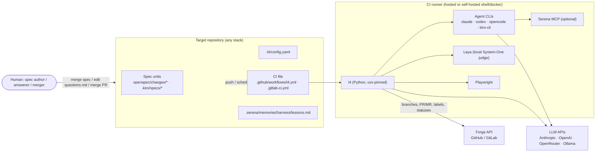
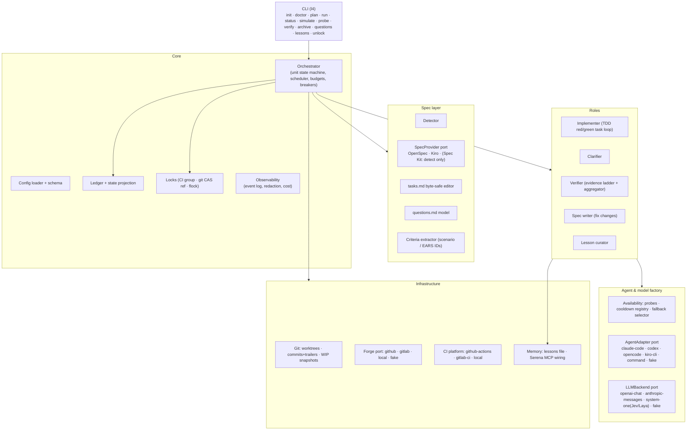
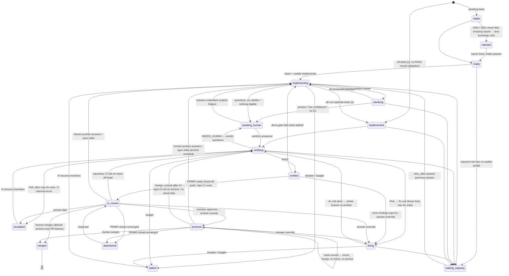
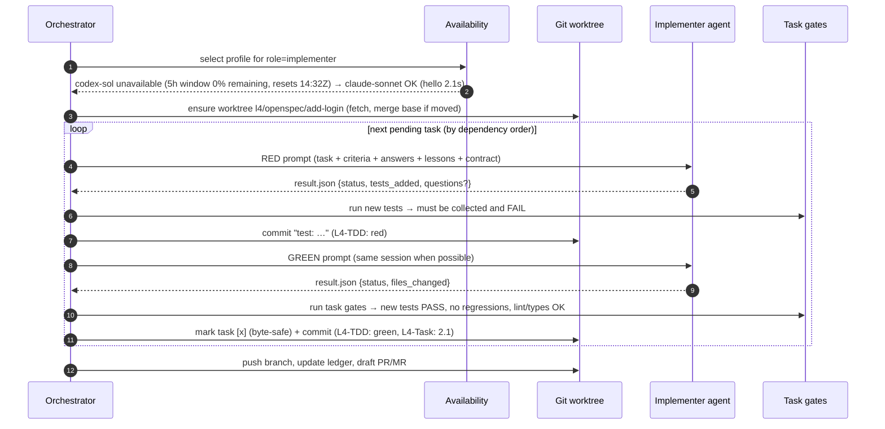
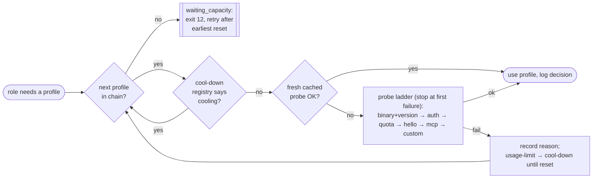
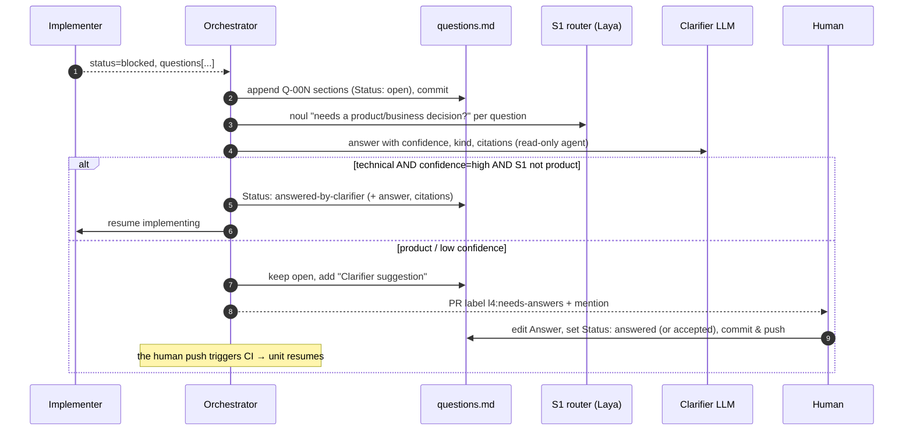
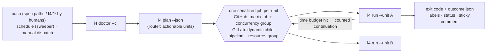

# L4 Harness — Architecture

> Status: **DRAFT for review** · 2026-10-03 · Normative requirements live in [`SPEC.md`](SPEC.md).
> Research evidence (cited, labelled) lives in [`research/`](research/README.md).
> Evidence labels used in this document: **[V]** verified against a primary source or reproduced locally,
> **[I]** inferred / design decision, **[U]** unverified, must be checked during implementation.

## 1. What this is

**L4 Harness** (`l4`) is a portable, CI-native control loop that you add to any existing repository to run
**specification-driven, test-driven, agentic development at autonomy level 4**. It:

1. **detects** which spec framework the repository uses (OpenSpec, Kiro; Spec Kit detected only),
2. **computes** what is implemented and what is not (task checkboxes + its own ledger),
3. **probes** which coding agents and models are actually usable right now (auth, quota, cool-down, a tiny
   "say hello" call) and **falls back** to the next configured agent when one is exhausted,
4. drives an **implementer** agent (Claude Code, Codex CLI, OpenCode, Kiro CLI, or any command) through the spec's
   tasks **test-first** in an isolated git worktree, one resumable step at a time,
5. turns blockers into **`questions.md`** inside the spec folder, lets a strong **clarifier** LLM answer what it
   safely can, and waits for a human for the rest,
6. runs an **adversarial, deterministic-first verifier** (gates, re-run tests, spec→test traceability, missing
   Playwright/unit tests generated by an independent agent, a local Laya System-One judge, an LLM judge panel),
7. converts every verifier finding into a **new spec change** that loops back to the implementer,
8. hands a **merge-ready PR/MR with an evidence package** to a human and, after the merge, **archives** the spec
   through a small archive-only PR (default; archiving on an approval label is an opt-in mode),
9. records **lessons** so later runs do not repeat the same mistakes,
10. offers **`doctor`**, **`plan`/dry-run** and **`simulate`** modes so the whole loop can be checked without
    spending a token.

There is **no LLM in the control loop**: the orchestrator is deterministic Python. LLMs act only inside
roles (implementer, clarifier, verifier, judges, spec writer), and every role's output is validated by code
before it can change state.

### 1.1 What "Level 4" means here

Autonomy levels are not standardised. SAE-style frameworks (Sourcegraph 2023, Shapiro 2026, Feng et al.,
Gartner 2026) agree that at L4 humans stop reviewing the code itself [V, research/06 §0.2]. The harness
adopts this working definition [I]:

> Inside a declared **operational design domain (ODD)** — allowed paths, task classes, a runnable test
> oracle, budgets — the harness takes an **approved spec** to a **merge-ready change** with no human
> reviewing intermediate steps or diffs. It handles its own fallback (verify → fix-spec → retry) within
> budgets. When it cannot continue it reaches a **minimal-risk condition**: nothing written to protected
> branches, work checkpointed on its own branch, precise questions in `questions.md`, lock released, humans
> notified.

Humans do four things: **approve specs** (merge the spec to the base branch), **answer escalated questions**,
**sign off at the merge gate on the evidence package** (the default merge policy is *human merges*), and
**audit exceptions**. If a human must read diffs to trust the result, the setup is L3; if there is no gate at
all, it is L5.

### 1.2 Development discipline imposed by default

The harness exists to make two disciplines the path of least resistance:

* **Specification-driven development (SDD)** — no implementation without a spec unit that validates; every
  scenario/acceptance criterion must be traced to a test; every verifier finding becomes a spec change (never a
  silent patch); code changes outside the spec's declared scope are flagged.
* **Test-driven development (TDD)** — every task runs as **red → green**: tests for the task's acceptance criteria
  are written first and must fail, then the implementation must make them pass with no regressions. The
  verifier checks the red-before-green history and that assertions were not weakened in between.

Both are on by default (`sdd.enforce: true`, `tdd.mode: strict`) and can only be relaxed per repo in config or
per task with a recorded justification that appears in the evidence package.

## 2. Context



## 3. Architectural principles

| # | Principle | Consequence |
|---|---|---|
| P1 | **Deterministic control loop** (borrowed from bmad-loop's "no LLM in the control loop" [V, research/06]) | State transitions, task selection, gates, verdict aggregation and archiving are plain code with tests. |
| P2 | **Level-triggered, stateless re-entry** (Ralph loop, Anthropic long-running harness [V]) | Every run re-derives "what next" from files on the unit's branch. Agent transcripts are a warm-start optimisation, never truth. |
| P3 | **State travels with the work** | Truth = spec files + `questions.md` + an append-only ledger committed on the unit branch. Any runner can resume any unit. |
| P4 | **Single writer for human-owned files** | Only the harness changes `tasks.md` markers and `questions.md` structure, byte-safely (port of the existing `kiro_tasks.py` helper). Agents are told not to touch them and a post-step diff check enforces it. |
| P5 | **Fail closed** | A crashed/timed-out verifier, an unparseable verdict, a refusal, zero tests executed — all are *not a pass*. |
| P6 | **Independent evidence** | The verifier never relies only on the implementer's tests or claims: it re-runs everything in a fresh worktree, generates its own tests for uncovered criteria (which must fail on base and pass on head), and prefers a model from a different vendor. (Origin: a past self-evaluated 88.9 % precision that audited at 21.9 %.) |
| P7 | **Deterministic before probabilistic** | Evidence ladder: tool results > System-One typed judgments > LLM judgments > human. A probabilistic signal never overrides a deterministic one. |
| P8 | **Ports and adapters everywhere** | Spec frameworks, agent CLIs, LLM backends, forges, memory, CI platforms are all behind small interfaces with a `fake` implementation, so the full loop is simulatable. |
| P9 | **Observable decisions** | Every decision (probe result, fallback, transition, verdict) is a structured log event; the durable subset goes to the ledger; the PR body/labels/statuses are projections rebuilt from the ledger. |
| P10 | **Thin footprint** | A target repo carries only `.l4/config.yaml`, the CI file, optional prompt overrides and the harness-owned files inside spec folders. The engine is fetched pinned (`uvx --from git+<harness-repo>@vX.Y.Z l4 …`). |

## 4. Building blocks



| Block | Responsibility | Depends on |
|---|---|---|
| **CLI** | Parses commands, maps outcomes to the exit-code contract and to CI outputs. | everything |
| **Config** | Loads `.l4/config.yaml` (+ env overrides), validates with a JSON-Schema-backed model, resolves profiles and fallback chains. | — |
| **Detector** | Deterministic filesystem rules decide which frameworks are present and which is primary ([SPEC §4](SPEC.md#4-spec-framework-detection-and-providers)). | SpecProviders |
| **SpecProvider** | One adapter per framework: enumerate units, parse tasks and criteria, validate, mark tasks, create fix units, archive. OpenSpec delegates to the `openspec` CLI (`--json`) where it can; Kiro is handled natively. | `openspec` CLI (Node ≥ 20.19) |
| **Orchestrator** | Per-unit state machine (§6), unit scheduling (parallel up to `max_parallel_units`), budgets, circuit breakers, time-budget handling. | all |
| **Ledger** | Append-only JSONL events per run, committed on the unit branch; `state.json` is a fold over the ledger. | VCS |
| **Locks** | One writer per unit: CI concurrency group / GitLab `resource_group` (primary), git compare-and-swap lock ref (portable backup), `flock` on shared shell runners. | VCS, CI |
| **Implementer** | Selects next task, builds the prompt, runs red then green phases through the chosen agent adapter, runs task gates, commits. | Factory, VCS, SpecProvider |
| **Clarifier** | Answers open questions with confidence, kind and citations; applies the auto-accept policy; routes product questions to humans. | Factory, S1 backend |
| **Verifier** | Runs the evidence ladder (§8), aggregates a verdict deterministically, writes `verification.md` + evidence. | Factory, Playwright, Laya |
| **Spec writer** | Turns verifier findings into a valid fix unit (OpenSpec change / Kiro bugfix spec). | SpecProvider |
| **Lesson curator** | Promotes verified failure patterns to `lessons.md`; dedupes, caps, supersedes. | Memory |
| **Availability** | Runs probe ladders, keeps the cool-down registry, picks the first usable profile in a role's fallback chain, logs why. | Adapters, backends |
| **Adapters / backends** | Uniform invocation, structured result, usage/cost and quota extraction, resume. | external CLIs / APIs |
| **Forge** | PR/MR lifecycle, labels, sticky comment, commit statuses, continuation dispatch. | REST APIs |
| **CI platform** | Reads CI context (run ids, deadlines, event), writes outputs (`$GITHUB_OUTPUT`, GitLab dotenv), renders templates. | — |

## 5. The spec unit and where its files live

A **unit** is one thing that can be implemented and archived: an OpenSpec change
(`openspec/changes/<id>/`) or a Kiro spec (`.kiro/specs/<name>/`). Unit IDs are namespaced:
`openspec:add-login`, `kiro:user-auth`.

The harness keeps everything about a unit **inside the unit's folder**, so a human can open one folder and see
what is happening, and so OpenSpec's archive carries the full history along:

```
openspec/changes/add-login/
├── proposal.md · design.md · tasks.md · specs/…     # human-owned spec (tasks.md markers: harness-written)
├── questions.md                                    # open/answered questions — humans edit answers here
├── verification.md                                 # latest verifier report (human-readable evidence summary)
└── .l4/
    ├── state.json                                  # derived snapshot (phase, task progress, profiles, budgets)
    ├── ledger/<run-id>.jsonl                       # append-only events, one file per run (merge-friendly)
    └── evidence/round-<n>/                         # small evidence files (test summaries, traceability matrix)
```

Verified with OpenSpec 1.14.0 [V, reproduced locally 2026-10-03]: extra files at the change root and in a
sub-directory pass `openspec validate --strict`, and `openspec archive` moves them into
`openspec/changes/archive/YYYY-MM-DD-<id>/` together with the change. Large artifacts (transcripts, Playwright
traces, screenshots) go to CI artifacts and are linked from `verification.md`.

Kiro has no archive concept [V, research/01]; for Kiro units `archived` is recorded in `state.json` and
(optionally, `kiro.archive_dir`) the folder is moved to `.kiro/specs/_archive/`.

## 6. Unit lifecycle



* Transitions are taken only by the orchestrator, recorded as ledger events, and are idempotent: each step has a
  key `(unit, step, task, input-hash)`; a `step.started` without `step.finished` is reconciled against commit
  trailers and the worktree before anything re-runs. **Built today (M0/M1):** the step trailer is
  `<task>/<phase>/<attempt>`; the `(unit, step, task, input-hash)` key is M2 (state-vcs-locks 1.22).
* **Approval of a spec = it is merged to the base branch.** Configuration and prompts are read only from the base
  branch, so a push to a unit branch cannot change what the harness executes. A fast path (specs pushed straight to an
  `l4/…` branch) exists but is off by default (`spec.allow_branch_specs`).
* The normative transition table is [SPEC §12.0](SPEC.md#120-lifecycle-normative); this diagram is its summary.
* **Fix units** spawned by the verifier live on the *same* branch and PR as their parent; the parent waits in
  `fixing`, then the *whole* branch is re-verified (fixes can regress other criteria). Fix units are archived right
  after the parent, in the same archive commit.

## 7. The implementer loop (TDD by default)



Key mechanics ([SPEC §7](SPEC.md#7-implementer)):

* **One task per invocation** (configurable grouping by parent task). Small steps give fine-grained restart points
  and keep the agent's context focused. The agent's session id is persisted the moment it is known so a crash can
  resume the same session on the same runner; otherwise a fresh session starts from the committed checkpoint
  plus a short "previous attempt" summary.
* **Result contract.** Every agent ends by producing a JSON result validated against a schema — natively where
  the CLI supports it (Claude Code `--json-schema`, Codex `--output-schema` [V, research/02/04]) and otherwise by
  writing the file named in `$L4_RESULT_PATH`. Invalid or missing result → one repair prompt → else a failed
  attempt.
* **Post-step guards.** After every agent step the harness diffs the worktree: protected files (`tasks.md`
  structure, `questions.md`, `.l4/`, CI files, agent configuration such as `.claude/**` or `opencode.json`,
  harness-owned memories) are restored and the violation logged; deletion/skip/weakening of pre-existing tests is
  flagged for the verifier.
* **Closing the TDD loopholes.** The red phase may touch test paths, test-support files and test-only dev
  dependencies, plus **signature-only stubs** (not-implemented bodies) so that tests for brand-new symbols compile and
  fail individually. Red is valid only if every new test fails, and also fails *by assertion* against **zero-value
  stubs** derived by the harness — a test that merely calls the new function is rejected as vacuous. Between red and
  green, the red tests, support files and test-runner settings are frozen, and green is checked by running the red
  tests **as committed in the red commit** against the new code. Green and a fix chore may not add, change or delete
  any path of the test globs at all (the test path freeze: tests belong in the red step, a human answer or a
  `[test-infra]` task frees one), whatever the language. The verifier additionally scans for result-forcing
  hooks, support files that patch production code, and new lint/type suppressions. The per-language details of these
  rules are settled by fixture repos in delivery change 0, which contain both the known gaming cases (must catch) and
  ordinary correct work such as zero-value edge-case tests and clock patching (must pass).
* **TDD exemptions** come only from tags the spec author wrote in the task title (`[docs]`, `[config]`, `[chore]`,
  `[no-test]`, `[test-infra]`), never from an agent's claim; the one agent-initiated case, "already satisfied by an
  earlier task", is accepted only after the harness confirms a passing discriminating test.
* **Stuck detection.** Agent `status: blocked`; no diff progress in 2 attempts; the same normalised failure
  fingerprint 3×; per-task turn/time budget exhausted. Then the harness asks the agent (one short call) to state
  the blocking questions, or escalates if it cannot.
* **Time budget.** The harness knows the job deadline (`ci.time_budget` or CI-derived). It stops starting new
  tasks when the remaining time is below the task estimate, interrupts the agent with SIGINT before the hard
  limit, commits a WIP snapshot to `l4-wip/<unit>` and dispatches a counted continuation.

## 8. Availability probes and fallback

Agents and models disappear for mundane reasons: an expired login, a 5-hour usage window exhausted, a provider
429 storm, a missing binary on a runner. The harness never starts a role on an agent it has not checked.



* **Probe ladder** per profile, cheapest first: binary present and version ≥ minimum → credentials present (env
  var *names* or the CLI's own login-status command) → quota (adapter-specific: remaining usage-window percentage
  where the CLI exposes it, else skipped) → **hello** (a minimal prompt that must answer exactly `L4-OK`, one
  turn, short timeout) → MCP servers start (optional) → user-defined command probes. Each step is configurable
  per profile.
* **Zero-cost quota sources exist for the two main tools** [V, re-run locally 2026-10-03]: Codex CLI 0.160.0's
  `codex app-server` answers `account/rateLimits/read` with the 5-hour (`windowDurationMins: 300`) and weekly windows,
  `usedPercent` and `resetsAt`, in 0.6 s without a model call; Claude Code 2.1.288's `/usage` costs $0 / 0 turns but
  returns human text in the local time zone, so the machine-readable `rate_limit_event` emitted on every
  stream-json request is preferred. OpenCode has no quota query and, worse, honours `retry-after` on a 429 for up
  to ~24.8 days — so the harness always enforces a wall-clock timeout [V, research/02].
* **Fail fast, never wait.** Adapters disable "wait until reset" behaviours (never `CLAUDE_CODE_RETRY_WATCHDOG`;
  low `CLAUDE_CODE_MAX_RETRIES`; abort on the first `rate_limit` retry event) and report a normalised
  `LimitSignal{kind, resets_at, source}`.
* **Cool-down registry.** When a probe or a real run hits a usage limit or 429, the profile is marked cooling
  down until the reported reset time (or a configured back-off) — in the runner cache *and* in the ledger, so
  other jobs skip it without spending a request.
* **Fallback chains** are declared per role (`implementer: [codex-sol, claude-sonnet, opencode-or]`). Mid-run
  exhaustion triggers the same selection; the next agent starts a fresh session from the last checkpoint (sessions
  are not portable across CLIs).
* **Independence constraint.** The verifier's selection excludes profiles that violate
  `verifier.independence` (default `different_vendor` from **every** implementer vendor that authored commits in this
  unit, judged by the model actually served), so a fallback on the implementer side can change the verifier choice.
  Independence is never relaxed at run time: with no independent verifier the unit waits, which is why the reference
  configuration includes a third-vendor judge.
* **Logged, always.** Example console line (also a structured `availability.selected` event):

  ```
  [l4] implementer: codex-sol skipped — quota: 5h window 100% used, 0% remaining (resets 2026-10-03T14:32Z); cool-down recorded
  [l4] implementer: claude-sonnet ok (binary 2.1.288 · auth subscription · quota 49% used · hello 2.1s) → selected, fallback #1
  ```

## 9. Clarification loop



* `questions.md` is **human-first Markdown with a strict, tolerant grammar** ([SPEC §6](SPEC.md#6-questionsmd)):
  an index table, then one section per question with `Status`, `Blocking tasks`, `Kind`, context, options,
  clarifier suggestion and an `Answer` block. Humans only need to write under *Answer* and change *Status*.
* A **human override** of an answer that the implementation already consumed is detected by answer hash and
  spawns a fix unit ("apply clarification Q-003"), because the harness never adds tasks to human-owned
  `tasks.md`.
* At most `clarifier.max_open_questions` (default 3) questions per escalation (Spec Kit precedent [V]).
* **Auto-accept is deliberately narrow:** both the implementer and the clarifier must call the question technical,
  the clarifier must be highly confident, Laya must put "needs a product decision" at ≤ 0.1, and every citation must
  resolve *and* be judged supportive (≥ 0.9). Without Laya nothing is auto-accepted. Answers reach the implementer
  inside `<l4:data>` blocks, never as instructions.
* **Drafts are never consumed:** an answer only counts once its Status is explicitly set.

## 10. Verifier: adversarial, deterministic first

The verifier runs on a **fresh worktree at the branch head**, with a profile independent from the implementer,
and a prompt that is skeptical by construction. It produces a verdict **only through deterministic
aggregation** of the ladder below ([SPEC §10](SPEC.md#10-verifier)).

| Step | Check | Kind | Can fail the unit alone? |
|---|---|---|---|
| 0 | Preconditions: all tasks `[x]`, branch up to date with base, spec validates strict | deterministic | yes |
| 1 | Integrity & scope: protected files untouched, pre-existing tests not deleted/skipped/weakened, no snapshot mass-updates, no secrets (gitleaks), diff within declared scope, TDD history (red before green, assertions not weakened), test and support paths unchanged by green and fix-chore commits (test path freeze) | deterministic | yes |
| 2 | Build, type-check, lint (repo commands from config) | deterministic | yes |
| 3 | Full test suite re-run, reports parsed (JUnit/JSON); **non-vacuous** (tests executed > 0, new tests executed); new tests repeated for flakiness | deterministic | yes |
| 4 | **Traceability**: every scenario / acceptance criterion has a stable ID and ≥ 1 passing, **discriminating** test tagged with it (it failed at its baseline — the task's red commit, the pre-fix head for fix units, or the merge-base), tracing at most three criteria; a tagged test that asserts nothing is not evidence. 4a: **audit sampling** — independent verifier tests for ~30 % of covered new criteria, written without access to the implementer's tests | deterministic | uncovered → step 5; still uncovered → human verdict |
| 5 | **Missing tests generated by the verifier agent** (Playwright for UI criteria, unit/integration otherwise); each must fail at its baseline and pass on head; a failing one is reviewed against the criterion text before it fails the unit | deterministic oracle, agent-authored | yes, after that review |
| 6 | Test quality on the diff (diff coverage; mutation testing) — opt-in | deterministic | configurable |
| 7 | Contracts / properties / security on new code (schemathesis, Hypothesis/fast-check, `semgrep --baseline-commit`) — opt-in | deterministic | configurable |
| 8 | **System-One judge (Laya, local, on by default)**: typed yes/no questions per criterion over the collected evidence; calibrated probability recorded | probabilistic, deterministic outputs | **no** — corroborates or raises disagreement |
| 9 | **Adversarial LLM judge panel**: per-criterion rubric, JSON-schema verdict, every cited file/line/test re-checked by code; panel of different vendors | probabilistic | only with validated evidence |
| 10 | Aggregation → `PASS` / `FAIL(findings)` / `NEEDS_HUMAN` | deterministic | — |

Notes:

* **Laya on by default (user decision).** Research measured Laya as byte-for-byte deterministic but near chance
  zero-shot on test-evidence questions (it called a failed test passing at p = 0.78) [V, research/03]. Therefore
  its role is bounded: it never decides a criterion — its verifier answers are recorded for calibration (and used only
  in the traceability-off judgment row), and it gates the clarifier's auto-accept (≤ 0.1 / ≥ 0.9 bands; without Laya
  nothing is auto-accepted). Every Laya answer plus the eventual
  human outcome is stored as a labelled example so Laya can be calibrated and fine-tuned on this repo's history.
  Jev (hosted, same wire protocol) is a drop-in alternative.
* **No temperature tricks.** Current Claude models reject temperature/top-p and forced tool choice [V,
  research/03/04]; determinism comes from structure: narrow rubrics, schema-validated output, machine-checked
  citations, panels and optional pass^k.
* **Playwright healer guard.** Playwright's generated healer agent is allowed to edit expected values [V,
  research/03]; the verifier rejects any test diff that changes an `expect`/assert line of a test it did not just
  generate.
* **Fail closed, one precedence table:** no usable judge (quota, 429, independence) → `waiting_capacity`; an exception
  in the harness → the unit stays `verifying` and the run exits 1 (retried); a refused, truncated, schema-invalid or
  wrong-model answer → that judge is discarded, then `needs_human` if no judge remains. Never `PASS`.
* **LLM judgments never FAIL a unit on their own:** a judge finding that no deterministic check confirms becomes a
  verdict question for a human (accept / reject), whose answer is reused until the criterion text changes or a
  tracing test fails.

### 10.1 From findings to a fix spec

Every `FAIL` finding has an ID, a severity, the criterion it violates (if any) and evidence. The spec writer turns
the findings of a round into **one fix unit** on the same branch:

* **OpenSpec** — `openspec/changes/<parent>-fix-<n>/` with `proposal.md` (why: verifier round *n*), `tasks.md`
  (one TDD task per finding) and either an **ADDED regression requirement** with a scenario (when the finding reveals
  behaviour no scenario covered — SDD: pin the behaviour in the spec first; never MODIFIED, because the parent's
  requirements only reach the base specs when the parent is archived) or `skip_specs: true` in
  `.openspec.yaml` (when an existing scenario was simply not met). Both variants validate strict and archive
  [V, reproduced locally with OpenSpec 1.14.0: a change with no deltas fails strict validation unless
  `skip_specs: true` is set].
* **Kiro** — `.kiro/specs/<parent>-fix-<n>/` as a bugfix spec (`bugfix.md`, `design.md`, `tasks.md`,
  `.config.kiro` with `specType: bugfix`) [V, research/01].

At most `verifier.max_fix_rounds` (default 3) fix units per parent, i.e. at most four verification rounds; beyond
that the unit escalates. A verifier-written test that fails on head is first reviewed by the judge panel against the
criterion text, so a test that misreads the spec goes to a human instead of forcing fix rounds.

### 10.2 Evidence that cannot be gamed cheaply

* A tracing test is evidence only if it is **discriminating** against one **synthetic baseline** — the merge-base
  (the pre-fix head for fix units) plus all of the unit's red-phase stubs — failing there by assertion and against the
  zero-value stubs; it traces at most three criteria, and the judge panel finds it adequate for the criterion.
* **Audit sampling:** for about 30 % of the covered new criteria, the verifier writes its own test from the criterion
  text alone, in a worktree from which the unit's tests were removed. A failure exposes weak implementer tests.
* **Human verdicts:** when evidence is disputed, the verifier asks per criterion in `questions.md` (accept / reject +
  reason). The answer is recorded and reused, so a dispute cannot loop.
* With traceability required (default), neither a judge nor Laya can pass an uncovered criterion on their own.

## 11. Memory: not repeating mistakes

Research shows Serena by design exposes only memory *names* to the agent, so an agent cannot be relied on to
read the right lesson by itself [V, research/05]. The harness therefore owns lesson delivery:

* **Storage:** plain Markdown under `.serena/memories/` (Serena's layout, readable with or without Serena),
  committed to the target repo. `harness/lessons.md` is written **only by the harness**; agents may only write
  proposals to `inbox/<run-id>/` (Serena `read_only_memory_patterns`; also enforced by the post-step diff guard).
* **Source of truth for lessons:** verifier findings and human corrections — never an implementer's
  self-assessment. Each lesson has a stable ID, a dedupe key, a scope (path globs, task kinds), `supersedes`, and
  evidence links; the file is capped (default 40 lessons / 12 KB) and linted.
* **Delivery:** the harness selects lessons relevant to the task's paths and injects them through each CLI's
  strongest channel (system-prompt append, agent resources, or the prompt preamble). Serena 1.7.0 (MIT, pinned;
  2.0 dev is GPL-3.0+ with breaking changes [V, PyPI and repo checked 2026-10-03]) is optional and adds symbol-level
  code navigation plus `embed_memory` of the lessons file.
* **Review:** memory changes are separate commits in the PR, so the human merge gate sees them.

## 12. CI integration

> **NOTE:** The workflow templates of 0.4.15 have ONE job, `l4`, that starts from the base branch and decides for itself
> which units to run. The fan-out in the diagram below is the older design. [control-loop.md](control-loop.md) describes
> the code as it is.



* **Loop guard by construction.** Checkpoint pushes do not trigger CI (GitHub: `GITHUB_TOKEN` pushes create no
  runs [V]; GitLab 17.5 has no job-token push [V], so the harness pushes with a project access token and the `ci.skip`
  push option). The **hand-off push** (the archive commit that makes the PR ready) is a normal push, so the
  repository's own CI runs on the head a human will merge; the l4 jobs themselves skip commits that carry an
  `L4-Run` trailer. Continuations are explicit dispatches whose iteration is **counted from the ledger** (a manual
  dispatch cannot reset the budget). Human pushes trigger CI normally — that is how answers resume work.
* **Router exit codes.** `l4 plan` exits 0 whether or not there is work (it reports the work in its output), so
  `doctor && plan && render-child` chains never break; semantic codes are mapped per step with `l4 ci map-exit`.
* **PR/MR**: opened as draft on the first push, body rendered from `state.json`, labels `l4:<phase>`,
  `l4:needs-answers`, `l4:escalated`; marked ready only after `verified` → `archived`.
* **Templates** shipped for both platforms at parity: GitHub reusable workflow + caller, GitLab CI/CD component +
  `include`. `l4 init` generates the caller files.
* **Shell-executor runners** (like the reference runner) share a filesystem between jobs: worktrees live under
  `$L4_CACHE/worktrees/<repository key>/<fw>/<unit>` with a `flock` under `$L4_CACHE/locks/<repository key>/`; agent CLIs and other user-local tools are checked by `l4 doctor`, the
  first job of every pipeline, which also installs missing ones user-locally when `ci.self_provision` resolves true
  (AD-18); root-level prerequisites and logins stay human steps. Subscription logins are shared per runner, so runs of the same `(tool, login)` are
  serialised to avoid OAuth refresh races.
* **One hand-off commit.** At PASS the harness pushes exactly one hand-off commit H (no `[skip ci]`); evidence,
  approval and required checks bind to H; while the PR is ready the harness pushes only archive-related commits (base
  merge + archive, or revert + merge + re-archive, each ending in a commit that runs CI), and later ledger events wait
  on the lock ref. Any foreign commit after H voids the approval and starts a new
  round.
* **Archive after merge (default, maintainer decision 2026-10-03).** The human merge of the hand-off head is the
  sign-off; the sweeper then opens a small archive-only PR built on the latest base (serialised across units, so
  parallel units never conflict), which a human merges (or the harness, if `auto_merge_archive_pr` is enabled). This
  mode has no revert, re-archive or approval paths.
* **Archive on approval (opt-in).** A verified unit's PR becomes ready (its hand-off push runs the repository's normal CI);
  when a member approves (`l4:approve` or a forge approval) the harness merges the latest base if needed, re-runs the
  fast deterministic checks, archives the parent and its fix units in one commit and pushes it; the human merges. If
  the base moves before the merge and touches the unit's capability, the harness reverts its archive commit, merges,
  re-checks and re-archives; rework pushed by a human also reverts it first — so no delta is applied twice and parallel
  units do not conflict on archived spec files. An opt-in `post_merge_pr` mode archives after the merge instead (an
  earlier "archive at the branch tip, refresh on every base move" design was dropped after review round 2).
* **Checkpoints never start pipelines, hand-offs always do.** Every checkpoint commit carries `[skip ci]` (honoured
  by push and merge-request/pull-request pipelines alike); hand-off commits carry no skip. On GitHub the harness mints
  the App installation token itself right before the hand-off push (tokens live 1 h).

## 13. Restartability

| Failure | Recovery |
|---|---|
| Job killed mid-task | Next run reads the ledger: `step.started` without `finished` → inspect `l4-wip/<unit>` snapshot and worktree; resume the agent session if same runner/adapter and session still exists, else fresh session with the checkpoint diff and a summary. |
| Runner lost entirely | State is on the remote branch; any runner re-creates the worktree from it. |
| Agent quota exhausted mid-run | Cool-down recorded, fallback profile selected, task restarted from last checkpoint. |
| Two runners pick the same unit | CI group/`resource_group` serialises; git CAS lock ref **(M2, not built; today the lease is a local flock, `vcs/locks.py`)** (`refs/l4/locks/<unit>`, pushed with `--force-with-lease=<ref>:<expected>`, never a `+` refspec [V, research/06]) rejects the loser; leases expire. **Fencing (M2, not built):** every branch push is one `git push --atomic` that also advances the lock ref under a lease, so a holder whose lease was taken over cannot write at all. |
| Long verification | Each verifier step is recorded; a continuation resumes at the first incomplete step while the head SHA is unchanged. |
| Harness bug / config error | Exit 1/2, unit untouched, `doctor` explains. |
| Base branch moved | Base merged into the unit branch (pushed history is never rewritten); conflicts in harness-owned files resolved by the harness, code conflicts by an implementer step, else escalation. |

## 14. Security model

* **Trusted triggers only**: pushes by members, schedules, manual dispatch. Never on fork PRs; comment commands
  (later) gated by author association.
* **Safe-outputs split** (gh-aw pattern [V]): agents run with forge tokens **stripped from their environment**; only
  the harness pushes, after validating the diff (protected paths: CI files, `.l4/**`, agent configuration,
  harness-owned memories, spec structure).
* **Two OS-level sandboxes.** Gate commands execute code the agent just wrote, and code running as the same OS user
  can read `/proc/<parent>/environ`, `.git/config` and login files — an environment allow-list alone is not a boundary.
  Each **agent** therefore runs in a sandbox (bubblewrap with a PID namespace, a container, or a separate user) that
  sees the worktree, a read-only `.git`, and **only its own profile's** login/credential directory (needed for
  subscription logins and session resume); every **gate** command runs in a sandbox with an empty home and no
  credentials at all. Push credentials are supplied per command and never stored in `.git/config`; the runner's
  credential-bearing remote URL is stripped at job start. An unsandboxed mode exists only as an explicit, logged risk
  acceptance. Both sandboxes get per-unit package caches (so agent-written code cannot poison another unit's cache).
  A plain separate-user sandbox cannot separate two logins kept in one home, so with several subscription profiles it
  needs one OS user per profile. Whether browsers, container-backed test services and the agent CLIs themselves run
  inside bubblewrap is settled by spikes before the sandbox is declared ready.
* **The harness never executes repository-controlled code itself:** the OpenSpec CLI comes from a harness-owned
  install (a planted `node_modules` package was shown to run under `npx`), git runs with hooks and fsmonitor disabled,
  and test reports are parsed with hardened parsers.
* **Repository content is data, not instructions**: the harness contract tells every agent so; untrusted text
  (issue/PR comments from non-members) never enters prompts.
* **Secrets**: configured by env var *name* only; a redaction filter runs on every harness-written file and log;
  the verifier runs gitleaks on the diff.
* **Agent-level sandboxing** per adapter on top (Codex `--sandbox workspace-write`, Claude Code permission
  allow-lists, OpenCode permission config, Kiro agent tool allow-lists), and a dedicated runner (the reference runner
  is tagged `agentic`).
* **Residual risk:** an agent's own LLM credential is reachable by code it runs; use dedicated keys with
  provider-side spend limits.

## 15. Reference live-test environment

| Item | Value (verified via the GitLab API through Mintkey, 2026-10-03) |
|---|---|
| Dummy repository for live tests | `git@gitlab.example.com:example-group/dummy-agentic.git` — project id 118, group `example-group`, `internal`, default branch `main`, shared runners enabled, merge method `merge` (preserves trailers), job timeout `build_timeout: 3600` s. Contents at 2026-10-03 16:20: one commit with GitLab's Getting-Started `.gitlab-ci.yml`; pipeline **#2521 succeeded — on runner #8**, because its jobs have no tags and runner #12 refuses untagged jobs (live confirmation that l4 jobs must carry `tags: [agentic]`) |
| GitLab server | `gitlab.example.com`, **17.5.2 CE** (Free) — templates must not use features newer than 17.5 or EE-only |
| Agentic runner | Instance runner **#12 `l4-runner`** (v19.4.1, linux/amd64), tags `agentic, ai, opencode`, `run_untagged: false` (jobs **must** declare a tag), **shell executor**, a VM on the maintainer's local network; the harness treats it as a black box (it never uses SSH; its checks and self-provisioning happen in CI jobs), while the maintainer prepares the host through the Mintkey SSH bastion with `scripts/runner/` ([`runner/README.md`](runner/README.md)) |
| Decisions for this runner (2026-10-03) | Agent auth **mixed** (subscription logins for Codex and Claude Code; API keys for OpenCode/OpenRouter and the judges); sandbox **bubblewrap** (0.6.1 installed and working for the runner user, 2026-10-03 [V, runner/sandbox-probe-2026-10-03.txt]); job timeout to be raised to **180 min** by the maintainer |
| Other runner | #8 `docker-runner` (v18.9.0, docker/python/django tags) — general builds, not for agentic jobs |
| Push-back | `ci_push_repository_for_job_token_allowed: false` → a **project access token** (`api`, `write_repository`) stored as a masked CI variable is required for pushes, MRs, labels and statuses |
| API access during development | Mintkey-brokered service `example-gitlab` (`https://gitlab.example.com/api/v4`); verified working for projects, branches, pipelines, jobs and job logs. The brokered identity is an **instance admin** — fine for read-only inspection, never for the harness itself, which uses a scoped project access token |

## 16. Key decisions

| ID | Decision | Alternatives considered | Why |
|---|---|---|---|
| AD-01 | Python ≥ 3.11 + uv | TypeScript single bundle; Go binary; shell | User choice; reuses the byte-safe `kiro_tasks.py`; Serena/Laya are Python. |
| AD-02 | Pinned `uvx --from git+…@vX.Y.Z` with thin footprint; `l4 init --vendor` for air-gapped | vendored copy; submodule | User choice; upgrades are a version bump. |
| AD-03 | Truth = unit folder files + per-run ledger on the unit branch | git notes; CI artifacts; external DB | Survives runners and squashes, visible in the PR; notes are not fetched by default and GitHub hides them [V]. |
| AD-04 | Deterministic orchestrator, LLMs only in roles | agent-as-orchestrator | Testable, simulatable, cheap; bmad-loop/gh-aw precedent. |
| AD-05 | Harness is the single writer of `tasks.md`/`questions.md` | agents tick boxes | Byte-safety, auditability, prevents agents claiming completion. |
| AD-06 | One task per agent invocation, TDD red/green phases | whole change in one session | Restart granularity, TDD enforcement, smaller contexts. |
| AD-07 | Probe ladder + cool-down registry + per-role fallback chains | try-and-fail | User requirement; avoids burning a job on an exhausted tool. |
| AD-08 | Deterministic-first verifier, fail closed, different-vendor judges, Laya on (bounded) | single LLM reviewer | Independent evidence; user choice for Laya. |
| AD-09 | Findings → new fix unit on the same branch | patch in place; reopen tasks | User requirement; keeps SDD and human-owned tasks intact. |
| AD-10 | Human merges by default; the spec is archived after the merge through an archive-only PR (maintainer decision 2026-10-03); archiving on an approval label is opt-in | auto-merge; archive at the branch tip with refresh on every base move (dropped after review round 2: stale window, churn, CI cost); archive after merge (`post_merge_pr`, opt-in) | User choice for merging; the merged result contains the archived spec; the approval is the human's sign-off on the evidence package. Use merge commits to keep trailers. |
| AD-16 | Agents and gate commands run in an OS-level sandbox (bwrap / container / separate user) | environment allow-list only | Adversarial review: gates run agent-written code; same-user processes can read ancestor environments and `.git/config`. |
| AD-17 | Discriminating evidence + audit sampling + human verdicts via `questions.md` | trust tagged tests; judge decides disputes | Adversarial review: a tagged vacuous test or one over-tagged test could otherwise produce a false PASS, and disputes could loop. |
| AD-11 | Harness-owned lessons injected per CLI; Serena 1.7.0 optional | rely on Serena alone; external memory service | Serena does not surface memory content unprompted [V]. |
| AD-12 | Router + one serialized job per unit; built-in-token pushes; counted continuations | single monolithic job; `workflow_run` chains | Loop safety, parallelism, platform parity. |
| AD-13 | One worktree + branch + PR per unit; units in parallel up to a max | worktree per task wave | User choice; simpler merges, clear review unit. |
| AD-14 | Adapter interface shaped after ACP (session · prompt · stop reason · updates · permission callback); **native CLI transport is the v1 default** for the four required CLIs; a generic `acp` adapter ships as experimental | ACP-only; native-only | ACP gives one client for MCP injection, permissions, cancel, resume and usage across many agents [V, live probe research/02], but has no structured-output or max-turns/budget support and its Claude/Codex adapters lag the CLIs (codex-acp pins Codex 0.137 vs CLI 0.160) [V]. Native flags give schema-enforced verdicts and hard caps today. |
| AD-15 | Pre-run availability: zero-cost quota queries where they exist, a "hello" probe otherwise; normalised limit signals; model-aware cool-downs | probe on every run; no probing | User requirement; Codex/Claude quota reads cost nothing [V]; model-family limits mean "same tool, other model" is often the right first fallback [V]. |
| AD-18 | Persistent shell runners provision themselves: `l4 doctor --fix` (fix kind `install`) installs missing tools user-locally — uv, a pinned Node, the OpenSpec prefix, the agent CLIs a role chain uses — when `ci.self_provision` resolves true (default `auto`: on for GitLab shell/ssh executors, off on disposable runners); every action is explicit, logged and pinned; never root, never a login — root-level prerequisites (bubblewrap, git, the `.bash_logout` fix) and authentication stay human steps that doctor prints; `scripts/runner/prereqs.sh` is the reproducible host script (SPEC L4-DOC-002, delivery change 12) | tools pre-installed by a human only (the earlier rule, still stated in §12); installing everything from CI, root packages included | Maintainer instruction 2026-10-03: adopting the harness should take one script or a couple of commands. Preparing `l4-runner` on 2026-10-03 separated the steps that need root (apt packages, the `.bash_logout` fix) from those that do not (uv, Node, OpenSpec, agent CLIs) [V, docs/runner/README.md]. Supersedes the earlier "agent CLIs must be pre-installed" rule (§12 now states the self-provisioning path). |

## 17. Risks and open questions

| # | Item | Mitigation / next step |
|---|---|---|
| R1 | Laya zero-shot accuracy near chance on our questions | Bounded role (§10); collect labelled data from day one; calibrate thresholds per repo; Jev as alternative. |
| R2 | Kiro CLI headless trust: in V3 an untrusted workspace ignores `.kiro/agents`, steering and MCP, and every "ask" becomes deny; no documented non-interactive trust [U, research/01] | Live-test on the reference runner before declaring Kiro adapter GA; harness drives Kiro with plain prompts and writes markers itself. |
| R3 | Agent CLIs change fast; quota reporting formats are undocumented internals | Adapters isolate parsing; contract tests replay recorded outputs; `doctor --live` catches drift. |
| R4 | GitHub: whether `if: always()` cleanup runs after the 6 h hard kill is undocumented [U] | Design relies on the soft deadline (SIGINT + WIP push) finishing well before the limit. |
| R5 | Shell-executor runner shares state between concurrent jobs | per-unit `flock`, per-job `SERENA_HOME`/CLI homes, runner `concurrent` sized deliberately. |
| R6 | Verifier-generated tests could encode a wrong reading of the criterion | Generated tests must fail on base and pass on head, are reviewed by the judge panel against the criterion text, and are visible in the PR. |
| R7 | Where the harness repository itself is hosted (GitHub vs the gitlab-host GitLab) — affects the `uvx --from git+…` URL and reusable workflow/component location | **Open question for the maintainer.** |
| R8 | Cost runaway on long loops | Harness-side cumulative cost accounting per unit (CLI `--max-budget-usd` does not count resumed sessions [V]), iteration/fix-round caps, breakers. |
| R10 | Several mechanisms rest on [U] facts (Playwright and agent CLIs inside bubblewrap, container-backed services without the Docker socket, Kiro headless trust, atomic pushes and custom refs on both forges, bubblewrap on GitHub-hosted runners) and the TDD-evidence rules (stub allow-lists, zero-value stubs, support-file and suppression scans) can only be proven per language | Delivery change 0 (`spikes`) settles them with spike reports and Python/TypeScript/Go fixture repos containing the known gaming cases; the verifier change is planned only after that. |
| R9 | The sandbox may not separate profiles' credentials: bubblewrap 0.6.1 is installed and the agent CLIs run inside it on the reference runner [V, runner], but the per-profile credential separation of SPEC L4-SEC-005 is not yet proven there | Doctor `SANDBOX-001` is specified to fail closed until it is (SPEC Q6, delivery change 11) but is **not registered today**; only the narrow `SANDBOX-002` (no daemon socket reachable, HB-1) is. Until SANDBOX-001 exists, nothing fails closed on credential separation. |

## 18. Glossary

**Unit** — one implementable spec (OpenSpec change, Kiro spec). **Run** — one `l4 run` invocation (≈ one CI job).
**Role** — implementer, clarifier, verifier, judge, s1-judge, spec-writer. **Profile** — a named binding of a role
to an adapter or backend, a model and options. **Adapter** — driver for an agent CLI. **Backend** — direct LLM or
System-One API client. **Probe** — an availability check. **Ledger** — append-only event log of a unit.
**ODD** — operational design domain: where the harness is allowed to act autonomously. **Evidence package** — the
verification report, traceability matrix, test results and links a human uses at the merge gate.
