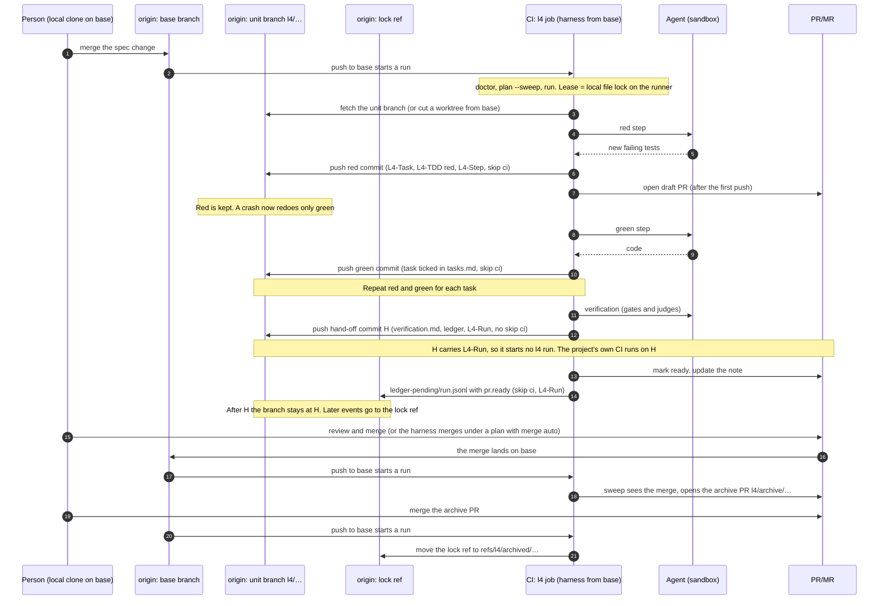
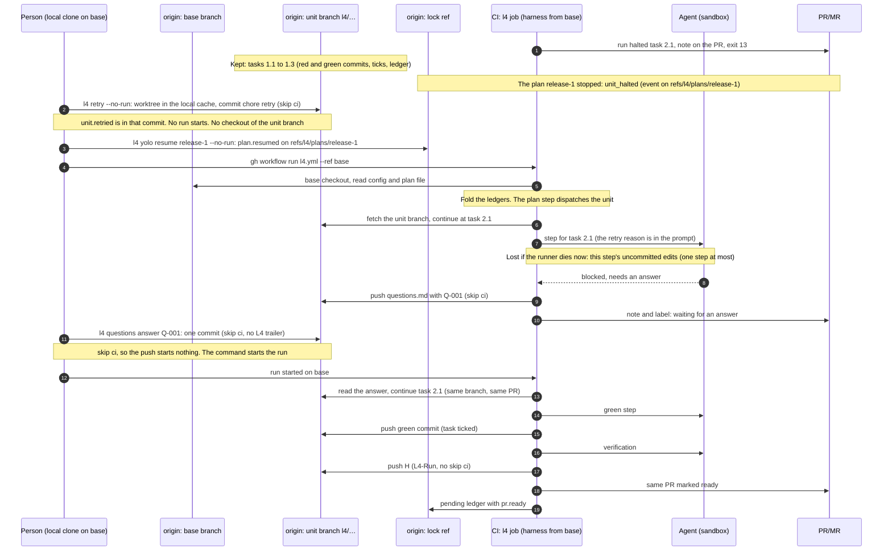

# How L4 runs: branches, events and the control loop

This page explains how L4 decides what to do, where it keeps its state, and how a unit branch is told to run again. It
is for two readers: a person who adopts L4, and a coding agent that operates L4.

It applies to harness 0.4.15 on GitHub and on GitLab. The text follows the rules of ASD-STE100 (Simplified Technical
English): short sentences, active voice, one instruction in each sentence.

Other documents:
- [quickstart.md](quickstart.md) tells you how to adopt the harness.
- [runbook.md](runbook.md) tells you how to operate the units, state by state.
- [yolo-mode.md](yolo-mode.md) tells you how delivery plans work.
- [architecture.md](architecture.md) shows the parts of the harness.

## Contents

1. [The short answer](#1-the-short-answer)
2. [The model: one control loop](#2-the-model-one-control-loop)
3. [Where the state lives](#3-where-the-state-lives)
4. [What starts a run](#4-what-starts-a-run)
5. [One run, step by step](#5-one-run-step-by-step)
6. [What is kept, and where work continues](#6-what-is-kept-and-where-work-continues)
7. [What your local commands do](#7-what-your-local-commands-do)
8. [A worked example: a halted unit in a stopped plan](#8-a-worked-example-a-halted-unit-in-a-stopped-plan)
9. [Swimlane diagrams](#9-swimlane-diagrams)
10. [Common questions](#10-common-questions)

Words used on this page: `<base>` is the base branch (`forge.base_branch` in `.l4/config.yaml`, for example `main` or
`staging`). A unit is one spec change. The unit branch is `l4/<framework>/<name>` (the prefix is
`forge.branch_prefix`, default `l4/`). PR means a GitHub pull request or a GitLab merge request.

## 1. The short answer

You run `l4 retry` from a clone on `<base>`. You do not check out the unit branch. The command does three things:

1. It fetches `<base>` and the unit branches.
2. It makes its own worktree of the unit branch, outside your clone, and records the event `unit.retried` in the unit's
   ledger.
3. It commits `chore(<name>): retry [skip ci]` to the unit branch, pushes it, and then asks the forge to start a CI run
   on `<base>` (unless you add `--no-run`).

The unit branch is never told to run. The next CI run starts from `<base>`, reads the ledger of every unit, and sees that
the unit can move. Section 2 explains why. Section 7 lists what every local command writes.

## 2. The model: one control loop

L4 has ONE control loop for the whole repository. It does not have one pipeline for each branch.

- Every run starts from the head of `<base>`.
- The run reads the state of every unit. The state is data in the ledger of the unit. It is not a message.
- The run plans, and then works on each actionable unit in its own worktree.
- A unit branch is never "notified". It does not listen. The next run reads its ledger.

So an event, such as a retry, an answer or a merge, has two parts. The first part is a write: a commit to the unit
branch, a ref on origin, or a label. The second part is a run that reads the write. The run can start by itself (a
schedule, a push to `<base>`) or because a command started it (`l4 retry` starts one unless you add `--no-run`).

The run takes the config from `<base>`, also when a push to a unit branch started it (section 4). The unit branch holds
code that an agent wrote. This rule means that the branch does not choose the rules that run on it: the repository has
one set of rules, on `<base>`.

The code reads the ledger with a fold (`src/l4/state/fold.py`): the phase of a unit is the result of all its events, in
order. `l4 status --rebuild` computes it again (SPEC L4-STA-002).

## 3. Where the state lives

| Place | What it holds | Who writes it |
|---|---|---|
| The base branch `<base>` | The spec folders (`openspec/changes/<name>/` or `.kiro/specs/<name>/`). The config `.l4/config.yaml`. The plan files `.l4/plans/<plan-id>.json`. The pinned harness: `.github/workflows/l4.yml` (GitHub) or `.l4/ci/l4.gitlab-ci.yml`, included by `.gitlab-ci.yml` (GitLab). | People. The harness does not push to `<base>`, except a merge under a plan with `merge: auto`. |
| The unit branch `l4/<framework>/<name>` | The implementation commits. `tasks.md` with its ticks. The ledger of each run in the unit folder: `.l4/ledger/<run-id>.jsonl`. `questions.md`, `feedback.md` and `verification.md` in the unit folder. | The harness, and people (answers, spec edits, extra commits). |
| The lock ref `refs/l4/locks/<framework>/<name>` | After the hand-off commit H, the ledger of each run, as `ledger-pending/<run-id>.jsonl`, for example the event `pr.ready`. The unit branch stays at H, so these events cannot go there. | The harness. The commit carries `[skip ci]` and `L4-Run`. |
| The plan ledger `refs/l4/plans/<plan-id>` | The events of a delivery plan, in `ledger.jsonl` (for example `plan.activated`, `plan.resumed`). It also holds `report.md` and `receipts/`. It is not in `.l4/plans/*.json`: that file is the plan, not its events. | The plan step in CI, and the `l4 yolo` commands. |
| Keep refs | `refs/l4/merged/<framework>/<name>`: the verified head of a merged unit, kept when its branch is deleted. `refs/l4/archived/<framework>/<name>/<run-id>`: the lock ref after the archive. `refs/l4/attempts/<framework>/<name>/<n>`: the old head, kept by `l4 restart`. | The harness. It never deletes `refs/l4/attempts/`. |
| The archive branch `l4/archive/<framework>/<name>` | The post-merge archive PR of an OpenSpec unit, titled `[l4] archive <name>`. A Kiro unit has no archive PR. | The harness. A person merges it. |
| The PR | The review. The harness keeps one note on it and sets labels. | The harness, and people. |
| Your computer or the runner, only | The worktrees (`$L4_CACHE/worktrees/<key>/<framework>/<name>`), the lease file (`$L4_CACHE/locks/<key>/<framework>/<name>.lock`) and the WIP snapshot `refs/l4/wip/<framework>/<name>`. | The harness. None of them is pushed. |

Verified in: `src/l4/vcs/names.py`, `src/l4/state/ledger.py`, `src/l4/state/pending.py`, `src/l4/yolo/store.py`,
`src/l4/yolo/plans.py`, `src/l4/vcs/push.py`, `src/l4/vcs/wip.py`, `src/l4/postmerge.py`. The text is in SPEC L4-STA-004,
L4-WTR-001 and L4-YOLO-033.

## 4. What starts a run

The workflow templates are `src/l4/ci/templates/l4.github.yml`, `l4.github-action.yml` and `l4.gitlab-ci.yml`. A run
starts on these events:

| Event | Meaning |
|---|---|
| A push to `<base>` | A merge, or a change of a spec or of the config. |
| A push to the unit-branch prefix | A person's answer or spec edit on a unit branch. |
| The schedule | `ci.schedule` on GitHub (default every 30 minutes). On GitLab, a schedule pipeline. |
| A manual start | `workflow_dispatch` on GitHub. On GitLab, a web, API or trigger pipeline. |

These rules limit the events:

- There is no `pull_request` trigger. A fork never runs the harness (SPEC L4-CI-003).
- A push whose commit message has the trailer `L4-Run:` is the harness's own push. It starts nothing, except on `<base>`.
  The exception is for a merge: a fast-forward merge can make a harness commit the head of `<base>`, and the run must
  sweep that merge.
- The harness adds `[skip ci]` to its bookkeeping commits: the task commits, the ledger commits and the lock-ref commits.
  A person's `l4 questions` commit also has `[skip ci]`.
- On GitHub, a push made with the `GITHUB_TOKEN` of the workflow never starts a workflow run. This is a rule of GitHub.
  So no push of the harness starts a run on any branch when the workflow uses that token, `<base>` included.
- `concurrency: group: l4` (GitHub) and `resource_group: l4` (GitLab) make runs wait for each other. One run works at a
  time. GitHub keeps only the newest waiting run.

**The base checkout.** On any branch other than `<base>`, the first step after the checkout is `base checkout`. It
checks out the head of `origin/<base>` (the log shows `l4: base checkout <sha>`). So the config and the harness
install steps come from `<base>`, not from the pushed branch (L4-GHP-005). On GitLab the same command is in
`before_script`.

> **NOTE:** In the setup-action form, the `uses:` line that pins the harness is in the workflow file of the branch that
> started the run. If that pin is not the pin of `<base>`, the run does no work. It prints a warning and exits 0
> (L4-ADO-005, `src/l4/ci/pin_guard.py`). Merge `<base>` into the unit branch to fix it.

## 5. One run, step by step

The job runs these steps, in this order (`l4.github.yml`, `l4.gitlab-ci.yml`):

1. **Checkout and base checkout** (section 4).
2. **Install the harness and the toolchains.** The setup action or the install step does this.
3. **`l4 doctor`.** It checks the environment (on GitLab, with `--ci --fix`).
4. **`l4 plan --sweep`.** The sweep does these duties, in this order (`src/l4/ci/sweeper.py`):
   - For each unit in `in_review`: merged detection (a unit whose PR a person merged becomes `merged` and gets its
     archive PR), and the CI duty (the harness reads the project's own pipeline for the hand-off commit H and records
     `ci.failed` or `ci.preexisting`).
   - Lock refs of archived units are moved to `refs/l4/archived/…`.
   - The closed-PR duty: a PR closed without a merge makes the unit `abandoned`.
   - The label duty: a member's `l4:retry`, `l4:resume` or `l4:restart` label acts as the command.
   - The follow-up duty: feedback on a merged unit becomes a follow-up unit.
5. **`l4 run`.** It does these things (`src/l4/orchestrator.py`, `run_command`):
   1. It stops with no work if the harness is not the pin of `<base>` (section 4).
   2. It reads every unit (`discover`) and makes follow-up units.
   3. **The plan step** (`src/l4/yolo/cycle.py`, `yolo_step`). With no plan file on `<base>`, nothing changes. With plan
      files, the step does at most ONE thing per run (L4-YOLO-012): it reviews a plan before its activation; or, for the
      active plan, it stops the plan, waits, merges a verified unit, checks a merged unit, completes the plan, or
      dispatches the one eligible unit. A unit listed in a plan that is not final is held. While a plan is active, units
      outside it get no new agent work (L4-YOLO-010).
   4. **Each unit that can move**, one after the other (`run_units`). For each unit: the lease, the worktree, the work,
      the final ledger push (`run_unit_in_worktree`). Section 6 explains the work.
   5. **Maybe start the next run.** After a plan step that leaves work, the run asks the forge for one more run on
      `<base>`. After the soft deadline it can ask for a continuation (L4-IMP-012, `ci.continuation: dispatch`).
6. **`l4 status`.** It prints the table.

**The work on one unit.**

1. The harness takes the lease. The lease is a local lock file on the runner (a non-blocking `flock`). The lock ref is
   not a lease in 0.4.15: it holds the pending ledger only (`src/l4/vcs/locks.py`).
2. It makes a fresh worktree of the unit branch. If the unit has no branch yet, it cuts the worktree from the head of
   `<base>`. It never reuses an old worktree (`src/l4/vcs/worktree.py`, L4-WTR-001).
3. It reads the ledger and decides by the phase of the unit (`Orchestrator._drive`): intake, clarify, implement,
   verify, fix, hand off.
4. In the implement phase, for each task: an agent writes the tests (red), the harness checks them, commits and pushes.
   Then an agent writes the code (green), the harness checks it, ticks the task, commits and pushes. The agents run in
   the sandbox.
5. Verification runs the gates and the judge agents. If it passes, the harness makes the hand-off commit H, pushes it,
   and marks the PR ready (`pr.ready`).
6. It opens the PR as a draft after the first push, and it keeps one PR for the unit.
7. At the end, it commits and pushes the ledger of the run to the unit branch. After H, it publishes the ledger to the
   lock ref instead.

## 6. What is kept, and where work continues

L4 is built so that a stop never loses finished work. This section says what is kept, what is done again, and what can
be lost. "Kept" means that the next run finds it and does not do it again. "Redone" means that the next run does it
again. "Lost" means that nobody can get it back.

### 6.1 What is durable after each step

The harness pushes after each red step and after each green step. Each push is a fast-forward push to the unit branch
(`Workbench.push`, `src/l4/implementer/tdd.py`). After the push, this is on the remote:

| Step | What is on the unit branch | Trailers |
|---|---|---|
| Red (a test task) | The new tests, in the commit `test(<name>): red for <task> [skip ci]`. The ledger events `task.red_ok` (the new test ids and the frozen test files) and `task.red_committed`. The ledger is in the same commit. | `L4-Unit`, `L4-Run`, `L4-Iteration`, `L4-Phase: implementing`, `L4-Task`, `L4-TDD: red`, `L4-Agent`, `L4-Step: <task>/red/<attempt>` |
| Green | The code, in the commit `feat(<name>): <task title> [skip ci]`. The tick `[x]` of the task in `tasks.md`. The events `task.done` and `task.green_committed`. | The same, with `L4-TDD: green` and `L4-Step: <task>/green/<attempt>` |
| Question | `questions.md` with the new question, committed by the harness. | |
| Answer | `questions.md` with the answer, committed by `l4 questions` or by a person. | |
| Hand-off | The commit H with `verification.md` and the ledger. `pr.ready` goes to the lock ref. | `L4-Phase: verified`, no `[skip ci]` |

The harness writes `task.red_ok` and `task.done` BEFORE the commit. The commit carries the event. So a kill after the
commit cannot lose the record (comments in `run_red` and `run_green`).

A task that needs no new test has `L4-TDD: already-satisfied`, `exempt` or `already-done` in its commit. The ledger events
and the tick are in that commit in the same way.

### 6.2 What each stop keeps and redoes

| What happened | Kept | Redone |
|---|---|---|
| **A task halts** (`max_task_attempts`). | Every earlier task: its commits stay on the branch, with their ticks. The red commit of the halted task, if it exists. | The failed attempts. Their edits were discarded at the failure (`discard_changes`). |
| **`l4 retry`** on a halted unit. | The branch, the PR and all commits. The unit goes back to `previous_phase`, and the breaker counters start again (`unit.retried`). The `--reason` goes to the implementer of the halted task as a note (L4-OPS-018). | New attempts on the halted task only. |
| **A task died between red and green.** | The red commit on the branch. | Only green. `resume_red` finds the red checkpoint and the event `task.red_ok`. Then the green step starts from the pushed red commit, and the red tests are frozen. It does not run red again, because it would fail with "no tests added". |
| **`l4 resume`** | The same as retry, for `halted` and `escalated` only. | New attempts. |
| **A new run on a unit in any phase** | The phase comes from the ledger. The run continues from the recorded phase (the table in `src/l4/state/retry.py`). | Only the current step of that phase. |
| **A halted or stopped plan** | The plan ledger and every unit's work. | Nothing. The plan does nothing until `l4 yolo resume`. |
| **A job timeout or a cancel** (exit 16) | Everything pushed before the signal. | After the signal the run pushes nothing (`Orchestrator.close`). The next run continues from the last pushed state and can do the current step again. Runbook 7.10 says the same. |
| **A runner crash or `SIGKILL`** | Everything pushed. The kernel drops the lease file when the process dies, so the next run takes the unit at once. | The step that was running (see 6.3). |
| **A secret in the unpushed commits** | The ledger. | The commits that hold the secret are discarded, and the run goes on (`_discard_unpushed`). |

A person's change to the spec folder can reopen work. A change to a criterion reopens the tasks that cite it
(`tasks.reopened`, L4-OPS-015). Those tasks are redone, and the others are kept.

### 6.3 What can be lost, and how much

The unit of loss is **one agent step at most**: the edits that the agent made in the worktree and that the harness has
not yet committed. That is one red step or one green step, and the checks that follow it.

The harness tries to keep that work too:

- While an agent runs, the harness makes a WIP snapshot of the worktree every `implementer.wip_snapshot_interval`
  (default `10m`), and once more when the agent returns.
- The snapshot is the **local** ref `refs/l4/wip/<framework>/<name>` of the clone that runs. It is never pushed. The
  code comment says it: "stored under the local ref … and never pushed" (`src/l4/vcs/wip.py`). SPEC L4-IMP-011 says the
  design pushes it to `l4-wip/<framework>/<name>`. The code on this branch does not do that.
- The next run on the SAME clone reads the snapshot first (`src/l4/state/reconcile.py`). If a commit of the unit
  carries the same `L4-Step`, the step finished and the snapshot is stale (dropped). If the snapshot sits right on the
  head of the new worktree, it is put back and the step runs again on it. If the head moved, the snapshot is dropped and
  the step starts over.

What this means on a **GitHub-hosted runner**: each job runs on a new machine. The snapshot ref is in the clone of the
old machine. The next job does not see it. So the uncommitted work of the killed step is lost, and the step starts
over from the last pushed commit. On a self-hosted runner that keeps the same clone between jobs, the snapshot can
survive. I inferred that last sentence from the code; I did not test it.

Two more things are local:

- **The tail of the run's ledger.** The ledger is in every commit, so every event that the next run needs is already in a
  commit. The lines written after the last commit are lost with the runner. If the publish of the pending ledger to the
  lock ref fails, the harness keeps the file in the runner cache (`pending-unpublished`) and publishes it in a later run
  on that runner.
- **The agent session.** The harness records the session id of each agent step (`agent.session`). The configuration key
  `implementer.session_resume` (`same_runner_only`, `artifact`, `never`) exists in the schema, but no code on this
  branch reads it. A new agent step starts a new session. The step gets the failure of the earlier attempt in its
  prompt, and the pushed commits are in the worktree. So `session_resume` keeps and loses nothing in 0.4.15.

### 6.4 The PR stays the same one

The PR of a unit is the same across runs, retries, resumes and fix units.

- The harness looks for the open PR of the unit branch before it creates one (`create_pr` calls `find_pr`). A retry after
  a crash does not open a second PR.
- While the unit is not in review, its PR is a draft. A unit that returns to work after the hand-off sets the PR back to a
  draft. The harness marks it ready again at the next hand-off (L4-ARC-008).
- `l4 restart` is different. It starts the unit again on a NEW branch, with a new PR. It keeps the old head in
  `refs/l4/attempts/…` (L4-OPS-004). Use `l4 retry` to continue. Use `l4 restart` only to start over.

### 6.5 A person's commits are kept and checked again

Any commit on the unit branch that the harness did not make stays on the branch. The worktree is rebuilt from the
remote branch, so it includes the commit.

- A commit after the hand-off H sends the unit back to `verifying`. A change in the unit folder (an answer or a spec edit)
  sends it back to `implementing` (`review_trigger`, L4-ARC-008).
- A commit after a stop sends a halted or escalated unit to `implementing` when it changes the unit folder
  (`spec_edit_since_stop`, L4-OPS-003).
- The PR goes back to a draft until verification passes again.

## 7. What your local commands do

Run these commands from a local clone, normally on `<base>`. None of them needs the unit branch checked out. In fact,
a command that makes a worktree for a unit branch refuses when that branch is checked out in your clone
(`WorktreeManager._release_branch`, runbook 7.11). Run `git fetch` first when you read: `l4 status` and `l4 plan` read
the refs of your clone, and only a CI run fetches them for you (`src/l4/vcs/refresh.py`).

| Command | What it writes | Pushes? | Starts a run? |
|---|---|---|---|
| `l4 retry --unit U --reason R [--rounds N] [--no-run]` | Event `unit.retried`; commit `chore(<name>): retry [skip ci]` on the unit branch. Runs no agent, gate or sandbox. For a merged unit, the archive retry. | Yes, to the unit branch | Yes, on `<base>`, unless `--no-run` |
| `l4 resume --unit U --reason R` | Event `unit.resumed`; commit `chore(<name>): resume [skip ci]`. Only for `halted` and `escalated`. | Yes, to the unit branch | No |
| `l4 restart --unit U --reason R [--no-run]` | A new unit branch, and the old head in `refs/l4/attempts/…`. | Yes | Yes, unless `--no-run` |
| `l4 questions answer Q --unit U --text T` and `l4 questions accept Q --unit U` | One commit to `questions.md` on the unit branch, with `[skip ci]` and no `L4-` trailer. `--no-push` prints the diff and writes nothing. | Yes, to the unit branch | Yes, on `<base>`, unless `--no-run` |
| `l4 yolo check PLAN [--worktree]` | Nothing. | No | No |
| `l4 yolo review PLAN` | Without `--local`, it asks CI to review: nothing is written by the command. With `--local`, it runs the judge here and writes `plan.reviewed` to the plan ref. With `--worktree`, it is a dry run (`--record` writes the review to the plan ref). | Plan ref only with `--local` or `--record` | Yes for the form that asks CI, unless `--no-run` |
| `l4 yolo activate PLAN --reason R [--no-run]` | Event `plan.activated` in `refs/l4/plans/<plan>`. It checks the review, the admission and that no other plan is active on the target. | Yes, to the plan ref | Yes, unless `--no-run` |
| `l4 yolo resume PLAN --reason R [--extend-cost\|--extend-runs\|--extend-attempts\|--extend-deadline] [--no-run]` | Event `plan.resumed`. It refuses while the cause is still there. | Yes, to the plan ref | Yes, unless `--no-run` |
| `l4 yolo cancel PLAN --reason R` | Event `plan.cancelled`. | Yes, to the plan ref | No |
| `l4 status`, `l4 yolo status` | Nothing. | No | No |
| `l4 run --dry-run` | Nothing. It shows what a run would do. | No | No |
| `l4 mcp serve` | The same commands as MCP tools for an IDE agent. It writes nothing itself. | As the command it runs | As the command it runs |

**Person and agent rules.**

- Activation is a person's decision. The MCP server does not offer `l4 yolo activate` or `l4 yolo cancel`. The server runs
  each tool as an agent (`AI_AGENT=l4-mcp`). It offers these writing tools: `l4_retry`, `l4_question_answer`,
  `l4_plan_review`, `l4_plan_draft` (working tree only) and `l4_plan_resume`. The rest of its tools only read.
- The guide for agents ([yolo-mode.md](yolo-mode.md)) says that an agent never activates, resumes or cancels a plan on
  its own, and never writes `refs/l4/plans/*`. Read `l4_status` and `l4_unit_events` before any writing tool.
- `l4 questions answer` and `accept` check who asks (`src/l4/actor.py`). An agent is a caller with an agent marker in the
  environment, or with a standard input that is not a terminal. An agent may write only a question of a kind in
  `clarifier.auto_accept_kinds`, with an answer that names no frozen path, unless `clarifier.answer_by_agents` is true on
  `<base>`.
- `l4 yolo accept` and `l4 yolo waive` also check the actor, and an agent needs `yolo.review.accept_by_agents`.
- `l4 retry` does not check the actor. Your push permission on the unit branch decides.

The start of a run is a forge call (`start_run_line`). If the forge refuses it or has no token, the command prints how
to start a run by hand and still exits 0.

## 8. A worked example: a halted unit in a stopped plan

The names are examples. The unit is `openspec:add-tracing`, the plan is `release-1`, the base branch is `staging`.

**The situation.** Task 2.1 of the unit halted with `max_task_attempts`. The plan `release-1` saw the halted unit and
stopped with `unit_halted`. Tasks 1.1 to 1.3 are done and pushed. Run `l4 yolo status release-1` and `l4 status --unit
openspec:add-tracing`. Read the cause and fix it first (runbook 7.2).

**The recovery.** Run these commands from a clone on `staging`:

1. Retry the unit, with no run:

   ```sh
   git fetch origin
   l4 retry --unit openspec:add-tracing --reason "the test needs the tracing fixture, see tests/conftest.py" --no-run
   ```

   The commit `chore(add-tracing): retry [skip ci]` lands on `l4/openspec/add-tracing`. The unit goes back to the phase
   it halted from. The reason goes to the implementer of task 2.1.
2. Resume the plan:

   ```sh
   l4 yolo resume release-1 --reason "unit retried" --no-run
   ```

   A retried unit alone does not restart a stopped plan. A stopped plan does nothing in its step. The command also
   refuses while the unit is still `halted`: it tells you to run `l4 retry` first. If the plan stopped because of a
   limit, the status shows which limit. Add `--extend-runs N`, `--extend-cost USD`, `--extend-attempts N` or
   `--extend-deadline ISO` for that limit.
3. Start a run on `staging`:

   ```sh
   gh workflow run l4.yml --ref staging
   ```

   Or wait for the schedule. If you leave out `--no-run` in steps 1 and 2, the commands start the run for you.

**What the run does.** It checks out `staging`, reads the ledgers and the plan ref. The plan is active again. The plan
step dispatches the unit. The unit continues from task 2.1 on the same branch and the same PR. Tasks 1.1 to 1.3 are not
done again. If task 2.1 already had a red commit, the run starts at green.

**An answer.** If the agent is blocked on task 2.1, the harness writes a question to `questions.md`, pushes it, and the
unit waits in `awaiting_human`. Answer with:

```sh
l4 questions answer Q-001 --unit openspec:add-tracing --text "use the shared fixture"
```

The command pushes the answer to the unit branch with `[skip ci]`. The push starts no run. The command then starts a
run on `staging`, which reads the answer and goes on. If you push an edit of `questions.md` with plain `git push`
instead, the push to `l4/**` starts a run. That run still takes the harness and the config from `staging`.

## 9. Swimlane diagrams

The lanes are, from left to right: the person, `origin` base branch, `origin` unit branch, `origin` lock ref, the CI job,
the agent in its sandbox, and the PR. GitHub renders the Mermaid blocks.

### Diagram A: the normal life of a unit



### Diagram B: a halted unit, recovery, and a question



### Diagram B in plain text

In each row, `S` is the lane that sends. `>` is the lane that receives. `*` is a lane that only has a note.

```
step  PERSON  BASE  UNIT  LOCK  CI   AGENT  PR   what happens
 1     .      .     *     .     S    .      >    run halts task 2.1: note on PR, exit 13
 2     S      .     >     .     .    .      .    l4 retry --no-run: commit "chore retry [skip ci]"
 3     S      .     .     >     .    .      .    l4 yolo resume --no-run: plan.resumed on refs/l4/plans/release-1
 4     S      .     .     .     >    .      .    gh workflow run l4.yml --ref base
 5     .      >     .     .     S    .      .    base checkout: config and plan file from base
 6     .      .     >     .     S    .      .    fetch unit branch, continue at task 2.1 (tasks 1.1-1.3 kept)
 7     .      .     .     .     S    >      .    agent step for 2.1 (a crash here loses this step only)
 8     .      .     .     .     >    S      .    agent returns: blocked, needs an answer
 9     .      .     >     .     S    .      .    push questions.md with Q-001 [skip ci]
10     .      .     .     .     S    .      >    note and label: waiting for an answer
11     S      .     >     .     .    .      .    l4 questions answer: commit [skip ci], no run from the push
12     S      .     .     .     >    .      .    the command starts a run on base
13     .      .     >     .     S    .      .    run reads the answer, continues 2.1 (same branch, same PR)
14     .      .     >     .     S    >      .    green step, push green commit, tick task
15     .      .     >     .     S    >      .    verification, push H [L4-Run, no skip ci]
16     .      .     .     >     S    .      >    PR marked ready, pending ledger (pr.ready) to the lock ref
```

## 10. Common questions

**Why do I not run `l4 retry` on the unit branch?** The unit branch does not run anything. A run starts from `<base>` and
reads the unit's ledger there. `l4 retry` makes its own worktree of the unit branch. If you have the unit branch checked
out in your clone, the command refuses with exit 2 (runbook 7.11). Do not check out the unit branch to "restart" it. An agent must do the same: use the commands from a clone on
`<base>`.

**Why did my push to the unit branch start a run that used the config of `<base>`?** A push to the unit-branch prefix is a
trigger. The run then does the base checkout, so the harness and config are the ones of `<base>`. Your spec edit is read
as data from the branch.

**Why do the harness's own pushes start nothing?** The task commits, ledger commits and lock-ref commits have `[skip ci]`.
Every harness commit has an `L4-Run` trailer, and the templates skip a push with that trailer on any branch other than
`<base>`. On GitHub, a push made with the workflow's `GITHUB_TOKEN` starts no run at all.

**How do I start a run now?** Dispatch the workflow on `<base>`: `gh workflow run l4.yml --ref <base>` on GitHub, or a
new pipeline on `<base>` on GitLab. This uses the harness that the pin of `<base>` names and the runner of the project.
`l4 run` on your computer runs the same steps with your harness version and your credentials. It needs bubblewrap, so
it exits with 3 on macOS. CI and your computer do not share the lease. Do not run `l4 run` while CI works on the same
unit (runbook 7.11).

**What happens with two plans on one target?** `l4 yolo activate` refuses the second plan while the first is `active`,
`waiting` or `stopped` on the same target. It names the first plan and tells you to let it finish or to run
`l4 yolo cancel`. A unit that two plan files list is a finding (`held_by_other_plan`), and `l4 yolo check` reports a
unit that no plan covers or that two plans cover.

**Where do I read what happened?** `l4 status --unit U` shows the phase, the cause and the next command. The ledger of the
unit and the CI log of the run show the details (runbook section 4).
