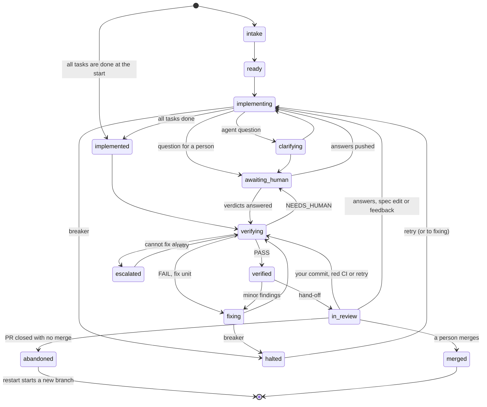
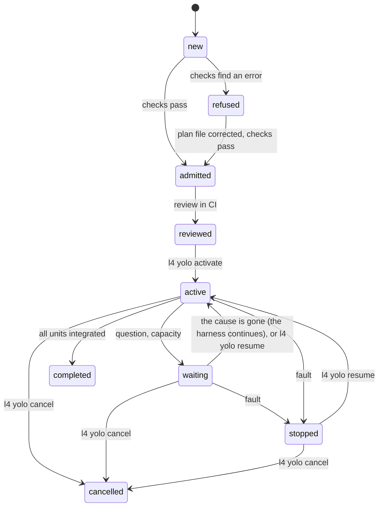

# L4 operations runbook

This runbook tells you how to operate the units of the L4 harness. It shows the states of a unit, how to find why a
unit stopped, and the procedures that make a unit move again.

It applies to harness 0.4.18 on GitHub and on GitLab. The text follows the rules of ASD-STE100 (Simplified
Technical English): short sentences, one instruction in each step, and each warning before its step.

Other documents:
- [quickstart.md](quickstart.md) tells you how to adopt the harness.
- [feedback.md](feedback.md) tells you how to ask for changes to the code of a unit.
- [state-diagram.md](state-diagram.md) shows all the phase transitions.
- [control-loop.md](control-loop.md) explains why you run `l4 retry` on the base branch, and how the unit branch runs again.

## Contents

1. [Read this first](#1-read-this-first)
2. [My unit does not move: where to start](#2-my-unit-does-not-move-where-to-start)
3. [The states of a unit](#3-the-states-of-a-unit)
4. [Find the state and the cause](#4-find-the-state-and-the-cause)
5. [Prepare your computer for l4 commands](#5-prepare-your-computer-for-l4-commands)
6. [Start a run](#6-start-a-run)
7. [Procedures for each state](#7-procedures-for-each-state)
8. [How to retry something](#8-how-to-retry-something)
9. [What your push does](#9-what-your-push-does)
10. [Reference](#10-reference)
11. [Known limits of 0.4.18](#11-known-limits-of-0418)
12. [Delivery plans](#12-delivery-plans)
13. [Reading the history (`l4 kg`)](#13-reading-the-history-l4-kg)

## Words used in this runbook

| Word | Meaning |
|---|---|
| unit | One spec change: an OpenSpec change or a Kiro spec. |
| `<unit>` | The unit id: `openspec:<name>` or `kiro:<name>`. |
| `<name>` | The name of the spec folder of the unit. |
| unit folder | `openspec/changes/<name>/` (OpenSpec) or `.kiro/specs/<name>/` (Kiro). |
| `<branch>` | The unit branch: `l4/openspec/<name>` or `l4/kiro/<name>`. |
| `<base>` | The base branch (`forge.base_branch` in `.l4/config.yaml`, default `main`). |
| PR | A GitHub pull request or a GitLab merge request. Each unit has one PR. |
| note | The one comment that the harness keeps on the PR and changes at each step. |
| member | A person with write access (GitHub) or Developer access or higher (GitLab). |
| token | The forge token. The variable that `forge.token_env` names holds it: `L4_FORGE_TOKEN` by default, `GITHUB_TOKEN` in the setup-action form. |
| run | One CI job of the harness, or one `l4 run` command. |
| retry | Continue a unit from the place where it stopped: `l4 retry` or the label `l4:retry`. |
| restart | Start a unit again on a new branch: `l4 restart` or the label `l4:restart`. |
| operator label | The label `l4:retry`, `l4:resume` or `l4:restart` on the PR of a unit. |

## 1. Read this first

> **CAUTION: A green job does not mean that the unit moves.** On GitHub, exit 10, 11, 12 and 13 give a green job. Exit
> 10 (progress) gives a notice. Exit 11, 12 and 13 (a stop) give a yellow warning. On GitLab, the job shows
> `failed (allowed)`. Read the annotation or the note.

> **NOTE: The `l4 status` table shows why a unit stopped.** The column `REASON` has the cause, cut at 60 characters.
> `l4 status --unit <unit>` shows the full cause and the next command (section 4).

> **CAUTION: The operator labels and `l4 resume` do not start a run.** `l4 retry` and `l4 restart` start a run when the forge token is set, unless
> you add `--no-run` (without the token they print how to start one). After you add a label, start a run (section 6) or wait for the schedule.

> **CAUTION: Do not use `l4 run --unit` to retry a unit or to look at a unit.** On a halted or escalated unit it exits
> 13 and changes nothing. On other phases it runs agents from your computer. To continue a stopped unit, use
> `l4 retry`. To see what a run would do, use `l4 run --dry-run` ([10.4](#104-commands-for-operation)).

> **CAUTION: Do not edit the ledger (the `.l4/` folders) or `verification.md`.** The harness owns these files. A
> changed ledger can make the unit `corrupt`, or change its state with no error. The harness stops all work on a
> `corrupt` unit.

> **CAUTION: Do not increase `verifier.max_fix_rounds` or `feedback.max_rounds` to free one unit.** These values
> apply to all units. Use `l4 retry` or the label `l4:retry` (section 7.3). They add the rounds for one unit.

> **CAUTION: Do not write the text `L4-Run:` in a commit message.** The harness marks its own commits with it. When the
> newest commit of a push to a branch other than `<base>` has it, CI does not start.

> **CAUTION: Do not use the agent CLIs by hand on a runner for unit work.** Run a login step on a runner only when the
> note gives it. Do not copy a login to another computer: a copied login can make the original login stop.

The harness never merges a PR. A person merges it. The one exception is a unit in an active delivery plan with
`merge: auto` ([section 12](#12-delivery-plans)).

## 2. My unit does not move: where to start

Find what you see in the first column. Then go to the procedure.

On GitHub, a red job shows process exit 1 for each code except 10, 11, 12 and 13. Read the real code in the annotation
`l4 exit <n> (<name>): …`. On GitLab, read the line `l4 exit <n>`.

| What you see | Probable state | Procedure |
|---|---|---|
| `l4 status` shows the phase `halted` | `halted` | [7.2](#72-halted) |
| `l4 status` shows the phase `escalated` | `escalated` | [7.3](#73-escalated) |
| The note starts with `### Halted:` | `halted` | [7.2](#72-halted) |
| The note starts with `### Escalated:` | `escalated` | [7.3](#73-escalated) |
| The note starts with `### Abandoned:` | `abandoned` | [7.13](#713-a-pr-closed-without-a-merge-or-a-deleted-unit-branch) |
| The note has `### Waiting for you: a human answer`, or the PR has the label `l4:needs-answers` | `awaiting_human`, or `fixing` when the heading ends with `(fix unit …)` | [7.1](#71-awaiting_human-a-question-waits-for-you) |
| The note has `### Waiting for capacity` | `waiting_capacity` | [7.4](#74-waiting_capacity-no-agent-is-available) |
| The note has `### Base merge needed`, and each run exits 1 | `verifying`, with a merge conflict | [7.7](#77-base-merge-conflict) |
| The note has `### Re-verifying after the hand-off` | `verifying` or `implementing` again (the note says which) | [7.5](#75-in_review-the-pr-is-ready) |
| The note has ``### The `l4:resume` label was not honoured`` | `halted`, `escalated`, `waiting_capacity` or `abandoned` | [7.2](#72-halted), step 8 of the label procedure |
| The note has `### The Kiro done-gate did not pass after the merge` | `merged` | [7.6](#76-after-the-merge) |
| The PR is ready for review and has the label `l4:in_review` | `in_review` | [7.5](#75-in_review-the-pr-is-ready) |
| The PR is closed with no merge, or the unit branch is deleted | `abandoned`, or the phase before the deletion | [7.13](#713-a-pr-closed-without-a-merge-or-a-deleted-unit-branch) |
| You want to change the spec of a unit that has a branch | any phase that is not finished | [7.14](#714-change-the-spec-of-a-unit-that-has-a-branch) |
| The job is red with exit 14 (the unit usually has no PR yet) | rejected | [7.8](#78-rejected-unit-exit-14) |
| `l4 status` shows the phase `corrupt` | corrupt ledger | [7.9](#79-corrupt-ledger) |
| The log has `is locked by another run: skipped` | locked | [7.11](#711-locked-unit) |
| The job is red with exit 1, 2 or 3 | error | [7.12](#712-red-job-exit-1-2-or-3) |
| The job is red with exit 16 | cancelled run | [7.10](#710-cancelled-or-timed-out-run-exit-16) |
| The log says `nothing to do: no unit has a next step`, but you expect work | — | [Section 4](#4-find-the-state-and-the-cause), then [section 9](#9-what-your-push-does) |
| No run started after your push | — | [Section 9](#9-what-your-push-does) |
| The job runs, and its log has no new line for a long time | a working run, or a stuck one | [4.6](#46-is-the-job-stuck) |

Each stuck unit has one command and one label. Use the command from your computer. Use the label on the PR. A label
needs a member who is not the user of the forge token.

| The unit is | Command | Label |
|---|---|---|
| `halted` | `l4 retry --unit <unit> --reason "<why>"` | `l4:retry` |
| `escalated` | `l4 retry --unit <unit> --reason "<why>"` (at a round limit it adds a round) | `l4:retry` |
| `waiting_capacity`, and you want it to continue now | `l4 retry --unit <unit> --reason "<why>"` | `l4:retry` |
| `in_review`, and you want a new verification | `l4 retry --unit <unit> --reason "<why>"` | None. Use the command. |
| `merged`, and the archive or the done-gate failed | `l4 retry --unit <unit> --reason "<why>"` | None. Use the command. |
| `abandoned` (the PR was closed with no merge) | `l4 restart --unit <unit> --reason "<why>"` | `l4:restart` |
| Any started unit that you want to start again | `l4 restart --unit <unit> --reason "<why>"` | `l4:restart` |

The label `l4:resume` means `l4:retry`. The command `l4 resume` does the same as `l4 retry` for a halted or an
escalated unit. It starts no run.

## 3. The states of a unit

The state of a unit is its phase. The harness writes each phase change as an event in the ledger of the unit. The PR of
the unit has the label `l4:<phase>`.



`waiting_capacity` is not in the diagram. A unit can go there from `ready`, `implementing`, `implemented`, `verifying`
or `fixing`. It returns to the same phase. A PR closed with no merge makes every phase except `merged` `abandoned`. The
diagram shows only `in_review`. A push that changes the spec ([7.14](#714-change-the-spec-of-a-unit-that-has-a-branch))
sends many phases to `implementing`. The diagram does not show it. [state-diagram.md](state-diagram.md) has all the
transitions.

| Phase | What it means | Who acts next | Exit code | Procedure |
|---|---|---|---|---|
| `intake` | The harness examines the spec. | Harness | — | — |
| `ready` | The spec is correct. The unit waits for a lease. | Harness | — | — |
| `implementing` | Agents do the tasks test-first: a red step (a test that fails), then a green step (the code). | Harness | — | — |
| `clarifying` | The clarifier agent answers the questions of the implementer agent. | Harness | — | — |
| `awaiting_human` | A question waits for a person. | **Person** | 11 | [7.1](#71-awaiting_human-a-question-waits-for-you) |
| `implemented` | All tasks are done. Verification did not start. | Harness | — | — |
| `verifying` | The verifier examines the full branch: gates, tests and a judge agent. | Harness | — | — |
| `fixing` | A fix unit repairs the findings of a failed verification. | Harness, or a **person** for a fix-unit question | — (11 when a fix-unit question waits) | [7.1](#71-awaiting_human-a-question-waits-for-you) |
| `verified` | Verification passed. The hand-off is next, or a fix unit for minor findings. | Harness | — | — |
| `in_review` | The PR is ready for review. | **Person** | 0 | [7.5](#75-in_review-the-pr-is-ready) |
| `merged` | A person merged the PR. | Harness | 0 | [7.6](#76-after-the-merge) |
| `waiting_capacity` | No agent of a necessary role is available. | Harness, sometimes a **person** | 12 | [7.4](#74-waiting_capacity-no-agent-is-available) |
| `halted` | A breaker stopped the unit. | **Person** | 13 | [7.2](#72-halted) |
| `escalated` | Verification failed, and the harness cannot continue alone. | **Person** | 13 | [7.3](#73-escalated) |
| `abandoned` | A person closed the PR with no merge. | **Person** | — | [7.13](#713-a-pr-closed-without-a-merge-or-a-deleted-unit-branch) |

A fix unit is a small unit that the harness writes when verification fails. Its folder is next to the unit folder, with
the name `<name>-fix-<n>`, on the same branch. You never run a fix unit. The harness runs it as part of its parent.

## 4. Find the state and the cause

The harness records the cause of each stop. The cause has a short code (`reason`) and a text (`detail`). Examine these
places in this sequence.

| Place | What it shows |
|---|---|
| 1. `l4 status` (column `REASON`) | The `detail` of a halted or escalated unit, cut at 60 characters. For other phases: the open question ids, or `until <time>`. |
| 2. `l4 status --unit <unit>` | `Cause:` (the full `detail`), `Stopped in run:` (the run id), `Or:` (the label) and `Next:` (the command). |
| 3. The note on the PR | The heading `### Halted: <detail>` or `### Escalated: <detail>`, and what to do. |
| 4. `l4 plan` (column `REASON`) | `halted: <detail>` or `escalated: <detail>`. |
| 5. The CI log of the run that stopped the unit | The line `[l4] run: <unit> halted: <detail>` or `[l4] run: <unit> escalated: <detail>`. |
| 6. `l4 status --unit <unit> --json` | `halt_reason` (the code), `halt_detail` (the text), `reason` and `next`. |
| 7. `outcome.json` of that run | `exit_reason` of the unit. |
| 8. `verification.md` on the branch, section `## Fix unit` | The round that failed. Only for an escalation by verification. |
| 9. The ledger | The `phase.changed` event, with `reason` and `detail`. |

> **NOTE:** A unit that stopped before harness 0.3.0 has no `detail` in its ledger. The `REASON` column then shows the
> old text, and `halt_reason` can be empty. The note can say "no fix round is left" also when rounds are left. Use
> `l4 retry`, and read `verification.md` for the cause.

> **NOTE:** After a refused label, the heading of the note shows the short code of the cause (for example
> `fix_rounds_exhausted`), not the text. Read `Cause:` in `l4 status --unit <unit>`.

The codes of `halt_reason` are:

| State | Codes |
|---|---|
| `halted` | `max_task_attempts`, `unselectable_task`, `baseline_failed`, `secret_in_push`, `planted_link`, `fix_records` |
| `escalated` | `fix_rounds_exhausted`, `no_convertible_finding`, `no_fix_units`, `fix_unit_not_created`, `feedback_rounds_exhausted`, `same_failure`, `verifier_errors` |

### 4.1 Read the note on the PR

> **NOTE:** The note is not a permanent record. A retry replaces the text with `Nothing is waiting for a human
> answer.` A retry also clears `halt_reason` and `halt_detail`. After a retry, only the CI log of the run that stopped
> the unit (4.2), its GitLab artifact (4.3) and the ledger (4.5) keep the cause.

1. Open the PR of the unit. Its source branch is `<branch>`.
2. Find the comment of the harness. It starts with a heading of level 3 (`###`).
3. Read the heading.
4. Find the heading in [section 2](#2-my-unit-does-not-move-where-to-start) or in [10.3](#103-headings-of-the-note).
5. Go to the procedure.

If the comment is only `Nothing is waiting for a human answer.`, use 4.2 to 4.5.

### 4.2 Read the CI log of the run that stopped the unit

> **CAUTION:** Only the run that stopped the unit has the reason line. Later runs do not work on halted or escalated
> units. They show the unit only in the tables of `l4 plan` and `l4 status`. Examine older runs until you find the
> line `phase … → halted` or `phase … → escalated`.

**On GitHub:**

1. Open the **Actions** tab.
2. Select the workflow `l4`.
3. Find the run that stopped the unit. Its summary page shows a yellow annotation, for example
   `l4 exit 13 (halted): halted: task 1.1: max_task_attempts (3) reached in red; last failure: …`.
4. Read the annotation. It gives the exit code and the reason.
5. Open the job log.
6. Search for `[l4] run:` and for the unit id.

With the GitHub CLI:

```sh
gh run list --workflow l4.yml --limit 20
gh run view <run-id> --log | grep -F '[l4]'
```

**On GitLab:**

1. Open **Build > Pipelines**.
2. Find the pipeline of the run.
3. Open the job `l4`. A designed stop shows as `failed (allowed)`.
4. Find the line `designed stop, not a failure: l4 exit <code> (<name>): <reason>`.
5. Search the log for `[l4] run:` and for the unit id.

To follow a pipeline from a terminal, use
`l4 ci watch --project <group/name> --ref <base> --tail 60` (GitLab) or `l4 ci watch --repo <owner/name>` (GitHub).
Put a token in `GITLAB_TOKEN` (GitLab) or `GH_TOKEN` (GitHub), or add `--auth-env <variable>`. Without a token, the
command stops with exit 2. The option `--ref <base>` does not follow a pipeline that a push to a unit branch started.
A designed stop is a success for `l4 ci watch`.

The important log lines:

| Line | What it tells you |
|---|---|
| `[l4] run: <unit> halted: <detail>` | Why the unit halted. This is the full text. |
| `[l4] run: <unit> escalated: <detail>` | Why the unit escalated. This is the full text. |
| `[l4] <unit> phase <from> → <to> (<trigger>)` | A phase change. |
| `[l4] <unit> task <k> <red\|green> attempt <n> failed: <reason>` | Why one attempt failed. The phase can also be `single`. For a fix unit, `[<fix unit>]` follows the unit id. The reason is cut. The full text is on the line `[l4] implementer: <k>: <phase> attempt <n> failed: …`. |
| `[l4] <unit> halted: <code> (task <k>)` | The short code of the breaker. |
| `[l4] <unit> task <k> <phase> attempt <n>: L4 repaired the result (<fix>; <fix>)` | The result object of the agent broke the result contract, for example a missing `summary`, a `status` that names the phase, or a text that is too long. The harness repaired it with fixed rules (`result.normalized`), and the gates and the verifier still judge the work. Each `<fix>` is `<field> <fix>` with its details, for example `status set to done, was red`, `summary set from final_message` or `notes_for_verifier cut from 2417 characters`. The attempt did not fail for the result. |
| `[l4] <unit> agent <phase> task <k> <status> (<time>, <model>), context peak <n>k tokens` | The end of an agent step. The last part is the largest context that the agent used in one call: `<n>k tokens` for OpenCode and Claude Code, `<p>%` for Kiro. Codex and a command give none, and an older ledger has none. |
| `[l4] <unit> task <k> <phase> attempt <n> failed on <profile>: <reason>` | The same as the attempt line above, with the profile that ran the attempt. Older ledgers have no profile. |
| `[l4] <unit> task <k> <phase>: escalated from <from> to <to> after <n> failed attempts` | The step moved to the next profile of `roles.implementer` (`implementer.escalated`). |
| `[l4] <unit> task <k> <phase>: <from> failed <n> attempts; no later profile can take it (<reason>); it stays on <from>` | A warning. No later profile could take the step, so it stays on its profile (`implementer.escalation_skipped`). |
| `[l4] <unit> implementer: <profile> ok (…) → selected, escalated from <from>` | The selection of the new profile after an escalation. |
| `[l4] <unit> halted: max_task_attempts (task <k>: <p1> <f1>, <p2> <f2>)` | The halt, with the failed attempts of each profile. |
| `[l4] <unit> task <k> <phase>: the prompt holds the person's retry note of <ts>` | The prompt of the step carries the `--reason` of your `l4 retry` (`prompt.rendered`). |
| `[l4] <unit> verdict <PASS\|FAIL\|NEEDS_HUMAN> (round <n>, …)` | The result of a verification round. |
| `[l4] <unit> agent <phase> step started (task <k>, attempt <n>, <agent>)` | An agent step starts. This line is at INFO since 0.4.5. |
| `[l4] <unit> task <k> <phase> attempt <n>: <profile> working <elapsed>, <c> tool calls, last activity <t> ago` | The heartbeat line. It shows that the agent step goes on. L4 writes it every `implementer.heartbeat` (default 2 minutes). While a tool call is open, the line ends with `, <m> tool call(s) open for <t>`. A `command` step gives no count: the line is `working <elapsed>`. Read [4.6](#46-is-the-job-stuck). |
| `[l4] <unit> task <k> <phase> attempt <n>: no activity from <profile> for <t>; L4 stopped it (implementer.idle_timeout)` | A warning. The agent printed nothing for `implementer.idle_timeout` and had no open tool call, so L4 stopped it (`agent.idle`). The attempt failed. |
| `red: <n> new tests fail, as intended` (one: `red: 1 new test fails, as intended`) | The red gate is as it must be: only new tests fail, and they fail by an assertion. The raw gate line is now at DEBUG. For another red result, the raw gate line stays at INFO. |
| `[l4] run: <unit>: waiting_capacity, retry_after <time>: <why>` | No agent is available, and when the harness tries again. With no recorded time, the line is `[l4] run: <why>`. |
| `[l4] run: <unit> rejected: <reasons>` | The spec is not correct (exit 14). |
| `[l4] run: <unit>: internal error: <Type>: <message>` | One unit stopped with an error. The other units go on. |
| `[l4] sweeper: <unit>: …` | Merges, archives, CI results, closed PRs and the operator labels. |
| `[l4] retry: <unit> retried: now <phase>` | The result of `l4 retry`. |
| `[l4] sweeper: <unit>: retried by a member's l4:retry label (event <n>)` | The sweep acted on the label `l4:retry` or `l4:resume`. |
| `[l4] sweeper: <unit>: started over by a member's l4:restart label (event <n>): attempt <n>` | The sweep restarted the unit. |
| `[l4] sweeper: <unit>: MR !<n> was closed without a merge: abandoned; l4 restart starts the unit over` | The PR was closed. The unit is `abandoned`. |
| `[l4] run: nothing to do: no unit has a next step` | No unit needs the harness. |
| `[l4] cli: internal error: <type>: <message>` | The command stopped with an error (exit 1). |

> **NOTE:** When `ci.upload_artifacts` is `false`, a run keeps no gate log. The committed ledger then holds the
> evidence: `gate.finished` of a failing test gate with no report, no executed test or a collection error, and
> `task.attempt_failed`, carry an `excerpt` of at most 600 characters (the `E` lines and the deepest repository
> location, redacted). Read it with `l4 status --unit <unit> --events --type gate.finished`.

### 4.3 Read the run artifact

On GitLab, each run keeps the folder `.l4-out/` as a job artifact for 1 week. On GitHub, each run keeps it as the
artifact `l4-out` for 7 days, when `ci.upload_artifacts` is `true` (the default). When it is `false`, the run says so
in the last log line: `artefacts: …/ (not uploaded: ci.upload_artifacts is false; the ledger's gate.finished and
task.attempt_failed events carry the excerpts)`.

> **NOTE:** The GitHub workflow of harness 0.2.0 uploads no artifact, because its upload step skips the hidden folder.
> Run `l4 upgrade` with harness 0.2.1 or later to correct the workflow. Until then, use the annotation and the job log
> (4.2).

> **NOTE:** `outcome.json` holds only the units of that run. A unit that halted in an earlier run is not in it. In CI,
> the step `plan --sweep` writes `outcome.json` first, and `run` replaces it. If `doctor` or `plan` stops the GitLab
> script, the file is the file of the plan (no `exit_reason`), or it is absent. The folder `logs/` can hold two files.
> The id of the run is `run_id` in `outcome.json`.

1. Download the artifact.
   - On GitHub: `gh run download <run-id> -n l4-out`, or the **Artifacts** list on the summary page of the run.
   - On GitLab: on the job page, select **Job artifacts > Download**.
2. Open `outcome.json`.
3. For each unit, read `phase_after` and `exit_reason`.
4. Open `l4.env`.
5. Read `L4_EXIT` and `L4_PHASES`.
6. For the full record, read `logs/<run-id>.jsonl`:

   ```sh
   # phase changes, breakers and the end of the run
   jq -c 'select(.stream=="event") | .event | select(.type=="phase.changed" or .type=="breaker.tripped" or .type=="run.finished") | {seq,type,from,to,trigger,reason}' logs/<run-id>.jsonl
   # warnings and errors
   jq -r 'select(.stream=="log" and (.level=="WARNING" or .level=="ERROR")) | "\(.level) \(.logger): \(.msg)"' logs/<run-id>.jsonl
   ```

7. For the work of an agent, read `agent/<run-id>/`. Each step has the prompt (`.prompt.md`), the event stream
   (`.jsonl`) and the error output (`.stderr`).
8. For the gates, read `gates/<run-id>/`. Each gate has one numbered log file.

### 4.4 Use `l4 status` and `l4 plan` on your computer

Do the steps of [section 5](#5-prepare-your-computer-for-l4-commands) first.

> **CAUTION:** Outside CI, `l4` reads only your local copies of the remote branches. If you do not fetch first, the
> result is old or empty.

> **NOTE:** If `forge.branch_prefix` is not `l4/`, use your prefix in the first refspec of the fetch command.

1. Fetch the unit branches and the lock refs:

   ```sh
   git fetch --prune origin '+refs/heads/l4/*:refs/remotes/origin/l4/*' '+refs/l4/locks/*:refs/l4/locks/*'
   ```

2. Show all units:

   ```sh
   l4 status
   ```

   | Column | Meaning |
   |---|---|
   | `PHASE` | The phase. `corrupt` means that the ledger cannot be read. `-` means that no run started the unit. |
   | `REASON` | The cause of a stop, cut at 60 characters (`halted`, `escalated`). The open question ids (`awaiting_human`). `until <time>` (`waiting_capacity`). `-` for other phases. |
   | `ITER` | The number of harness invocations that wrote to the ledger of the unit. |
   | `TASKS` | Done and total required tasks of `tasks.md`. |
   | `OPEN-Q` | The ids of open questions. |
   | `VERDICT` | The last verdict: `PASS`, `FAIL` or `NEEDS_HUMAN`. |
   | `LAST` | The time since the newest event in the ledger of the unit, for example `6m ago`. `-` means that the unit has no event. |
   | `SOURCE` | `branch`: from the unit branch. `worktree`: from your checkout (no branch found). `archive`: from an archived OpenSpec change that has `feedback.md`. |
   | `FEEDBACK` | The count of feedback items in each state. It shows only when a unit has feedback. |

3. Show one unit with the full cause and the next step:

   ```sh
   l4 status --unit <unit>
   ```

   The output has these lines, under the table:

   ```text
   Phase: halted
   Cause: task 1.1: max_task_attempts (3) reached in red; last failure: …
   Stopped in run: <run id>
   Or: add the label l4:retry
   Retry note: the --reason of l4 retry goes to the implementer of task 1.1
   Next: l4 retry --unit <unit> --reason TEXT
   ```

   Two more lines can follow `Stopped in run:`:

   ```text
   Last activity: 6m ago (agent.finished, task 2.1, run 24680)
   Open run: 24681 started 21m ago, no end recorded: https://github.com/<owner>/<repo>/actions/runs/24681
   ```

   `Last activity:` is the newest event in the ledger, with its type, its task and its run. `Open run:` shows the newest `l4 run` that started and has no end recorded.
   The link shows only when the ledger holds the CI link of the run (`run.started.ci_url`).

   `Cause:` and `Stopped in run:` show only while the unit is stopped. `Or:` shows only for a unit that a label
   moves. `Retry note:` shows only for a unit halted on `max_task_attempts` that names a task. `--json` then has
   `halt_task`. `Next:` is the bare command. For a unit that waits for an answer, it names the file and the question ids.

4. Show the full state of one unit:

   ```sh
   l4 status --unit <unit> --json
   ```

   | Field | Meaning |
   |---|---|
   | `halt_reason` | The code of the cause of the stop ([section 4](#4-find-the-state-and-the-cause)). It is empty after a retry. |
   | `halt_detail` | The text of the cause. It is empty after a retry. |
   | `reason` | The text that the column `REASON` shows, whole. |
   | `next` | The command or the action that moves the unit. |
   | `previous_phase` | The phase that a retry returns to. |
   | `retry_after` | When the harness tries the agents again (`waiting_capacity`). |
   | `fix_rounds_counted`, `fix_rounds_extra` | Fix rounds used, and rounds added by a retry or a resume. The limit is `verifier.max_fix_rounds` (default 3) plus `fix_rounds_extra`. |
   | `feedback_rounds_used`, `feedback_rounds_extra` | Feedback rounds used, and rounds added by a retry or a resume. The limit is `feedback.max_rounds` (default 5) plus `feedback_rounds_extra`. |
   | `refused_signals` | Operator labels that the harness did not accept, and why. |
   | `ci_failure` | The red jobs of your own CI on the hand-off commit. |
   | `last_activity` | The newest event: `ts`, `type`, `run_id`, and `task` when the event has one. `null` when the unit has no event. |
   | `open_run` | The run with no end recorded: `run_id`, `started`, and `ci_url` when the ledger holds it. `null` when no run is open. |

5. Show the next action of each unit:

   ```sh
   l4 plan
   ```

   The column `NEXT` is `implement`, `clarify`, `verify`, `hand_off`, `follow_up` or `none`. The value `none` means
   that the harness does nothing for this unit. The column `REASON` tells you why, and who must act. For a halted or
   escalated unit, it holds the recorded cause.

### 4.5 Read the ledger

Use the ledger only when the other places do not give the cause. Do not change it.

- **Before the hand-off**, the ledger is in `<unit folder>/.l4/ledger/<run-id>.jsonl` on `<branch>`, one file for each
  run:

  ```sh
  git show origin/<branch>:<unit folder>/.l4/ledger/
  git show origin/<branch>:<unit folder>/.l4/ledger/<run-id>.jsonl
  ```

- **After the hand-off**, new events go to the lock ref `refs/l4/locks/<framework>/<name>`, in the folder
  `ledger-pending/`:

  ```sh
  git show refs/l4/locks/<framework>/<name>:ledger-pending/
  ```

- **At all times**, the events of the sweep go to the lock ref. These are `resume.refused`, `resume.hint`, `ci.failed`,
  `pr.closed` and `archive.failed`.

A halt is a `breaker.tripped` event, then a `phase.changed` event with `"to": "halted"`. The event `phase.changed`
has the code in `reason` and the text in `detail`. `breaker.tripped` has a short code in `reason` (for example
`max_task_attempts`) and the details in `last_failure`, `detail` or `paths`.

The event `result.normalized{task, phase, attempt, source, fixes}` says that the harness repaired the result object of
an agent step. `source` is `result` or `final_message`. `fixes` lists `{field, fix, from?, to?, was?, count?, length?}`
and holds no text of the agent. The event `agent.finished` has `context_peak_tokens` or `context_peak_percent` when the
agent's stream shows the largest context of one call.

The event `agent.idle{task, phase, attempt, profile, silent_s, tool_calls}` says that L4 stopped an agent that had no
activity for `implementer.idle_timeout`. It comes before `agent.finished` of the same step. The event `run.started` has
the field `ci_url` (`run.started.ci_url`), the CI link of the run. The event `gate.finished` of a red gate has `red_new_failing` (the number of new tests
that fail by an assertion). The heartbeat line is not a ledger event.

### 4.6 Is the job stuck?

Use this procedure when the job runs and its log has no new line for a long time. A step of an agent can take many
minutes. A long step is not a fault. Look for signs of life first.

1. Read the log of the running job. While an agent step runs, L4 writes a heartbeat line every `implementer.heartbeat`
   (default 2 minutes):

   ```text
   [l4] <unit> task 2.1 green attempt 1: <profile> working 6m, 14 tool calls, last activity 20s ago
   [l4] <unit> task 2.1 green attempt 1: <profile> working 12m, 31 tool calls, last activity 40s ago, 1 tool call open for 4m
   ```

   The line has the form `working <elapsed>, <c> tool calls, last activity <t> ago`. When a tool call is open, it
   ends with `<m> tool call open for <t>` (or `<m> tool calls open for <t>`: the time of the oldest call).

   | What you see | What it means |
   |---|---|
   | The count of tool calls grows, and `last activity` is small | The agent works. Wait. |
   | `last activity` grows, and a tool call is open | A long command runs, for example a test run. Wait. |
   | `last activity` grows, and no tool call is open | The agent is silent. L4 stops it after `implementer.idle_timeout` (default 10 minutes). |
   | No heartbeat line for more than 2 minutes | The step is not running. The job can wait for a gate, a judge or a push. Read the last lines of the log. |

2. Know the limits. L4 stops an agent step in two cases:

   - The agent prints nothing for `implementer.idle_timeout` (default 10 minutes) and has no open tool call. L4 sends
     SIGINT, waits 5 seconds, and then kills the process. The log has the warning `no activity from <profile> for <t>`.
   - One agent step takes more than 30 minutes. The failure reason is `the agent step reached its time limit (30m)`.

   Both stops fail the attempt, not the unit. After `implementer.escalate_after` failed attempts, the next profile of
   `roles.implementer` takes the phase. To change a limit, set `implementer.idle_timeout` or `implementer.heartbeat` in
   `.l4/config.yaml` (`0` turns the rule off; the minimums are `1m` and `30s`). The harness pin must be 0.4.5 or later
   before you edit the config, because the schema is strict.

3. In the red step, the line `red: <n> new tests fail, as intended` says that the new tests fail, as they must. The
   agent step that follows is the green step.

4. Read the state from your computer. Do the fetch of [4.4](#44-use-l4-status-and-l4-plan-on-your-computer) first. Then:

   ```sh
   l4 status --unit <unit>
   ```

   `Last activity:` shows the newest event of the unit. `Open run:` shows the run that has no end recorded, with its CI
   link. For a delivery plan, `l4 yolo status` shows the same two lines for the current unit.

5. On GitHub, list the runs that are still in progress:

   ```sh
   gh run list --workflow l4.yml --status in_progress
   ```

   A run in this list works, or is stuck. Compare its age with the heartbeat lines in its log. If the heartbeat lines
   stop and the age grows, cancel the run (`gh run cancel <run-id>`). The next run starts the unit again.

6. Know what `l4 status` cannot show:

   - A run shows on the unit branch only from its first step commit. In the first minutes of a run, `Last activity:`
     is from the run before.
   - `Last activity:` can be one step old, because the ledger is pushed at each step commit.
   - A cancelled run shows as `Open run:` with its age, until a later run starts. The age and the link let you check.
   - On GitLab, the job summary of 0.4.5 does not exist. Read the job log.

On GitHub, the summary page of the run also lists each finished task with its attempts, profile and time.

### 4.7 A run ended without a record

`l4 yolo status` calls the open run of the current unit **ended without a record** when the run has no end in the
ledger and one of these holds:

- it is older than its job timeout (`run.started` records `job_timeout_s`; an older record assumes 180 minutes, and the
  text says `assumed`), or
- the forge says that the CI run has completed (a cancel, a timeout, a crash).

```text
open run: r-20261016T1139Z-1a2b started 3h 30m ago, no end recorded: it ended without a record (older than its job timeout (180 min): likely the CI timeout): <link>
Next: the run r-20261016T1139Z-1a2b of openspec:add-x ended without a record (…); the unit continues from its last pushed step: start a run on staging: gh workflow run l4.yml --ref staging
```

**Cause.** The CI cancelled the job (its timeout, or a person), and a cancelled job cannot push its last ledger lines.
The unit is where its last push left it. Nothing holds a lock: the next run, however it starts, takes the unit at once.

**Fix.** Run the command that `Next:` gives. On GitHub it is `gh workflow run l4.yml --ref <base>`; on GitLab it is the
new-pipeline page of the project with `ref=<base>`. A step that the cancelled job had started is done again.

The same `Next:` line appears for an active plan with no open run when the forge says that nothing is running or queued
on the base and the plan is idle for two schedule periods, or no schedule can advance it. The usual cause of the second
case is a base that is not the default branch: see 7.15.

## 5. Prepare your computer for l4 commands

> **CAUTION:** Do step 6 when `origin` does not name the project. Without it, `l4 retry`, `l4 restart`, `l4 archive`,
> `l4 plan --sweep`, `l4 run` and `l4 verify` stop with exit 2 when the token is set.

> **CAUTION:** Do not write the token in a file or in a command line that the shell keeps in its history.

1. Install `l4` at the same version as the pin of your project.
   - Setup-action form: `uv tool install git+https://github.com/<owner>/<harness repo>@<tag or commit>`. A private
     harness repository works with your own git credentials: https with your credential helper or token, or the ssh
     form `uv tool install git+ssh://git@github.com/<owner>/<harness>.git@<sha>`.
   - Vendored form: use `.l4/bin/l4` in the project. Type it from the repository root.
   - Fetched form: use `.l4/bin/l4` in the project. Type it from the repository root. It runs `uvx` with the pinned
     commit.
2. Clone the project.
3. Switch to `<base>`.
4. Pull.
5. Fetch the unit branches and the lock refs (the command of [4.4](#44-use-l4-status-and-l4-plan-on-your-computer),
   step 1).
6. Check that `l4` finds the project.
   - `l4` reads the project from `origin`: `owner/name` of a github.com `origin`, or the host and the path of a GitLab
     `origin`. Most clones need nothing more.
   - If `origin` is another host, set the variable `GITHUB_REPOSITORY` (GitHub):

     ```sh
     export GITHUB_REPOSITORY=<owner>/<name>
     ```

   - For GitLab, you can set `forge.gitlab.api_url` and `forge.gitlab.project` in `.l4/config.yaml` on `<base>`. The
     configured values win over `origin`.
   - If `forge.type` is `auto` and `origin` is on github.com, `l4` uses GitHub. Otherwise it uses GitLab outside CI.
7. If the command needs the token (see the table below), put the token in the environment. The token must be able to
   push and to edit PRs. Use the variable that `forge.token_env` names. The example uses the default name:

   ```sh
   read -rs L4_FORGE_TOKEN && export L4_FORGE_TOKEN
   ```

Outside CI, when that variable is empty, the pushes of these commands use your own git credentials (the keychain, a
credential helper or an ssh key). The calls to the forge's API (labels, pull requests, the start of a run) still need the
token. When the variable is set, the push uses it.

In this runbook, `l4` means the command of step 1. What each command needs:

| Command | Linux with bubblewrap | Agent CLIs | Token |
|---|---|---|---|
| `l4 status`, `l4 plan` | No | No | No |
| `l4 plan --sweep` | No | No | Yes |
| `l4 feedback …` | No | No | No (git only) |
| `l4 retry`, `l4 restart` | No | No | Yes. The labels and the start of a run need it. The push uses your own git credentials when the variable is empty. |
| `l4 resume` | No | No | Yes, so that the note and the labels change |
| `l4 archive` | No | No | Yes |
| `l4 run`, `l4 verify` | **Yes** | **Yes** | Yes |
| `l4 run --dry-run` | No | No | No |
| `l4 doctor` | No | No | No (`--live` calls the agents) |

> **NOTE:** `l4 run` and `l4 verify` stop with exit 3 on macOS, because they need bubblewrap. Let CI do this work.

> **NOTE:** `l4 archive` on an OpenSpec unit runs the `openspec` CLI on your computer. It needs Node and the pinned
> OpenSpec version (check ENV-003 of `l4 doctor`).

## 6. Start a run

Each CI run checks out the head of `<base>`, plans all units and runs the units that have a next action. You cannot
start a CI run for one unit. A run that you start on a unit branch does the same as a run on `<base>`. `l4 retry`
and `l4 restart` start a run for you when the forge token is set, unless you add `--no-run`; without the token
they print `start a run with: …`, and you do that.

**On GitHub:**

- In the browser: **Actions > l4 > Run workflow**, select the branch `<base>`, then **Run workflow**.
- With the GitHub CLI:

  ```sh
  gh workflow run l4.yml --ref <base>
  ```

**On GitLab:**

- In the browser: **Build > Pipelines > Run pipeline**, select `<base>`, then **Run pipeline**.
- With the API: `POST /projects/<id>/pipeline?ref=<base>`, with a token that can run pipelines.

**Other ways that a run starts:**

- The schedule. On GitHub, `ci.schedule` sets it (the default is every 30 minutes), and GitHub runs it from the workflow
  file on the **default branch**, with the pin that file has (see [7.15](#715-use-a-separate-base-branch-for-example-l4main)). On GitLab, `l4 setup gitlab --cron`
  makes it (the default is `*/30 * * * *`).
- A push to `<base>`, for example a merge.
- A push to a unit branch. [Section 9](#9-what-your-push-does) gives the exceptions.

**Rules:**

- Only one run works at a time (`concurrency: l4` on GitHub, `resource_group: l4` on GitLab). A new run waits. GitHub
  keeps only the newest run that waits.
- **Re-run jobs** and **Retry** use the commit of the first run. After you push a correction to `<base>`, start a new
  run (this section).
- A job stops after 180 minutes. The harness starts one more run only if a step was handed back or units remain at the
  soft deadline and `ci.continuation` is `dispatch`. It starts exactly one (on GitHub a `workflow_dispatch` of
  `l4.yml`, on GitLab a pipeline on the base), also when another unit of the run exits 11, 12 or 13. A run in which no
  step started starts none and warns: raise `timeout-minutes` and `L4_JOB_TIMEOUT_MINUTES` (or `ci.time_budget`).
- The soft deadline is `ci.time_budget` minus `ci.soft_deadline_margin` (default 20 minutes), counted from the start of
  the job (`L4_JOB_STARTED_AT`, written by the first step `job start` of the GitHub workflow; `l4 upgrade` adds it).
  Before each step and each verification round, the harness compares the time left with the step's estimate (the
  longest step of that kind in this run or recorded for the unit, at least 10 minutes) and does not start a step that
  does not fit. The first step of a run always starts. A step still running at the soft deadline gets SIGINT, then
  SIGKILL after 5 seconds, and is handed back: the ledger records `deadline.reached`, the step does not count as an
  attempt, the phase does not change, and the run exits 10. The next run continues from the last pushed step. The
  work of a stopped step is lost.
- A step that is stopped twice at the soft deadline (the same task and phase, or the same verification round) does not
  fit in one job. The unit halts with `deadline_repeated`, and the reason shows the time left against the estimate for
  both stops. Raise `timeout-minutes` and `L4_JOB_TIMEOUT_MINUTES` (or `ci.time_budget`), or split the task, then
  `l4 retry --unit <unit> --reason TEXT`.
- Failed attempts count across runs: `implementer.max_task_attempts` and `implementer.escalate_after` read the task's
  failed attempts since its last commit, retry, resume or restart. A run that hands back and continues does not give a
  task fresh attempts. Each continuation is one more run of a delivery plan, so `limit_runs` is reached sooner
  (`l4 yolo resume --extend-runs N`).

## 7. Procedures for each state

### 7.1 `awaiting_human`: a question waits for you

**Causes:**

- An agent cannot continue a task without a decision, and the clarifier agent cannot answer.
- The spec has a contradiction or an open question.
- The verdict is `NEEDS_HUMAN`. The judge cannot decide whether a criterion is met, or a finding or a hold needs a
  decision. These are **verdict questions**.

- A check that L4 could not decide (a **harness question**, kind `harness`). The agent was not charged: see the
  procedure below.

A question of a fix unit does not move the unit to `awaiting_human`. The unit stays in `fixing` with exit 11 and the
labels `l4:fixing` and `l4:needs-answers`. The heading is ``### Waiting for you: a human answer (fix unit `<name>`)``.
`l4 plan` says `fixing: fix unit questions open: …`.

**Procedure: the command**

`l4 questions` reads `questions.md` on the unit branch on `origin`, not in your work tree. It needs the forge
credentials of section 5 and push permission on the unit branch. `accept` and `answer` write one commit to the unit
branch and push it, without force. The commit has `[skip ci]`, so the push starts no run: the command asks the forge to
start one on the base branch only when the forge token is set, and otherwise prints `start a run with: …`. The command changes only the
`- **Status:**` line, the `### Answer` text and the index row of the question.

1. List the open questions of the unit:

   ```sh
   l4 questions --unit <unit>
   ```

   A question that has a draft answer shows `draft` in place of its kind. Without `--unit`, the command lists the
   questions of every unit that has a branch on `origin`. Add `--json` for machine output.

2. Read one question:

   ```sh
   l4 questions show Q-NNN --unit <unit>
   ```

   The output shows the section, what `accept` would take, each frozen test path that an accepted suggestion would
   unfreeze, and the `Next:` commands. For a question of a fix unit, give the fix unit: `--unit <framework>:<name>-fix-<n>`.
3. Give the answer in one of two ways:

   ```sh
   l4 questions answer Q-NNN --unit <unit> --text "<your answer>"
   l4 questions accept Q-NNN --unit <unit>
   ```

   `answer` writes your text and sets the Status `answered`. `--text -` reads the text from standard input. `accept`
   sets the Status `accepted`: it takes the suggestion of the clarifier. Do not use `accept` for a verdict question.
4. To see the change first, add `--no-push`. The command then prints the diff and the commit message, and writes
   nothing.
5. Make sure that the output says that the commit was pushed and what happened to the run: `run started on <base>`, or
   `start a run with: …` (no forge token, or the forge refused: do the command in the line). The run moves the unit when your
   answer frees a task. `l4 plan` then shows `answers submitted: Q-NNN`.

The command stops with exit 2 and changes nothing when the answer cannot be taken. The output has `questions: <cause>`
and a `Fix:` line. The causes are: the question is not `open` (use the hand edit to change an answer that a run
already took), the question has a draft answer, the unit is finished or a run works on it now, a verdict answer does
not start with `accept` or `reject`, the text has a line that the file reads as structure, or the branch moved since
the fetch (run the command again).

> **NOTE:** If the caller is an agent (an agent marker is set in the environment, or standard input is not a
> terminal), the command writes only a question of a kind in `clarifier.auto_accept_kinds` (default `technical`), not
> a verdict question, and only when the answer names no frozen test path of a task that the question holds. A person
> runs every other write. Or set `clarifier.answer_by_agents: true` in `.l4/config.yaml` on `<base>`. The key on the
> unit branch does not count.

**Procedure: the hand edit**

The hand edit is the other way. Use it to change a question that the command refuses, or when you cannot run the
command.

> **CAUTION:** Change only the answer and the `- **Status:**` line of the question. Do not change the index table at the
> top, the ids or other sections.

1. Switch to `<branch>`.
2. Pull.
3. Open the file `questions.md` of the question: `<unit folder>/questions.md`, or `<unit folder>-fix-<n>/questions.md`
   for a fix unit.
4. Find the section `## Q-NNN: …` of the question.
5. Write your answer under `### Answer`, below the line `<!-- write below this line -->`.
6. Set the line `- **Status:**` of that section to one of these values:
   - `answered`: your own answer.
   - `accepted`: you accept the suggestion of the clarifier as it is written. Use it only when the section has one.
     Do not use it for a verdict question.
   - `dismissed`: the question is not important now. Do not use it for a verdict question.
7. Add the file to the commit. For a fix unit, the path is `<unit folder>-fix-<n>/questions.md`:

   ```sh
   git add <unit folder>/questions.md
   ```

8. Commit:

   ```sh
   git commit -m "answer Q-NNN"
   ```

9. Push:

   ```sh
   git push
   ```

A push to a unit branch runs that branch's own copy of `l4.yml`, which can be older than the base's and pin an older harness; the harness then does no work. So start the run on the base branch: `gh workflow run l4.yml --ref <base>` (GitLab: new pipeline on the base branch). The unit moves when your answers free a task. `l4 plan` then shows `answers submitted: Q-NNN`. `l4 questions accept` and `answer` do this for you when the forge token is set: their commit has `[skip ci]` and the command starts the run on the base (`--no-run` skips it); without the token they print how to start one.

**For verdict questions** (`- **Kind:** verdict`; the title starts with `Criterion C-…`, `Finding F-…` or `Hold H-…`):

- Set the Status to `answered`. Do not use `accepted` or `dismissed` for a verdict question. The harness reads
  `dismissed` as `open`. The note and `l4 plan` then say `Q-NNN: a verdict question cannot be dismissed: start the
  answer with accept or reject`.
- Start the answer with the word `accept` or `reject`. Then give your reason. With the command, use
  `l4 questions answer` and the same words in `--text`. `accept` waives a criterion, a finding
  or a hold.
- A `reject` fails the criterion and starts a fix round, but only while fix rounds are left. Otherwise the unit
  escalates.
- To tell the fix what is wrong, end the reason with a sentence `WHEN … THEN …`. Write `WHEN` and `THEN` in capital
  letters. Everything after `THEN` to the end of the answer is the THEN clause. The fix must make the scenario true.
  The scenario is required for a rejected finding that has no criterion, and for a rejected hold of any kind other
  than scope, coverage or judge view (for example `diff coverage: not measured: …`). That hold becomes a behaviour
  finding with the scenario as its task. Without the scenario the unit escalates, and the question of such a hold
  says so: it does not promise a fix unit.
- A hold `judge view: …` (harness 0.4.18 and later) says the judge could not see all of the diff: one file longer than
  one part (120000 characters), or a diff that needs more than 8 parts. A diff of several files is judged in parts, so
  most large diffs raise no hold; lock files (`uv.lock`, `package-lock.json`, …) are one line each and never raise
  one. Answer `accept` when you checked the files the hold names yourself; the question lists every unseen file (the hold's
  text names five), and your accept is bound to the content of those files: when one changes, the hold is asked again. A `reject` stops the unit
  (`judge_view_rejected`, [7.3.3](#733-escalated-with-judge_view_rejected)): a fix unit cannot shrink a diff, so no
  `WHEN … THEN …` makes a fix of it. Split the change into smaller units instead.
- Before you reject, make sure that the criterion id is the one that you mean. `verification.md` shows which
  requirement each id is.
- A finding `task <key> is ticked as already satisfied, but its text is not done` (harness 0.4.8 and later): the
  harness ticked the task without a change of its own, and the judge did not see its text done. Read the task in
  `tasks.md`, then the code and documents. If the work is there (the judge did not see it, for example it is in code
  that the diff does not show), `accept` and say where it is. If not, `reject` with a `WHEN … THEN …` sentence that
  states what the task asks. The fix unit then does it. On 0.4.8 and 0.4.9, when the unit has more than one
  requirement, the reject escalates the unit (`no finding of this round can be converted into a fix task`); move the
  pin to 0.4.10 or later, then `l4 retry`.
- Answer all open verdict questions. The unit moves only when all of them have an answer. `l4 plan` then shows
  `verdicts answered: Q-NNN`.

**A harness question: a check L4 could not decide** (`- **Kind:** harness`; the title reads `Task <k>: the
<pre-satisfied | run (b) zero-value | test-at-red> check could not decide`):

- It means the **agent was not charged**. L4 ran a check on the agent's tests (the zero-value run, the base run, or the
  run at the red commit), the check did not run the tests (for example a module failed to import in the varied code,
  and pytest ran no test), and a run that cannot decide is not a failure of the agent. No attempt was used, no
  profile escalated, and the step's changes were discarded.
- Read the cause. `l4 status --unit <unit>` prints `Cause: Q-NNN: <title> (<reason>)` and `Next:` with both answers.
  The ledger holds the evidence: `l4 status --unit <unit> --events --type check.inconclusive` (the reason, the runs
  that were made, the functions that were kept real, and the `excerpt` of the failing run in `gate.finished`).
- Answer with the command, and start the answer with one of two words:
  - `l4 questions answer Q-NNN --unit <unit> --text "retry: <note>"` runs the check again. Use it after you upgraded L4
    (`l4 upgrade`) or fixed the cause. The saved patch is deleted, an agent step runs, and the note reaches it as an answer.
  - `l4 questions answer Q-NNN --unit <unit> --text "accept: <why>"` takes the claim on the evidence of the real run, for
    exactly the step you were shown. The question's Context lists every path the step changes, the source of each test it
    names and the diff of every changed path (redacted, at most 40 lines each; a cut says that the cut lines are replayed too and
    where the whole patch is); read all of it. The step's changes are saved on the unit branch as `<unit folder>/.l4/held/<task>-<check>.patch`
    (L4-IMP-065). The next run starts **no agent** for that step: it applies the saved patch (checking its digest first),
    runs the guards, the gates and the same checks an agent's changes get, and when the check is inconclusive again for the
    tests it named, they count; the ledger records `held.replayed` and `via: human_override` (`agent_override` for an
    agent's answer) with the question and the digest of your answer, and the step's commit deletes the patch. If the patch
    is missing, its digest differs or it no longer applies (the branch moved), there is no override: a new question says
    why. The accept takes effect only through that replay: if the replay fails a gate (it counts as an attempt) or the check refutes a
    criterion, the accept is used up, and a later step of the task that meets the same inconclusive check is held again with a
    new question that shows the new step; the agent is told that the earlier accept covers nothing now. A reopened task drops
    every earlier accept. If the saved patch cannot be replayed (missing, changed, no longer applies), the new question has
    `saved: false` and offers only `retry`: an `accept` to it gives no override. A replay commits exactly its saved patch: what a test or the
    setup writes while the replayed step's gates run (a new path, or a rewrite of a patched file) is put back after each gate run and
    recorded as `held.replay_restored`. A very large
    step is saved whole; the question then lists the paths and the patch path instead of the diffs.
    A check that now shows a criterion not to discriminate still fails the attempt. The verifier and the judge see that
    the claim was accepted. A question that 0.4.16 raised has no saved patch: its accept works as before (one more agent
    step that must write the same tests).
  - `l4 questions accept` is refused for this kind, and so is an answer that starts with another word. A `dismissed`
    Status reads as `retry`.
- Only a person answers, unless `clarifier.answer_by_agents` is `true` on the base branch. The clarifier never takes
  a harness question. While it is open, `l4 plan` says `harness check inconclusive: Q-NNN`, and a delivery plan waits
  for the unit without starting the next run.

**The harness does not read these:**

- An answer with the Status `open`. The log tells you: `Q-NNN has an answer but its Status is still open`.
- A Status word that the harness does not know, for example `accept`. It reads as `open`. The only message is the
  warning `<Q>: unknown status <text>`.
- The Status column of the index table. The harness writes that table.
- An `answered` with no text, or an `accepted` with no suggestion.
- A verdict answer that does not start with `accept` or `reject`.
- A harness answer that does not start with `accept` or `retry`: the plan says `harness answer must start with accept
  or retry: Q-NNN`.
- Answers on `<base>`, and comments on the PR.

### 7.2 `halted`

A breaker stopped the unit during `implementing` or `fixing`. A secret in the outgoing commits can halt a unit in
`verifying` and `verified` also. Read the cause (section 4). Then find it in this table.

| The cause starts with | Code | Cause | What to do before you retry |
|---|---|---|---|
| `task <k>: max_task_attempts (<n>) reached in <red\|green\|single>; last failure: …` or, when two or more profiles ran the step, `task <k>: max_task_attempts (<n>) reached in <phase> on <p1> (<f1>), <p2> (<f2>); last failure: …` | `max_task_attempts` | The agent failed the same step `<n>` times (`implementer.max_task_attempts`, default 3). With a chain of profiles, each profile has its own count, and the detail names the profiles in the order that they ran. | Read the last failure. Correct its cause: an unclear task or spec, a test environment problem, or a gate configuration. Push the correction to `<branch>`. Write the `--reason` of `l4 retry` for the implementer of that task: it reads the reason as a note (see the NOTE on escalation below). |
| ``task <k> cannot be selected: its checkbox is not an empty `[ ]` `` or `task <k> of <name>-fix-<n> cannot be selected: …` | `unselectable_task` | The checkbox of the task in `tasks.md` is not `- [ ]`. | Correct the checkbox on `<branch>`: in `tasks.md`, or for a fix unit in `<unit folder>-fix-<n>/tasks.md`. |
| `the test gate cannot run at the base: …`, `tests do not collect at the base: …` or `the test gate cannot run at the red checkpoint: …` | `baseline_failed` | The test command does not run, or finds no tests, before the agent starts. | Set `gates.test.command` in `.l4/config.yaml` on `<base>`. Correct the code and the test setup on `<branch>`. If you corrected them on `<base>`, merge `<base>` into `<branch>` ([7.7](#77-base-merge-conflict)). |
| `secret in the outgoing commits, push blocked: <path> (<kind>)` | `secret_in_push` | The commits of the run contain a secret. | Remove the source of the secret at `<path>`. Push the correction. |
| `task <k>: a gate run put a symbolic link at <path>[, …] (on the path of a file the harness restores); …` | `planted_link` | A test run replaced a directory or a file of the worktree with a symbolic link. The harness removed the link, wrote nothing through it, discarded the attempt and halted the unit. | Read `breaker.tripped` in the run ledger: `links` names each link and where it pointed (`points_to`). Find the test that makes links in the worktree and have it make them under its own temporary directory (`tmp_path`). Push the correction. |
| `<unit> is fixing but no fix unit is open`, or `the fix unit <x> is not a fix unit of <unit>` | `fix_records` | The fix records do not agree. | Report it as a harness defect. |

> **CAUTION:** If you do not correct the cause, the unit halts again in the next run.

> **NOTE:** For a secret, the run discards its commits that were not pushed. The commits hold the secret. The run then
> pushes the halt alone, with no code. The remote branch gets no commit with the secret from this run. If the secret
> comes from the agent, it can come back.

> **NOTE:** After `planted_link`, the worktree is clean: the link is gone, the files the harness restores hold their
> content from before the test run, and nothing was written outside the worktree. The halt is a stop for a person, not
> an attempt to retry: the agent's test or code did something a test never needs. A harness restore that fails without a
> link (`restore failed`) only fails the attempt, and the agent is told in the next prompt.

> **NOTE:** A configuration file that the harness put back is not a halt. The step's `guard.violation` has
> `rule: "gate configuration"` or `"runner configuration"`, the `path` and the `sections` that changed, and the whole file
> went back to the step's base (a dependency added in the same file must be written again). To allow the change for one
> task, write a `[config]` tag (gate configuration) or a `[test-infra]` tag (gate and runner configuration) in the task
> title, or answer a question of the task with an answer that names the file (`task.config_opened` records it). Runner
> configuration is never allowed in green. Adding a pytest marker needs none of this.

> **NOTE:** A push that changes the unit folder (the spec or `tasks.md`) sends a halted unit to `implementing` at the
> next run ([7.14](#714-change-the-spec-of-a-unit-that-has-a-branch)). A push that changes only other files does not
> move the unit. The log then shows `halted; a person pushed after the halt: add the label l4:retry or run l4 retry`.

> **NOTE:** The harness repairs the result object of an agent step before it validates it. A result with a missing
> `summary`, a wrong `status` (for example the name of the phase), a text that is too long or a field that the harness
> derives (`phase`, `task_ids`, `files_changed`, `tests_added`) no longer fails an attempt. The log then has the line
> `L4 repaired the result (…)` ([4.2](#42-read-the-ci-log-of-the-run-that-stopped-the-unit)). An attempt fails for its
> result only when the agent delivered no result object: the reason is
> `the agent's result is invalid: no result was delivered (…)`. A `blocked` result with no question is not a failed
> attempt: it raises one question made from its summary, as before. The gates still judge the work, so a step that
> changed nothing fails with its own reason, for example `no tests added`.

> **NOTE:** A green step can stop on a frozen test-support file, for example `conftest.py`. The question then has the
> first option ``Edit `conftest.py`: …``. Answer it with `l4 questions accept Q-NNN --unit <unit>` (Status `accepted`),
> or with an answer that names the file. The next green step may change that file. An ignore file such as `.gitignore`
> is never unfrozen. A task whose own reviewed text names a Python support file needs no answer.
>
> **NOTE:** A green step can also stop on an existing test that the red step did not touch, because the task changes
> what that test asserts (for example `isinstance(captured[-1], Exporter)` must become `captured[-1]._inner`). The
> harness puts such a file back (`guard.test_tamper`, rule `test path freeze`) unless a person's answer names it. A
> technical question whose first option is ``Edit `<that test>`: …`` and whose text names the file is opened by
> `l4 questions accept Q-NNN --unit <unit>` (`l4 questions show` says "unfreezes the pre-existing test"). The red tests of
> the task stay frozen.

> **NOTE:** Escalation along the chain `roles.implementer`. When the chain has two or more profiles, a task phase that
> one profile fails `implementer.escalate_after` times (default 2) goes to the next usable profile. The new profile
> starts in a fresh session and reads the reasons of the earlier failures. Each profile has its own count of failed
> attempts. A profile that has a later usable profile gets `escalate_after` failures. The last profile gets
> `implementer.max_task_attempts`. The unit halts when the last profile has used them. A move goes by profile, not by
> adapter or vendor: two OpenCode Go models, for example `opencode-go/deepseek-v4.1-flash` and
> `opencode-go/glm-5.3-flash`, are two steps. The task keeps the new profile for its later phases. The next task starts
> on the first profile again. A limit, a question and a `blocked` result do not count as failed attempts. The harness
> does not move a task to a profile when no judge of another vendor would be left. Then the log has
> `no later profile can take it (<reason>)` and the task stays on its profile. The tasks of a fix unit do not move.
> Set `implementer.escalate_after: 0` to turn escalation off: each profile then keeps all its attempts and the unit
> halts as in 0.4.3. `l4 doctor` (CFG-009) warns when the key is not below `max_task_attempts`, or when two profiles run
> the same model. The key needs harness 0.4.4: move the pin first, because the config schema is strict.

Retry the unit with the command or with the label. Both give the unit new task attempts. You run the command from a
clone on `<base>`, and not on the unit branch: [control-loop.md](control-loop.md) tells why, and what a retry keeps.

**The command: `l4 retry`**

> **NOTE:** `l4 retry` writes the commit `chore(<name>): retry [skip ci]` to `<branch>`. It fetches the base branch
> and the unit branches first. It does not check membership. Your push permission on `<branch>` decides.

> **CAUTION:** A CI run never holds the lock of this computer. If a CI run works on the same unit, the push of
> `l4 retry` fails with exit 1 (non-fast-forward). Make sure that no CI run works on the unit.

1. Do the steps of section 5, with the token.
2. Correct the cause.
3. Push the correction.
4. Retry the unit:

   ```sh
   l4 retry --unit <unit> --reason "<why the unit can continue now>"
   ```

   For a unit halted on `max_task_attempts`, the `--reason` is also the implementer's note. Write what the
   implementer must do differently, in at most 300 characters. The implementer of that task reads it in every step,
   until the task is done. A newer note replaces an older note.
5. Make sure that the log has `[l4] retry: <unit> retried: now <phase>`. The phase is `implementing` or `fixing` for
   a halted unit. It is `implementing` also when you changed the spec since the stop. Read the line `note:` of the
   output. `note: the reason goes to the next steps of task <k>` means that the implementer reads the reason.
   `note: the stop names no task, so no implementer step reads the reason` means that it does not (the unit halted on
   another cause). `retry: the reason is longer than 300 characters; the implementer reads the first 300` means that
   the reason was cut. The label `l4:retry`, a spec push and `l4 restart` give no note.
6. Read the last line of the output:
   - `run started on <base>`: a run works on the unit now.
   - `a run is already queued on <base>`: a run starts soon.
   - `start a run with: …`: the forge did not start a run. Do the command in the line.
7. If you do not want a run now, add `--no-run` to the command. Start a run later (section 6).
8. If the line says `now halted`, do step 4 again after the other `l4` process ends. The log then also has
   `is locked by another run: skipped`.

**The label: `l4:retry`**

> **CAUTION:** The harness reads the label only on an open PR. For a closed PR, use `l4 restart`
> ([7.13](#713-a-pr-closed-without-a-merge-or-a-deleted-unit-branch)). The harness refuses the label of the user of the
> forge token. If the forge token is your personal token, use the command, or ask another member to add the label.

1. Correct the cause.
2. Push the correction.
3. Make sure that you are a member, and that you are not the user of the forge token.
4. Add the label `l4:retry` to the PR. The label `l4:resume` has the same effect. A run creates both labels. If the
   project has no such label, create it.
5. Start a run on `<base>` (section 6), or wait for the schedule. The label starts no run.
6. Make sure that the log of that run has
   `[l4] sweeper: <unit>: retried by a member's l4:retry label (event <n>)`. For an escalation at a limit, the unit
   gets one more round of that kind. The same run then continues the unit.
7. Make sure that `l4 status` shows the new phase. Do not add the label again. The harness removes it after the retry.
8. If the note shows ``### The `l4:resume` label was not honoured``, read the reason under it. Each reason names the
   command that works. Do that command. Or follow the advice for the reason:
   - `the label was set by a user who is not a member of the project`: ask a member to add the label.
   - `the label was set by a member below Developer access (level <n>)`: ask a member with Developer access or
     higher to add the label.
   - `the label was set by the harness's own user`: use `l4 retry`, or ask another person to add the label.
   - `the forge does not say who set the label`, or `the harness cannot tell which user is its own, so no label is
     honoured`: a new label does not help. Use the command.
   - `a newer operator label on this merge request acts instead`: no action is necessary. The newer label acts.
9. If a new label can fix the reason, remove the label. Then ask a member to add the label again. Only a new "add"
   event counts.

**`l4 resume` and `l4:resume`**

`l4 resume --unit <unit> --reason "<why>"` still works for a halted or an escalated unit. It writes the commit
`chore(<name>): resume [skip ci]`. It starts no run and does not look for a spec edit. Use `l4 retry` instead.

### 7.3 `escalated`

Verification failed, and the harness cannot continue alone. A retry returns the unit to `verifying`. If you changed the
spec since the stop, a retry sends the unit to `implementing`.

| Cause (code) | What the detail says | What to do |
|---|---|---|
| `fix_rounds_exhausted` | `fix rounds used <n>/<m>` | Read `## Findings` and `## Criteria`. Decide whether more fix rounds can help. If the spec is wrong, correct the spec on `<branch>`. The retry adds the rounds (one, or `--rounds <n>`). |
| `no_convertible_finding` | `no finding of this round can be converted into a fix task` | Read the `not converted` lines. A retry alone repeats the same verdict. Give the fix as feedback first ([7.3.1](#731-escalated-with-no-convertible-finding)). |
| `no_fix_units` | `<framework> has no fix units` | Report it as a harness defect. The framework cannot make fix units. |
| `fix_unit_not_created` | `the fix unit could not be created: <error>` | Read the error. If it names a spec file that you can correct, correct the file on `<branch>`. If not, report a harness defect. A plain retry with no correction repeats the failure. |
| `feedback_rounds_exhausted` | `feedback round limit reached (<n>)` | Feedback items used all rounds (`feedback.max_rounds`). The retry adds the rounds. |
| `same_failure` | `round <n> failed the same way as round <n-1>: …` | The same gates or tests failed in two rounds, and nobody changed the branch between them. Read the gates and tests that fail. Correct the cause on `<branch>`. A retry with no change fails again. |
| `verifier_errors` | `3 consecutive internal verifier errors` | The verifier stopped with an internal error three times. Read `[l4] run: <unit>: the verifier failed again: <type>: <message>` in the CI log and the `verify.error` events in the ledger. Correct the cause, or report a harness defect. |

> **CAUTION:** If nothing changed, the next verification fails the same way, and the unit escalates again.

**Procedure:**

1. Read the cause (section 4).
2. Read `verification.md` on `<branch>`.
3. If it is necessary, correct the cause.
4. Push the correction.
5. Retry the unit with the command or the label of [7.2](#72-halted). At a round limit, the retry adds one round of the
   kind that is used up:

   ```sh
   l4 retry --unit <unit> --reason "<why>"
   l4 retry --unit <unit> --reason "<why>" --rounds 2
   ```

6. Use `--rounds <n>` only for an escalation at a limit. The command refuses `--rounds` for a unit that is not
   escalated (exit 2). If the unit has rounds left, the command ignores `--rounds` and prints a warning. The label adds
   one round for each label event.
7. Start a run, if the output does not say that a run started (section 6).

`l4 resume --unit <unit> --reason "<why>" --extend-fix-rounds <n>` and `--extend-feedback-rounds <n>` still work. The
command refuses a flag on a halted unit. It refuses a resume of a feedback-limit escalation without
`--extend-feedback-rounds`. It refuses a resume of a fix-limit escalation without `--extend-fix-rounds`. The error
message tells you the correct flag. A retry has no such rule.

#### 7.3.1 Escalated with no convertible finding

Cause `no_convertible_finding`. The round failed on a finding of a person that no fix task can be derived from: for
example a rejected hold (`diff coverage: not measured: …`) whose reason has no `WHEN … THEN …`. `l4 status
--unit <unit>` ends with `Next:` and names the way out. **A retry alone repeats the same verdict.**

1. Read `verification.md` and the `not converted` lines. Decide what the rejection asks for in the code.
2. Give that fix as feedback (L4-OPS-022). Use `--when` and `--then` for a change of behaviour:

   ```sh
   l4 feedback add --unit <unit> --kind behaviour --when "<condition>" --then "<result>" --text "<the request>"
   ```

   Then run the git lines that `add` prints (commit and push `feedback.md`).
3. Retry the unit (section 7.2): `l4 retry --unit <unit> --reason "<why>"`, or the label `l4:retry`.
4. The next run spawns a feedback fix unit. A feedback-only fix unit consumes the rejects of its round that could not be
   converted (L4-VER-016), also in ledgers of 0.4.5 and older. The next round judges the fixed code and the feedback
   (`feedback.judged`). A hold that is raised again is asked as a **new** question: answer it on the fixed code.
5. If the old answer was a mistake and no code should change, replace it on purpose (the audited override):

   ```sh
   l4 questions answer Q-NNN --unit <unit> --text "accept <reason>" --replace
   ```

   The command works only on an answered verdict question (`accept …` or `reject …`). It writes the new answer, keeps
   the previous one in an HTML comment under it, and names the replacement in the commit (`(answer replaced)`). The
   next round records it as a new verdict, and the latest verdict of the target wins. Without `--replace`, the command
   refuses an answered question (exit 2) and its `Fix:` line names the flag. A clarification answer cannot be replaced
   this way (L4-QMD-006: change it by hand). An agent may not do it unless `clarifier.answer_by_agents` is true.
   Then retry the unit (step 3).

#### 7.3.2 Escalated by a test or support-file blocker of step 1

Step 1 (integrity) fails the unit, and the same finding comes back in every fix round, when a harness commit changed the
tests it must not touch. `verification.md` lists the test as `<path>::<name> (<why>)` under `## Findings`. A fix unit
cannot restore a test (the test-path freeze), so the unit escalates after the repeated finding.

| Finding | What it means | What to do |
|---|---|---|
| `a pre-existing test was changed` | A test that exists at the base was changed or bound again by a harness commit: its body, decorators or parametrisation, a fixture, helper, constant or mark it uses in its file, or a second `def` of its name. | Restore the test on the unit branch in your own commit: `git checkout <base> -- <path>`. If the change is wanted, make it in your own commit after the restore (a person's change is listed, not blocked). |
| `a pre-existing test was deleted` | A test that exists at the base is gone, and no test with the same definition appears under another name or file. | The same restore. A test that moved with its definition is not deleted. |
| `a red step changed a test that an earlier step wrote` | A later red commit changed a test that an earlier task of the unit wrote. | The same restore, from the red commit of the earlier task: `git checkout <sha> -- <path>`. |
| `the test report was altered` | The JUnit report of a gate run disagrees with the record the harness's pytest plugin kept of what pytest judged: a pass the record does not hold, or a failure the report no longer shows, or an empty or missing record under a pytest report (`(no outcome record)`). The finding lists the test ids. Something rewrote the report after the run (an `atexit` hook, `os._exit`, a session-end hook). | Remove the code that touches the report (`l4 doctor` and the content scan name `atexit.register`, `os._exit` and session-end hooks in support files). A runner without the plugin (Go, TypeScript) is not checked. The content scan also names `l4_trace`, `_OUTCOME_FD`, `L4_OUTCOME_FILE`, `config.option.xmlpath`, `sys.modules` lookups of `l4` and assignments to `.exitstatus` / `.xmlpath`. |
| `production code reacts to the test run` | A line of the unit's production diff (neither test nor support) names `.l4-out`, a configured report path, an `L4_*` or `PYTEST_*` variable: code that behaves differently while the verifier's run is going. Lines such as `"pytest" in sys.modules`, `import pytest`, `atexit.register` or a `sys.argv` check for pytest are only listed for the judge. | Remove the line. Production code does not look for the test run. Only reads of `L4_*`/`PYTEST_*` variables and names of `.l4-out` or the report path count (comments and docstrings do not; an xdist worker variable is fine). A repository whose production code legitimately names these (the harness on itself, a tool that writes `.l4-out`) lists the paths in `verifier.test_awareness_allow` in `.l4/config.yaml` **on the base branch** (a key added on the unit branch does not count); a match there is listed for the judge under the allowing glob instead of blocking, and `l4 doctor` (CFG-010) shows the list. |
| `a construct that can change what the tests report`, with `patches <symbol>, which the unit changed, for every test` | A test-support file (`conftest.py`, a fixture file, a helper) patches code the unit changed in module-level code or in an autouse fixture. | Remove the patch, or move it into a fixture that a test requests by name. A fixture a test requests is listed under `## Fixtures that patch the unit's code when a test requests them`, not blocked. |

| `a pre-existing test fails on the unit's code` | The gate ran at head with every test and support file the unit added or changed at its base version (an added one set aside), and a test that passed at the base failed (twice). The row `pre-existing tests still pass` of the integrity table says how many base tests passed and where the base result came from; the finding lists the ids. | Restore the base version of the weakened test or support file on the unit branch in your own commit (`git checkout <base> -- <path>`), or fix the code so that the base test passes. **An intended behaviour change** (the test must change because the specified behaviour changed): list the test in a `tests.superseded` event (the reopened task's red step records it), or let a person make the change in their own commit or answer. A support file (conftest, fixture, golden data, helper) that only people changed, a `[test-infra]` task changed or a `task.unfrozen` frees stays at head for the run and is listed under `## Pre-existing tests changed with an allowance`, so the tests that depend on it are not blocked. |
| `a pre-existing test no longer runs on the unit's code` | A base test is missing from that run, or a file no longer collects (for example a production module that imports only while the unit's `conftest.py` is present). A parametrised case whose id vanished counts too, unless a `tests.superseded` event names it. | The same restore. When a production module needs a test file to import, fix the code. |
| `a construct that can change what the tests report`, with `pytest_pyfunc_call`, `pytest_runtest_call`, `pytest_runtest_setup`, `assignment to .obj` or `.runtest` | A support file or a helper module under the test globs (a `.py` file with no test) replaces or wraps the call of a test. | Remove it, or ask for a `[test-infra]` task. |

Then push and retry the unit (section 7.2). A `[test-infra]` task, a `task.unfrozen` for the same task and a
`tests.superseded` event (a reopened task's stale test) are allowed and listed under `## Pre-existing tests changed with
an allowance`.

An audit test is written next to the unit's own test files (else where a `--collect-only` run shows the command collects it, else `tests`), runs with every test and support file the unit added or changed at its base version and collects only its own file; it never runs with the unit's files in place. When its import fails in a production module, when the log does not say why, or when the run gives no result for it, the criterion is held (`failed`, reasons `a production module fails to import without the unit's test and support files: <path>: <error>`, `the audit test does not collect and the log does not say why`, `the audit run gave no result for the audit test`): fix the production module so that it imports on its own. A failure in the audit test's own import goes back to the writer once and is a minor rejection the second time, and so is a test command that never collects the audit file (the reason names the command: change the command or its directory).

The Audit table of `verification.md` has a `Support` column: `base` (the audit test ran with the unit's test and support files at their base versions) or `-` (the unit changed none). `head` appears only in the Generated UI tests table (step 5), where a head run may use the unit's runner support files after a clean content scan.

#### 7.3.3 Escalated with `judge_view_rejected`

Cause `judge_view_rejected` (L4-VER-044). A person rejected a hold `judge view: …`: the judge could not see all of the
diff. A fix unit cannot shrink a diff, so no task is made from the reject, whatever its reason says, and the unit
escalates. `l4 status --unit <unit>`, the refusal of `l4 run --unit` and the sticky note name the way out and none names
`l4 feedback add`. **A retry alone repeats the same hold.**

1. Split the change into smaller units: move part of the work to another spec or unit, then
   `l4 restart --unit <unit> --reason "<why>"`. The new diff is judged in parts and needs no hold.
2. Or, once you checked the files that the hold names, replace the answer with an accept (the audited override), then
   retry the unit:

   ```sh
   l4 questions answer Q-NNN --unit <unit> --text "accept I read <files>" --replace
   l4 retry --unit <unit> --reason "<why>"
   ```

   An agent may not do it unless `clarifier.answer_by_agents` is true.

A plan stopped on the unit (`unit_escalated`) shows the same way out in the `Next:` line of `l4 yolo status`, before the
retry and the `l4 yolo resume`.

### 7.4 `waiting_capacity`: no agent is available

**Causes:**

- No profile of a necessary role (`implementer`, `verifier_agent`, `judges`) can run: the CLI is not installed, the
  login is not valid, the key is not set, or a usage limit is active.
- `roles.<role>` in the config names no usable profile.
- An `opencode` profile fails at the `binary` probe step because the `opencode` on the runner is OpenCode 2. OpenCode 2
  has the same binary name and rejects `--pure` and `--dir`. See "OpenCode v2 on the runner" below.

- A CLI does not answer a probe step in time. The note shows `<cli> did not answer within <N> s (<step> step)`.
  See "A probe step that did not answer" below.

If `roles.implementer` or `roles.judges` is empty, the job is red with exit 2. The unit does not go to
`waiting_capacity`.

A profile whose adapter cannot judge (a judge call has no tools) in `roles.judges`, `roles.verifier_agent`,
`roles.clarifier` or `roles.s1_judge` is not a capacity problem either: the configuration does not load, and every
command, `l4 doctor` included, exits 2 with `profiles.<name> is in roles.<role>, but its adapter <adapter> cannot judge
(a judge call has no tools): … must use one of claude-code, codex, opencode, fake; remove <name> from roles.<role>`.
Remove the profile from that role, commit and push. `kiro-cli` is not a judge adapter in 0.4.18; it becomes one in
0.4.19. A backend profile (an API model) is still allowed in these roles.

**What you see:** the note `### Waiting for capacity`, with each profile and why it cannot run.

The harness always records a time to try again (`retry_after`). When the cause gives no time, the time is now plus
`availability.default_cooldown`. CI continues the unit after that time. This is true for a unit that waits from
`fixing` also.

**Procedure:**

1. Read the note.
2. Find the cause for each profile.
3. Correct the cause: the login, the secret of the key, the CLI, or `roles.<role>` in `.l4/config.yaml`.
4. If you changed `roles` or `profiles`, run `l4 upgrade`.
5. Commit the changed files to `<base>`.
6. Push `<base>`.
7. Run `l4 plan --unit <unit>`.
8. Read REASON in the table:
   - `waiting_capacity until <time>`: wait until that time, or continue the unit now (the next procedure).
   - `capacity: retry_after <time> passed`: start a run (section 6).
   - `waiting_capacity: M0 does not re-enter on its own`: the ledger is old and has no time. Continue the unit now
     (the next procedure).
9. Make sure that the unit moves. Run `l4 status`, or read the log of the run.

**Continue the unit now**

`l4 retry` ignores `retry_after`. It returns the unit to the phase from which it waited.

1. Do the steps of section 5, with the token.
2. Correct the cause (the steps above).
3. Run:

   ```sh
   l4 retry --unit <unit> --reason "<why>"
   ```

4. Or add the label `l4:retry` to the PR, and start a run (section 6).

To examine one profile again on a self-hosted runner, run `l4 probe <profile> --role <role> --no-cache`. The role is
`implementer`, `verifier_agent` or `judges`. When the probe passes, it removes the wait time of that profile on that
runner. The unit still waits until its `retry_after`, unless you retry it.

**OpenCode v2 on the runner**

The note, `l4 probe` and `l4 doctor` show this reason for an `opencode` profile:

```text
opencode 2.0.32 is OpenCode v2; this profile runs v1 (opencode-ai 1.x): install opencode-ai@1.18.34 (l4 doctor --fix installs it user-locally); OpenCode 2 support comes in a later L4 release
```

1. As the runner user, run `opencode --version`. `opencode v2.0.32` is OpenCode 2. `1.18.34` is OpenCode 1.
2. Run `l4 doctor --fix`. It installs `opencode-ai@1.18.34` into the harness prefix and links `~/.local/bin/opencode`.
   Or run `npm install --prefix ~/.local/share/l4/npm opencode-ai@1.18.34` and link
   `~/.local/share/l4/npm/node_modules/.bin/opencode` as `~/.local/bin/opencode`.
3. If `~/.local/bin/opencode` is a regular file and not a link, `l4 doctor --fix` leaves it alone and fails with its
   path. Move it away yourself (for example to `opencode2`), then run step 2 again.
4. Run `l4 probe <profile> --role <role> --no-cache`. When the probe passes, the unit can continue.

**A probe step that did not answer**

The note, `l4 probe` and `l4 doctor` show this reason when a CLI does not answer in time. The `binary`, `auth` and
`quota` steps wait `availability.probe_step_timeout` (20 seconds by default, never more than
`availability.probe_timeout`). The `hello` step waits `availability.probe_timeout`.

```text
opencode did not answer within 20 s (auth step); an OpenCode v2 daemon or a login prompt can cause this: run l4 doctor
```

1. Run `l4 doctor` as the runner user. It shows the CLI, its version and the step.
2. If the CLI is `opencode`, run `opencode --version`. `opencode v2.0.32` is OpenCode 2: follow "OpenCode v2 on the
   runner" above.
3. For any CLI, run the step by hand as the runner user (`<cli> --version`, `<cli> auth status`). A login prompt that
   waits for a person, or a helper process that keeps the output open, is the usual cause. Finish the login, or stop
   the helper process.
4. Run `l4 probe <profile> --role <role> --no-cache`. A step that did not answer is never cached, so the next run
   probes again.

### 7.5 `in_review`: the PR is ready

The unit passed verification. The PR waits for a person.

> **CAUTION:** Do not rewrite the history of `<branch>` (no force push). The harness sees that the hand-off commit is
> not on the branch, and it verifies the unit again.

- **Merge it.** Use any merge method. The harness never merges.
- **Ask for changes.** Use `l4 feedback add` on `<branch>`, then commit and push. [feedback.md](feedback.md) tells you
  how.
- **Answer or change the spec.** A change in the unit folder after the hand-off sends the unit to `implementing`
  ([7.14](#714-change-the-spec-of-a-unit-that-has-a-branch)).
- **Push your own commit.** A commit that is not from the harness sends the unit to `verifying`. The PR becomes a
  draft again, and the note shows `### Re-verifying after the hand-off`. When verification passes, the harness hands
  off again.

- **Verify again with no change.** Run `l4 retry --unit <unit> --reason "<why>"`. The unit goes to `verifying` (the
  trigger is `retry_requested`). There is no label for this case. The command is the one way.
- **Close the PR with no merge.** The next sweep makes the unit `abandoned`. See
  [7.13](#713-a-pr-closed-without-a-merge-or-a-deleted-unit-branch).

**Your own CI is red on the hand-off commit:** the next run sends the unit to `verifying` (`repository_ci_failed`), and
the fix loop tries to correct it. If the same jobs are also red on `<base>`, the harness records `ci.preexisting` and
does nothing.

**Your own CI did not run on the hand-off commit (GitHub):** the push of the harness used `GITHUB_TOKEN`, and GitHub
starts no workflow for such a push. The log shows `no workflow ran on the hand-off commit`. Use a personal access token
or a GitHub App token as the forge token. The harness refuses the label of the owner of that token. To continue a unit,
use `l4 retry` ([7.2](#72-halted)), or ask another member to add the label.

To use your own token in the setup-action form, where `forge.token_env` is `GITHUB_TOKEN`:

1. Set `forge.token_env: L4_FORGE_TOKEN` in `.l4/config.yaml`.
2. Add the token as the secret `L4_FORGE_TOKEN`.
3. Run `l4 upgrade`.
4. Commit the changed files.
5. Push the commit.

### 7.6 After the merge

The next run on `<base>` sees the merge. A merge is a push to `<base>`, so it starts that run.

- **OpenSpec:** the harness opens an archive PR on the branch `l4/archive/openspec/<name>`. A person merges it. Only one
  archive PR is open at a time. The others wait (`archive pending`).
- **Kiro:** Kiro has no archive step. The harness runs the done-gate on `<base>`. If it fails, the note shows
  `### The Kiro done-gate did not pass after the merge`. Complete the open tasks in `tasks.md` on `<base>`. The
  harness examines the folder again when it changes.
- **The archive failed:** the log shows `the archive failed earlier on these inputs (see its pending ledger); not tried
  again`. The harness tries again when `<base>` or the unit folder changes. For a Kiro unit, it tries again only when
  the unit folder changes. To try again now:

  1. Do the steps of section 5, with the token.
  2. Run one of these commands. They do the same for a merged unit:

     ```sh
     l4 retry --unit <unit> --reason "<why>"
     l4 archive --unit <unit> --retry
     ```

     `l4 retry` exits 2 if the unit has no recorded archive or done-gate failure.

- **Feedback after the merge:** the next run makes a follow-up unit `<name>-followup-<n>` with its own branch and PR.
  [feedback.md](feedback.md) tells you how.

### 7.7 Base merge conflict

Verification merges `<base>` into `<branch>` first. When the merge has conflicts, every run exits 1, and the note shows
`### Base merge needed`.

> **NOTE:** The harness resolves conflicts in `questions.md` and `tasks.md` itself. A person resolves all other files.

> **CAUTION:** Do not change the files in `.l4/`.

1. Switch to `<branch>`.
2. Pull.
3. Fetch the base branch:

   ```sh
   git fetch origin
   ```

4. Merge the base branch:

   ```sh
   git merge origin/<base>
   ```

5. Resolve the conflicts.
6. Commit.
7. Push. The push starts a run.

### 7.8 Rejected unit (exit 14)

The harness refuses the spec. The CI job is red with exit 14. The log shows `[l4] run: <unit> rejected: <reasons>`. The
unit usually has no PR yet. The reasons are:

- `the unit has no tasks`: add tasks to `tasks.md`. Plain CI does not show this reason: `l4 plan` shows `none` with
  `no tasks`. Only `l4 run --unit` shows it.
- `gates.test.command is not configured: there is no test oracle`: set `gates.test.command` in `.l4/config.yaml`.
- Kiro validation errors: correct the Kiro files. A Kiro unit that has a branch and a PR can also be rejected, in the
  phases `intake`, `ready`, `implementing`, `awaiting_human` and `clarifying`. The harness reads its spec from the unit
  worktree, so correct the spec on `<branch>`.
- A criterion id that two criteria use (`CriterionIdCollision`): make each id unique.
- ``no spec framework (OpenSpec or Kiro) was found in this repository; run `l4 init` ``: the log shows it as a
  `[l4] cli: …` line with no unit. Run `l4 init`.

Correct the config on `<base>`. The unit is rejected in each run until you correct it.

### 7.9 Corrupt ledger

`l4 status` shows the phase `corrupt`. `l4 plan` shows `ledger corrupt: <file>:<line> …`. CI runs skip the unit, and
their exit code does not change. `l4 run --unit`, `l4 verify` and `l4 resume` on the unit stop with exit 1.
`l4 retry` does not move the unit.

The cause is a changed ledger file. It has a line that is not correct, a sequence number that goes back, or an event of
another unit. Or its `run_id` does not match the file name (a renamed or copied file).

Before the hand-off, the ledger is on `<branch>` only. After the hand-off, new events are in `ledger-pending/` on the
lock ref, and a revert on `<branch>` cannot reach them. Release 0.4.18 has no procedure for a corrupt `ledger-pending/`.
Report a harness defect.

1. Fetch:

   ```sh
   git fetch origin
   ```

2. Find the commit that changed the ledger file:

   ```sh
   git log origin/<branch> -- <unit folder>/.l4/ledger/
   ```

3. Switch to `<branch>`.
4. Pull.
5. Revert the commit of the person:

   ```sh
   git revert <commit>
   ```

6. Push.
7. If `l4 plan` names a file in `ledger-pending/`, or the harness made the commit, report a harness defect. Include the
   file and the line.

### 7.10 Cancelled or timed-out run (exit 16)

A person cancelled the job, or the job reached its time limit. After the signal, the run pushes nothing. Checkpoints
that the run pushed earlier stay.

- Start a run (section 6). The next run continues from the last pushed state. It can do the step again.
- If one unit is too long for one job (180 minutes), divide its tasks.

### 7.11 Locked unit

The log shows a line `lock.busy: unit is locked by run <id> (…)` and the text `is locked by another run: skipped`.
The text in the parentheses has `pid <p>`. On GitLab it also has `CI job <n>`. Another run on the same computer works
on the unit.

> **CAUTION:** A run on your computer and a run in CI do not share this lock. Do not run `l4 run` or `l4 verify` on
> your computer while CI works on the same unit. The push of the second run is refused (exit 1), and the work of that
> run is lost. A local `l4 retry`, `l4 resume` or `l4 restart` while CI works on the same unit can also fail with exit 1.

- Wait for the other run to end. The lock goes when its process stops.
- If the line has no pid, read the pid in the file `$L4_CACHE/locks/<key>/<framework>/<name>.lock` (the default is
  `~/.cache/l4/`). `<key>` is the repository key: the name of the only directory under `$L4_CACHE/locks/` that holds
  your unit's file (a runner that serves several projects has one directory for each project). A file at
  `$L4_CACHE/locks/<framework>/<name>.lock` (no key) belongs to a harness from before the repository key. Its pid
  is of that older harness, and the current harness ignores the file.
- After an upgrade, a worktree that the older harness left under `$L4_CACHE/worktrees/<framework>/<name>` (or under
  another key, after the project was renamed or moved) still has the unit branch checked out in that clone. The next
  run removes that registration and the directory, because they are the clone's own and lie under
  `$L4_CACHE/worktrees`. It never touches a worktree elsewhere: if you checked the unit branch out in your own
  worktree, the run exits 2 with `the branch <b> is checked out in the worktree <path>`; check out another branch
  there. The run also exits 2, and touches nothing, in two cases that look like a leftover:
  - Another repository's checkout is at the registered path (`which holds a checkout of another repository`). The
    message names the stale registration of this clone, `<clone>/.git/worktrees/<id>`. Remove that directory (the
    command `git worktree prune` does nothing here, because the path still exists), or move the other repository's
    checkout away. Then run again.
  - The branch is checked out in the main checkout of this clone, or in the checkout you run `l4` from (`this run
    works in`). Check out another branch there, or run `l4` from another checkout. Then run again.
  Upgrade the projects of a runner between pipelines: a job of the older harness that is still running holds
  the old lock path, so it does not exclude a job of the new one.
- `l4 unlock` is not available in 0.4.18 (exit 2). On a self-hosted runner, if the process does not stop, stop the
  process with the pid.

### 7.11a The prompt cut a spec file, or red names a criterion

Three lines of this kind need no repair of the harness.

- **`Prompt cut:` in `l4 status --unit <unit>`** (for example `Prompt cut: task 1 red attempt 1: .kiro/specs/x/design.md
  61234 of 125492 characters`). The implementer's prompt did not show a file whole. The prompt names each such file
  under `# Not shown in full` and the agent can open it, but a long file is read less well. Shorten the file, or raise
  `implementer.context_budget_tokens` (a profile may set `context_budget_tokens`). `l4 run --dry-run` and `l4 doctor`
  (SPEC-004) show the same cut before a run. A steering file that is cut cannot be opened by the agent: shorten it.
- **A red failure `no new test traces <id> (Req N.M), which the task's _Requirements: … line names`.** The task cites a
  criterion that no new test of the step traces. The next attempt reads the message. If the criterion is already
  tested by an earlier task, the step may add no copy only when that earlier red proved it; else add a test.
- **A judge hold `the spec file <path> is larger than 262144 bytes`, `is a symlink` or `was cut to fit the judge's
  budget`.** The judge did not see that spec file whole. Split or shorten the file, replace the link with the file, or
  raise `verifier.judge_context_budget_tokens` (default 48000); then retry.

### 7.12 Red job: exit 1, 2 or 3

**Exit 1, internal error or infrastructure:**

- `could not read Username`, `HTTP Basic: Access denied`, `401` or `403` in the message: a credential problem. Make
  sure that the job has the token. Run `l4 doctor`.
- `### Base merge needed`: go to [7.7](#77-base-merge-conflict).
- `the branch moved on the forge (non-fast-forward): a human pushed`: a person pushed during the run. The next run
  continues from that push. You do not have to do anything.
- `the unit branch was deleted or moved on the forge`: go to [7.13](#713-a-pr-closed-without-a-merge-or-a-deleted-unit-branch).
- `ledger corrupt`: go to [7.9](#79-corrupt-ledger).
- Other text: a harness defect.
  1. Run the command again on your computer with `-v` after the command name, for example `l4 status -v` or
     `l4 plan -v`.
  2. Report the defect with the traceback, the run id, `harness_version` and `harness_commit` from `outcome.json`.

  Without `-v`, the harness writes no traceback.

**Exit 2, usage or configuration:** read the `[l4] cli:` line. Correct the command or `.l4/config.yaml`. On your
computer, the line can say that the project is unknown. Do step 6 of [section 5](#5-prepare-your-computer-for-l4-commands).

**Exit 3, the environment is not ready:**

- The token is not set in the job.
- The install of an agent CLI failed.
- The forge refused a push, because of permissions or branch protection. The message names the rules of the forge that
  refused it. On GitHub the token needs `contents: write` and `pull-requests: write` (the workflow's `permissions`, or a
  fine-grained token), and the branch must not be protected against it. On GitLab the token must be a project access
  token with the `write_repository` and `api` scopes and the Developer role or higher. If the message says that the token
  variable is not set, set it.
- `gates.setup` failed.
- Bubblewrap is not usable on the runner.
- The shim prints `uv was not found` or `uvx was not found`.
- In the fetched form, `harness.commit` is not 40 hex characters.

Run `l4 doctor` (on a self-hosted runner, `l4 doctor --ci`). Correct each row with the status `fail`.

### 7.13 A PR closed without a merge, or a deleted unit branch

**A PR closed without a merge.** The next sweep makes the unit `abandoned`. The note on the PR gets the heading
``### Abandoned: the merge request was closed without a merge``. This happens from every phase except `merged`.

Choose one of these:

- **Continue the same unit.** Open the PR again before you restart. The next sweep returns the unit to the phase that it
  had.
- **Start the unit over.** Use `l4 restart` (the procedure below), or add the label `l4:restart` to the closed PR.

**A unit branch deleted after its merge is normal.** With `yolo.merge.delete_branches: true` (the default) the harness
deletes the branch of a merged unit of a delivery plan, and its archive branch after the archive PR merges. The unit is
`merged`, not abandoned, and nothing needs a restart. The verified head stays at
`refs/l4/merged/<framework>/<name>`. If the plan ledger has `unit.branch_kept`, the harness did not delete that
branch: a person pushed to it after the merge, the keep ref held another commit, or the forge refused the delete (the
reason is in the event). Delete it by hand when you are sure, or leave it. Set `yolo.merge.delete_branches: false` to
keep every branch.

**A deleted unit branch.** The next run stops with exit 1. The log says `the unit branch was deleted or moved on the
forge`, and it names `l4 restart`. Choose one of these:

- **Restore the branch.** Push the old head to `<branch>`.
- **Start the unit over.** Use `l4 restart` (the procedure below). The restart has no old branch to read. It cuts the
  new branch from `<base>`, and the unit folder is the folder on `<base>`.

**Restart a unit**

> **CAUTION:** A restart replaces the branch `<branch>`. The harness first keeps the old head as the ref
> `refs/l4/attempts/<framework>/<name>/<n>`. The harness never deletes this ref. Do not delete it.

> **CAUTION:** A restart does not keep the ledger, `verification.md`, the evidence and the fix units of the old branch.
> It keeps the unit folder (the spec, `questions.md` and `feedback.md`). The task boxes are as `<base>` has them. All
> tasks run again.

1. Do the steps of section 5, with the token.
2. Make sure that no run works on the unit.
3. Push the spec corrections that you want to `<branch>`, if the branch exists. The restart takes the unit folder from
   the branch.
4. Start the unit over:

   ```sh
   l4 restart --unit <unit> --reason "<why>"
   ```

5. Read the output. It says `<unit> restarted attempt <n>`, the attempts ref, and the PR that the command closed.
6. Read the last line of the output:
   - `run started on <base>`: a run works on the unit now.
   - `start a run with: …`: the forge did not start a run. Do the command in the line.
7. If you do not want a run now, add `--no-run` to the command. Start a run later (section 6).
8. Make sure that `l4 plan --unit <unit>` shows `implement`. The next run opens a new PR.

The command refuses an unstarted unit, a `merged` unit and a locked unit (exit 2). It fails with exit 1 and the message
`the branch moved: run l4 restart again` when a person pushed to the branch during the restart. The branch, the PR and
the refs are then as they were. Do the command again. If the harness cannot close the old PR, the restart still
succeeds. The log then says `close it by hand`. Close the PR in the forge.

A merged change gets a follow-up unit ([feedback.md](feedback.md)), not a restart.

**The label: `l4:restart`**

1. Make sure that you are a member, and that you are not the user of the forge token.
2. Add the label `l4:restart` to the PR. The PR is open, or it is the closed PR of an `abandoned` unit.
3. Start a run on `<base>` (section 6), or wait for the schedule.
4. Make sure that the log of that run has
   `[l4] sweeper: <unit>: started over by a member's l4:restart label (event <n>): attempt <n>`. The same run then
   implements the unit again.

If the harness refuses the label, the note shows the reason and the command that works (see the label procedure in
[7.2](#72-halted), step 8).

### 7.14 Change the spec of a unit that has a branch

Change the spec on the unit branch `<branch>`. A push to `<branch>` re-enters the unit by itself. You do not use a
command. The CI triggers do not change: a push to `<base>` or to a branch with the prefix of `forge.branch_prefix`.

**Which files count:** a file in the unit folder, except these:

- the folder `.l4/` and the file `verification.md` (the harness owns them);
- `questions.md` (use the answer procedure, [7.1](#71-awaiting_human-a-question-waits-for-you));
- `feedback.md` (use `l4 feedback`, [feedback.md](feedback.md)).

A fix-unit folder `<name>-fix-<n>` does not count. A change outside the unit folder does not count.

**What happens:**

- The unit goes to `implementing` at the next run, from these phases: `intake`, `ready`, `implemented`, `verifying`,
  `verified`, `awaiting_human`, `clarifying`, `halted` and `escalated`.
- The ledger gets `unit.retried` with the reason `spec edited`. `l4 plan` shows `spec edited after <phase>`.
- A unit in `in_review` goes to `implementing` as before (`spec_edit_after_handoff`,
  [7.5](#75-in_review-the-pr-is-ready)).
- A unit in `fixing` takes the edit when its fix unit ends.
- A unit that is escalated at the fix-round or the feedback limit gets one round of that kind, one time for each head.
- A unit in `implementing` reads the new spec in the next run. It needs no phase change.

**Kiro units:** if you change an acceptance criterion in `requirements.md`, the harness opens the tasks that cite it
(`_Requirements:_`) again. It sets them to `[ ]` with their parent tasks. It does this in a commit
`chore(<name>): reopen tasks <keys> for changed requirements <ids> [skip ci]`. The tasks then run test-first. The
harness compares the text after it normalises the spaces. A line that you only wrap again changes nothing. A criterion
that you add or remove counts as changed.

**OpenSpec units:** the harness opens no task again. The verifier judges the changed scenarios. Each criterion that is
not met becomes a fix task, one round later.

> **CAUTION:** A spec push starts agent work at once. If your edit is not finished, add `[skip ci]` to the commit
> message. Push again, with no `[skip ci]`, when the edit is complete. The next run reads all commits.

> **CAUTION:** A spec edit on `<base>` does not reach the unit. It reaches the unit at the next base merge of a
> verification. Make the edit on `<branch>`.

1. Switch to `<branch>`.
2. Pull.
3. Change the spec files in the unit folder.
4. Commit. Add `[skip ci]` to the message if the edit is not finished.
5. Push.
6. Make sure that `l4 plan --unit <unit>` shows `implement` with the reason `spec edited after <phase>`.

To go on at once from your computer, use `l4 retry`. It fetches before it reads the branch, and it sends a halted or an
escalated unit to `implementing` also.

> **NOTE:** `l4 run --unit` on your computer does not fetch. If you pushed the edit from another computer, a stale local
> ref can miss it. Use `l4 retry`, or fetch first.

### 7.15 Use a separate base branch (for example `l4/main`)

Use this when the specs that the harness builds go to their own branch, and `main` receives only what a person
promotes. The harness then cuts unit branches from that branch and opens their PRs to it.

1. Create the branch from `main`, for example `l4/main`, and push it.
2. On that branch, set `forge.base_branch: l4/main` in `.l4/config.yaml`.
3. Run `l4 upgrade`.
4. Commit the changed config and CI file, and push them to `l4/main`.
5. On GitHub, also copy `.github/workflows/l4.yml` to `main`, and push it.

   GitHub starts the schedule and a dispatched run only from the file on the default branch. Copy the file again
   after every `l4 upgrade`: a stale copy runs the old pin. A run with a pin other than the base's does no work and
   prints a warning that names both commits (doctor row `CFG-008`).

   From 0.4.19, such a stopped run relays: before it reads the configuration, it starts `l4.yml` once on the base (when
   the base may have work and no other run of it is queued or running there), so the schedule keeps moving the plan.
   The stopped run executes the default branch's harness, so you must copy .github/workflows/l4.yml to the default
   branch once (or promote the base): until that copy pins 0.4.19 or later, its scheduled runs cannot relay. The run
   on the base warns while the default branch's copy is behind or missing, and `l4 upgrade` reminds you.
6. Run `l4 setup github`. It adds `main` to the deployment branches of the environment `l4` (a job that runs on the
   default branch cannot read the environment's secrets otherwise), and it checks that `main` has the workflow file.
   Run it after the file from step 5 is on `main`: until then the dispatch answers 404 and the row is `FAILED`.
7. Merge a spec into `l4/main` to start its unit.
8. Promote `l4/main` to `main` with a PR, when you are ready.

> **CAUTION:** Merge `main` into `l4/main` after each change on `main`. If you do not, the base merge of verification
> can find conflicts (7.7).

> **CAUTION:** After you move the pin with `l4 upgrade`, a push to an open unit branch still runs the harness that
> the unit branch pins. The new pin reaches that branch when verification merges the base into it. To use the new
> harness at once, start a run on the base branch (section 6).

> **NOTE:** The scheduled run on GitHub runs on `main`, and it checks out `l4/main` for the work. It restores the tool
> caches, but only a push to `l4/main` saves them.

## 8. How to retry something

| I want to | Do this |
|---|---|
| Run the harness again now | Start a run on `<base>` ([section 6](#6-start-a-run)). |
| See what a run would do, with no change | `l4 run --dry-run` ([10.4](#104-commands-for-operation)). |
| Run a red job again | Use **Re-run jobs** (GitHub) or **Retry** (GitLab). It uses the commit of the first run. After you push a correction to `<base>`, start a new run. |
| Retry a task that used all its attempts | The unit is `halted`. Correct the cause, then `l4 retry` or the label `l4:retry` ([7.2](#72-halted)). |
| Give an escalated unit more fix rounds | `l4 retry … [--rounds <n>]`, or the label `l4:retry` ([7.3](#73-escalated)). |
| Give an escalated unit more feedback rounds | `l4 retry … [--rounds <n>]`, or the label `l4:retry` ([7.3](#73-escalated)). |
| Try an escalated unit again after a repeated failure | Change something, then `l4 retry`. A retry with no change fails again ([7.3](#73-escalated)). |
| Verify a unit in review again | `l4 retry --unit <unit> --reason "<why>"` ([7.5](#75-in_review-the-pr-is-ready)). |
| Continue a unit that waits for capacity | Correct the cause, then `l4 retry`, or start a run ([7.4](#74-waiting_capacity-no-agent-is-available)). |
| Continue after I answered a question | Push the answers ([7.1](#71-awaiting_human-a-question-waits-for-you)). The push starts a run. |
| Change the spec of a unit | Change the spec on `<branch>` and push ([7.14](#714-change-the-spec-of-a-unit-that-has-a-branch)). |
| Start a unit over | `l4 restart --unit <unit> --reason "<why>"`, or the label `l4:restart` ([7.13](#713-a-pr-closed-without-a-merge-or-a-deleted-unit-branch)). |
| Continue a unit whose PR a person closed | Open the PR again, or start the unit over ([7.13](#713-a-pr-closed-without-a-merge-or-a-deleted-unit-branch)). |
| Try an archive again | `l4 retry --unit <unit> --reason "<why>"`, or `l4 archive --unit <unit> --retry` ([7.6](#76-after-the-merge)). |
| Use a refused operator label again | Do the command that the note names. Or a member removes the label and adds it again ([7.2](#72-halted)). |
| Continue a delivery plan that stopped | Find the stop reason, then do the action of the table in [12.3](#123-procedure-a-plan-is-stopped). |
| Continue after a cancelled run | Start a run ([7.10](#710-cancelled-or-timed-out-run-exit-16)). |

## 9. What your push does

| Your push | Result | Does a run start? |
|---|---|---|
| A commit to `<branch>` when the unit is `in_review`, outside the unit folder | The unit goes to `verifying`. | Yes |
| A change to the unit folder when the unit is `in_review` (spec, `tasks.md`, `questions.md`, `feedback.md`) | The unit goes to `implementing`. | Yes |
| A change to the spec files of the unit folder in another phase that is not finished ([7.14](#714-change-the-spec-of-a-unit-that-has-a-branch)) | The unit goes to `implementing` at the next run. A halted or escalated unit also. | Yes |
| Answers in `questions.md` when the unit is `awaiting_human` | The unit moves when the answers free a task. | Yes |
| `feedback.md` before the hand-off | The items wait for the next verification. | Yes |
| A push to a `halted` branch that changes no spec file | The unit stays `halted`. The log tells you to add `l4:retry` or to run `l4 retry`. | Yes, but the unit does not continue |
| A push to `<base>` (a merge also) | The harness examines merges, archives and new units. | Yes |
| A commit message with the text `L4-Run:` (the newest commit of a push to a branch other than `<base>`) | Nothing. | **No** |
| A commit message with `[skip ci]` or `[ci skip]`, or `git push -o ci.skip` (GitLab) | Nothing now. The next run reads the commit. Use it for an edit that is not finished. | **No** |
| The label `l4:retry`, `l4:resume` or `l4:restart` | The next run acts on the label. | **No** |
| `l4 retry` or `l4 restart` | The command acts at once. Its commit has `[skip ci]`, so the push starts no run. The command starts a run itself, unless you add `--no-run`. | By the command |
| `l4 resume` | The command resumes the unit at once. | **No** |

> **NOTE:** The CI file uses `forge.base_branch` and `forge.branch_prefix` from `.l4/config.yaml`. After you change
> one of them, run `l4 upgrade` and commit the changed CI file.

## 10. Reference

### 10.1 Exit codes

On GitHub, each code except 0 and 10 to 13 gives process exit 1. Read the real code in the annotation
`::error::l4 exit <n> (<name>): …`. On GitLab, read the line `l4 exit <n>`.

| Code | Name | Meaning | GitHub job | GitLab job | What to do |
|---|---|---|---|---|---|
| 0 | `ok` | Done, or nothing to do. | Green | Green | Nothing. |
| 1 | `internal_error` | A harness defect or an infrastructure problem. | Red | Red | [7.12](#712-red-job-exit-1-2-or-3) |
| 2 | `usage_error` | Incorrect arguments or configuration. | Red | Red | [7.12](#712-red-job-exit-1-2-or-3) |
| 3 | `doctor_failed` | The environment is not ready. | Red | Red | [7.12](#712-red-job-exit-1-2-or-3) |
| 10 | `continue` | Progress. More work is necessary in a next run. | Green, blue notice | `failed (allowed)` | Nothing. |
| 11 | `awaiting_human` | A question waits for a person. | Green, yellow warning | `failed (allowed)` | [7.1](#71-awaiting_human-a-question-waits-for-you) |
| 12 | `waiting_capacity` | No agent of a necessary role is available. | Green, yellow warning | `failed (allowed)` | [7.4](#74-waiting_capacity-no-agent-is-available) |
| 13 | `halted` | A breaker stopped the unit, or the unit escalated. `l4 run --unit` on a stopped unit also exits 13. | Green, yellow warning | `failed (allowed)` | [7.2](#72-halted), [7.3](#73-escalated) |
| 14 | `rejected` | The spec is not correct, or no spec framework was found. | Red | Red | [7.8](#78-rejected-unit-exit-14) |
| 15 | `regression` | `l4 eval --compare` found a regression. | Red | Red | Examine the scorecard. |
| 16 | `cancelled` | A signal stopped the run. The run pushes nothing after the signal. | Red | Red | [7.10](#710-cancelled-or-timed-out-run-exit-16) |

When a run works on more than one unit, the exit code is the most severe one, in this sequence:
1, 16, 2, 3, 14, 15, 13, 11, 12, 10, 0.

> **NOTE:** Exit 13 does not always mean the phase `halted`. Exit 13 also comes from a secret found during
> verification, and from `l4 archive` after a recorded archive failure. On GitLab, read `L4_PHASES` in `l4.env`, or
> `phase_after` in `outcome.json`. On GitHub, read the phase in the `l4 status` step of the job log.

### 10.2 Labels

| Label | Who sets it | Meaning |
|---|---|---|
| `l4:<phase>` | Harness | The phase of the unit, for example `l4:halted` or `l4:in_review`. One at a time. |
| `l4:needs-answers` | Harness | The unit has open questions. |
| `l4:retry` | A member who is not the user of the forge token | Continue a unit in `halted`, `escalated` or `waiting_capacity`, like `l4 retry`. For an escalation at a limit, it adds one round. The harness removes it after use. |
| `l4:resume` | A member who is not the user of the forge token | The same as `l4:retry`. |
| `l4:restart` | A member who is not the user of the forge token | Start the unit over, like `l4 restart`. The PR is open, or it is the closed PR of an `abandoned` unit. |

The prefix `l4:` comes from `forge.labels_prefix`. The note and the log of the harness name the labels with the prefix
that you set. Each run that sets the phase labels of a PR also creates the three operator labels. `l4 setup github`
creates `l4:resume` only. `l4 setup gitlab` creates no labels.

### 10.3 Headings of the note

| Heading | Meaning | Procedure |
|---|---|---|
| `### Halted: <detail>` | A breaker stopped the unit. The note names `l4 retry` and the label. | [7.2](#72-halted) |
| `### Abandoned: the merge request was closed without a merge` | A person closed the PR. The note names `l4 restart` and the label. | [7.13](#713-a-pr-closed-without-a-merge-or-a-deleted-unit-branch) |
| `### Escalated: <detail>` | Verification failed, and the harness cannot continue alone. The note names `l4 retry` and the label. | [7.3](#73-escalated) |
| `### Escalated: the verifier failed this unit and it cannot be fixed automatically` | The findings of the last round. It comes after the heading above. | [7.3](#73-escalated) |
| `### Waiting for you: a human answer` | Questions wait for you. With `(fix unit …)`, they are in the fix unit, and the unit stays in `fixing`. | [7.1](#71-awaiting_human-a-question-waits-for-you) |
| `### Waiting for capacity` | No agent is available. | [7.4](#74-waiting_capacity-no-agent-is-available) |
| `### Base merge needed` | The merge of `<base>` into `<branch>` has conflicts. | [7.7](#77-base-merge-conflict) |
| `### Re-verifying after the hand-off` | A commit after the hand-off, or red CI. The unit goes back to `verifying` or to `implementing` (the note says which). | [7.5](#75-in_review-the-pr-is-ready) |
| ``### The `l4:resume` label was not honoured`` | The harness refused an operator label (`l4:retry`, `l4:resume` or `l4:restart`). The heading keeps the old text. The reason follows, with the command that works. | [7.2](#72-halted) |
| `### The Kiro done-gate did not pass after the merge` | A required Kiro task is not done on `<base>`. | [7.6](#76-after-the-merge) |
| `### Your feedback` | The state of each feedback item. | [feedback.md](feedback.md) |
| `Nothing is waiting for a human answer.` | No question waits for a person. It does not show who must act: in `in_review` a person merges, and after a label a person starts a run. | — |

### 10.4 Commands for operation

| Command | What it does | Changes state |
|---|---|---|
| `l4 status [--unit <unit>] [--json]` | Shows the phase and the cause of each unit. With `--unit`, it shows `Cause:`, `Or:`, `Retry note:` (a unit halted on `max_task_attempts`) and `Next:`. `--json` shows the full state. | No |
| `l4 plan [--unit <unit>] [--json]` | Shows the next action of each unit, and why. | No |
| `l4 plan --sweep` | Records merges, archives, CI results, closed PRs and operator labels. CI runs it. | Yes |
| `l4 doctor [--ci] [--live] [--fix]` | Examines the environment, the config and the agents. | `--fix` installs tools |
| `l4 retry --unit <unit> --reason <text> [--rounds <n>] [--no-run]` | Continues a unit in `halted`, `escalated`, `waiting_capacity` or `in_review` at once, and starts a run. For a merged unit, it is the archive retry. For a unit halted on `max_task_attempts`, the reason is also the implementer's note for that task (at most 300 characters) and the command prints a `note:` line. | Yes |
| `l4 restart --unit <unit> --reason <text> [--no-run]` | Starts a unit over on a new branch, keeps the old head as a ref, closes the old PR, and starts a run. | Yes |
| `l4 resume --unit <unit> --reason <text> [--extend-fix-rounds <n> \| --extend-feedback-rounds <n>]` | Resumes a halted or escalated unit at once. It starts no run. Use `l4 retry`. The reason is a note in the same way as for `l4 retry`. | Yes |
| `l4 archive --unit <unit> [--retry]` | Runs the archive or the done-gate of a merged unit. | Yes |
| `l4 feedback add\|list\|show\|submit\|withdraw` | Writes or shows feedback items. | Edits `feedback.md` only |
| `l4 probe [<profile>] [--role <role>] [--no-cache]` | Examines the availability of agent profiles. With `--no-cache`, it clears the wait time of the profile on that runner when the probe passes. | See the description |
| `l4 ci watch` | Follows a pipeline or a run to its end. It needs a token in `GITLAB_TOKEN` or `GH_TOKEN`, or `--auth-env <variable>`. | No |
| `l4 run --dry-run` | Shows what a run would do. It starts no lease, worktree or agent, and it pushes nothing. It writes the prompts to `.l4-out/dry-run/`. The last line is `would exit <n>`. The exit code is 0. | No |
| `l4 run [--unit <unit>]` | Runs units. CI runs it. On a halted or escalated unit, `--unit` exits 13 and changes nothing. | Yes |
| `l4 questions [list] [--unit <unit>] [--json]` | Lists the open questions of a unit and its fix units, or of every unit that has a branch. It reads `origin`, not your work tree. | No |
| `l4 questions show Q-NNN --unit <unit> [--json]` | Shows one question, what `accept` would take, and the frozen test paths it would unfreeze. | No |
| `l4 questions accept Q-NNN --unit <unit> [--no-push]` | Takes the suggestion of the clarifier as the answer. It commits to the unit branch and pushes. `--no-push` shows the change and writes nothing. | Yes: `questions.md` on the unit branch |
| `l4 questions answer Q-NNN --unit <unit> --text <text> [--replace] [--no-push]` | Writes your answer. It commits to the unit branch and pushes. `--text -` reads standard input. `--replace` replaces the answer of an answered verdict question and keeps the old one in a comment ([7.3.1](#731-escalated-with-no-convertible-finding)). | Yes: `questions.md` on the unit branch |
| `l4 yolo check\|review\|activate\|status\|cancel\|resume\|report <plan-id>` | Operates a delivery plan ([section 12](#12-delivery-plans)). `check`, `status` and `report` only read. | The others: yes |
| `l4 verify --unit <unit>` | Runs only the verification of an `implemented` or `verifying` unit. It also accepts an `awaiting_human` unit when all verdicts are answered. | Yes |

These commands and options are not available in 0.4.18. `l4 --help` marks each with `(not yet implemented)`. They stop
with exit 2: `l4 unlock`, `l4 status --rebuild`, `l4 resume --extend-iterations`, `l4 resume --extend-cost`,
`l4 run --time-budget`, `l4 verify --dry-run`.

### 10.5 Files

| File | Where | Can a person edit it? |
|---|---|---|
| `questions.md` | Unit folder, on `<branch>` | Use `l4 questions` ([7.1](#71-awaiting_human-a-question-waits-for-you)). Or edit the `### Answer` and the `- **Status:**` line of a question. |
| `feedback.md` | Unit folder, on `<branch>` | Use `l4 feedback`. |
| Spec files and `tasks.md` | Unit folder | Yes. A change sends the unit to `implementing` ([7.14](#714-change-the-spec-of-a-unit-that-has-a-branch)). |
| `verification.md` | Unit folder, on `<branch>` | **No.** The harness writes it at each round. |
| `.l4/ledger/*.jsonl` | Unit folder, on `<branch>` | **No.** A change can make the unit `corrupt`. |
| `.l4/evidence/round-<n>/` | Unit folder, on `<branch>` | **No.** The record of each round. |
| `.l4/fix.json`, `.l4/followup.json` | Fix unit or follow-up unit folder | **No.** |
| `ledger-pending/*.jsonl` | Lock ref `refs/l4/locks/<framework>/<name>` | **No.** |
| `.l4/config.yaml` | Project root, on `<base>` | Yes. Run `l4 upgrade` after you change `ci.*`, `forge.base_branch`, `forge.branch_prefix`, `forge.token_env`, `roles` or `profiles`. |
| `.github/workflows/l4.yml`, `.l4/ci/l4.gitlab-ci.yml` | Project | **No.** `l4 upgrade` writes them. |

## 11. Known limits of 0.4.18

These limits make operation more difficult. Know them before you start.

- Only the run that stopped a unit has the cause in its log. Later CI runs do not mention it. Read the `REASON` column
  of `l4 status`, or `l4 status --unit <unit>`.
- A unit that stopped before harness 0.3.0 has no recorded `detail`. Its `REASON` shows the old text, its
  `halt_reason` can be empty, and its note can say "no fix round is left" also when rounds are left.
- After a refused operator label, the heading of the note shows the short code of the cause, not the text.
- The harness writes tracebacks only with `-v` after the command name. The CI templates do not use `-v`.
- Local commands find the project from `origin` when `origin` is on github.com (GitHub) or on a GitLab host. For
  another origin, set `GITHUB_REPOSITORY` (GitHub) or `forge.gitlab.api_url` and `forge.gitlab.project` (GitLab).
  Without them, the commands that need the project stop with exit 2.
- The harness reads the labels `l4:retry` and `l4:resume` only on an open PR of a unit in `halted`, `escalated` or `waiting_capacity`.
  For a unit in `in_review` or `merged`, use the command. The label `l4:restart` is also read on the closed PR of an
  `abandoned` unit.
- A corrupt `ledger-pending/` on the lock ref has no procedure ([7.9](#79-corrupt-ledger)).
- `l4 retry` and `l4 resume` do not check membership, although the help of `l4 resume` says "members only".
- `l4 resume` starts no run. `l4 retry` starts one. Both take a spec edit that a person pushed before.
- `l4 run --unit` on your computer does not fetch. A stale local ref can miss a spec edit that someone pushed from
  another computer. Use `l4 retry`, which fetches.
- A spec push during `fixing` or `waiting_capacity`, and one that `l4 verify` finds, is recorded and waits until the fix unit
  ends, capacity is restored or the next `l4 run` ([7.14](#714-change-the-spec-of-a-unit-that-has-a-branch)).
- A lock does not protect a local run against a CI run on another computer. A local `l4 retry`, `l4 resume` or
  `l4 restart` while CI works on the same unit can fail with exit 1.
- Without the forge credentials, `l4 status` in GitHub Actions stops with `internal error: GitError` instead of a
  clear message.
- Escalation along the chain (`implementer.escalate_after`) does not apply to the tasks of a fix unit. They stay on
  their profile and halt after `max_task_attempts`.
- A retry note exists only for a unit halted on `max_task_attempts`. A stop with another cause, a label, a spec push and
  `l4 restart` give no note.
- `max_cost_usd_per_unit` is still not enforced. The `limits.max_cost_usd` of a plan is checked between unit runs only,
  so one run can pass it, and an escalation to a dearer profile can raise the cost of that run.
- `implementer.result_repair_attempts` is in the config, and no code reads it. A step with no result object fails its
  attempt with no repair call.
- `budgets.max_iterations_per_unit`, `budgets.max_cost_usd_per_unit`, `budgets.no_progress_iterations` and
  `budgets.same_error_repeats` are in the config, but no breaker uses them.
- `l4 questions accept` and `answer` do not write ledger events. The next run records `question.answered`. An agent
  caller follows the agent rule of [7.1](#71-awaiting_human-a-question-waits-for-you). To see the change before
  the push, use `--no-push`.
- The commands and options of [10.4](#104-commands-for-operation) that are not available.
- An OpenCode step or a `command` step with one silent command longer than `implementer.idle_timeout` is stopped. The
  stream of OpenCode shows a tool call only at its end, so L4 cannot see that the call is open. Raise
  `implementer.idle_timeout` for such a project. A claude-code, codex or kiro-cli step is not stopped while a tool call
  is open.
- `Last activity:` of `l4 status` can be one step old: it comes from the ledger on the unit branch, and the ledger is
  pushed at each step commit. A cancelled run shows as an open run until a later run starts.
- With `bwrap`, a gate and an agent start from an **empty home** and an empty runner cache (0.4.18). The harness puts
  back, read-only, the tools it finds: the `PATH` entries and the install roots of their symlinks, `$L4_HOME`, uv's
  Python and tool directories, the corepack home and `~/.serena`. A tool under the home that it does not find fails inside
  the sandbox with "command not found" or a broken virtual environment. Add its directory to `sandbox.tool_paths` (both
  sandbox kinds, read-only). An entry that is, holds or lies inside a login is refused when the configuration is loaded.
  `l4 doctor` row SANDBOX-003 proves on the runner that a file in the home, in another unit's step directory and in the
  lock directory is not readable. With `sandbox.mode: none` (accepted risk) none of this applies.
- A `gates.setup` command that needs a private registry login (`~/.npmrc`, `~/.config/pip/pip.conf`, `~/.netrc`) gets
  it only through `sandbox.setup_paths`, read-only, in the sandbox of the setup command and nowhere else. Setup runs
  code the agent can influence (a build hook, a `postinstall` script), so that login is in its reach: use a token that can
  only read packages. Doctor row SANDBOX-004 warns as long as the key is set.
- Go projects: `GOMODCACHE` and Go's checksum database cache (`GOPATH/pkg/sumdb`) are read-only in every gate but
  `gates.setup`, so a Go command there that must fetch or verify a module fails (`open .../pkg/sumdb/...: no such file or
  directory`). Run `go mod download all && go mod verify` in `gates.setup`. A tool with a cache of its own
  (golangci-lint: `GOLANGCI_LINT_CACHE`; anything under `~/.cache`) must point it at `.l4-out/` in the gate script. Doctor
  row SANDBOX-005 warns when a Go project's `gates.setup` has no `go mod download`.
- `.venv` and every `node_modules` are read-only in every gate but `gates.setup`, and `node_modules/.cache` and
  `node_modules/.vite` start empty at every gate. A test gate that writes elsewhere in `node_modules` (a code generator
  such as `prisma generate`) fails with a read-only error: move that command to `gates.setup`.
- After every agent step and every other gate, the harness compares `.venv` and `node_modules` with what the last
  successful `gates.setup` built. A directory that differs is **removed** and the next `gates.setup` builds it again, with
  the ledger events `env.rebuilt` (what differed, and why) and, for a file nothing explains, `guard.violation` with
  rule `environment`. A dependency change that goes through the manifest and the lock file (`uv add`, `npm install`) is
  expected and costs only the rebuild. An upgrade whose manifest changed but whose lock file did not is a `guard.notice`
  (not a failure). A Python startup hook (`*.pth`, `sitecustomize.py`) that no installed package lists is always a
  violation. The verifier's workbench builds its own environment: its first `gates.setup` removes the implementer's.
- The package caches (`uv`, `pip`, `npm`, `pnpm`, `go`, `gobuild`) are read-only in every sandbox but a `gates.setup`
  command's, and each agent step and gate works in a private scratch cache that is emptied: `uv add` or `npm install`
  in a step downloads again, and a test gate with `gates.network: none` that needs a package setup did not download fails
  (Go's module cache is read where it is). The verifier builds from its own cache, emptied at the start of each round, so a
  verification costs one download (or the seed copy). Put every download in `gates.setup`.
- A project with **no `gates.setup`** gets no baseline: every `.venv` or `node_modules` that a step or a gate leaves is
  removed, so a test command that builds its own environment (`uv run`) builds it in every gate. Set `gates.setup`.
- Per-unit directories under `$L4_CACHE` carry the repository key (0.4.18): `units/<key>/<fw>/<name>`,
  `pending-unpublished/<key>/<fw>/<name>`. A cache starts empty once after the upgrade, and the old
  `units/<fw>/<name>` directories can be deleted by hand; the harness never touches them. A run file of the earlier
  `pending-unpublished/<fw>/<name>` layout is published by the repository it records (its key, or the project path of its
  CI link); any other, a run you made locally included, stays and a warning names its directory and the count: move
  such a file into the keyed directory by hand to have it published.
- The login lock files (`~/.cache/l4/locks`) and the unit lock files (`$L4_CACHE/locks`) are not readable inside the
  sandboxes while they lie under the home or the runner cache. A `$L4_LOCK_DIR` set to a path outside both stays visible.
- The run log can say that the artefacts are uploaded when the rendered workflow has no upload step. Check the
  workflow for `actions/upload-artifact` before you look for the gate logs in the run.
- A change to a gate script on the base branch does not reach a running unit. The unit runs the gate script of its own
  branch until a person merges the base into the unit branch (`git merge origin/<base>`, push, then `l4 retry`).

## 12. Delivery plans

A delivery plan orders units. It also sets limits for a group of units. A person activates the plan once. The harness
then runs the units one at a time, in the order of their dependencies. [yolo-mode.md](yolo-mode.md) describes the plan
file and the safety rules. This section tells you how to operate a plan.

> **CAUTION:** Sections 1 to 11 apply to a plan with `merge: human`. With `merge: auto`, the harness merges the PR of
> a unit that is in a plan. The harness never merges a unit that is not in an active plan with `merge: auto`.

> **NOTE:** GitLab is not validated live for plans. The plan logic uses only git and calls that exist on GitHub and on
> GitLab.

### 12.1 The states of a plan

The state of a plan is in the ledger of the plan: the ref `refs/l4/plans/<plan-id>` on `origin`. A person does not
edit this ref. Use `l4 yolo status <plan-id>` to read the state.

| State | What it means | Who acts next | Command |
|---|---|---|---|
| `new` | The plan file is on `<base>`. The harness did not examine it. | Harness | `l4 yolo check <plan-id>` |
| `refused` | The checks found an error in the plan. | **Person** | `l4 yolo check <plan-id>` |
| `admitted` | The checks passed. The review did not run yet. | Harness | `l4 yolo review <plan-id>` |
| `reviewed` | The review ran. A person reads it. | **Person** | `l4 yolo activate <plan-id> --reason "<why>"` |
| `active` | The harness runs the units. | Harness | `l4 yolo status <plan-id>` |
| `waiting` | The current unit waits for a person or for capacity. The harness continues by itself when the cause is gone. | **Person**, or harness | 12.4 |
| `stopped` | A fault stopped the plan. The harness does nothing until a person acts. | **Person** | 12.3 |
| `cancelled` | A person cancelled the plan. This state is final. | None | `l4 yolo report <plan-id>` |
| `completed` | Each unit is integrated. The report is ready. | **Person** | `l4 yolo report <plan-id>` |



### 12.2 Procedure: review and activate a plan

1. Put the plan file in `.l4/plans/<plan-id>.json` on `<base>`. Push it. To make the file, use 12.8.
2. Run `l4 yolo check <plan-id>`. It prints the findings and the order of the units. It changes nothing. Before the push, run `l4 yolo check <plan-id> --worktree`: it reads the plan files and the units from the working tree.
3. If the exit code is 2, correct each finding. Push the plan file again. Do step 2 again.
4. Run `l4 yolo review <plan-id>`. This starts a run on `<base>`. The run reviews the plan.
5. Run `l4 yolo status <plan-id>`. Read the verdict of each unit and each batch.
6. If a verdict is not `READY`, follow [12.2a](#122a-procedure-the-review-is-not-ready). Then do steps 4 and 5 again.
7. Run `l4 yolo activate <plan-id> --reason "<why>"`.

> **WARNING:** `l4 yolo activate` freezes the spec of each unit and the plan file. If a person changes a frozen spec
> afterward, the plan stops with `inputs_changed`. The same is true if a person edits the plan file of an active plan.
> A later review or admission of the file does not change what the activation froze.

The review does not run if the judge agent fails or does not answer in time. The harness then records no review, and
the next run tries again. If the size limits cut some of the unit's own material, the verdict is at most `NEEDS_REVISION`, and the finding names
the file, its size, the budget and the key to raise. The limits are `yolo.review.max_file_chars` (20,000),
`max_folder_chars` (80,000) and `max_dependency_chars` (20,000). A cut of a prerequisite folder does not block.

The activation is refused with exit 2 and the cause in these cases:
- The review is stale: `activate: the review of <plan-id> is stale against origin/<base> (<sha>):`, then one line for
  each cause (the plan file's two digests; each unit whose spec digest changed, with where it is read and the files that
  changed; a subject the review did not judge; unpushed commits as a `local:` line) and a `Fix:` line with the exact
  command. `l4 yolo status` shows the same lines under `review: stale`. A `local:` line means the change is in your
  commits and not on `origin`: push, then `l4 yolo review <plan-id>`.
- The review was made with an older review prompt (the first line names both versions;
  `l4 yolo status` shows `review: stale (the review prompt changed)`).
  Run `l4 yolo review <plan-id>`. After a harness upgrade, CI reviews again (and the judge agent charges for it) every
  plan that is not yet activated and every plan that is stopped with `inputs_changed`. A plan that is active is not
  reviewed again, and a resume of a plan stopped for a limit needs no new review.
- A unit or a batch is not `READY` and has no acceptance that holds ([12.2a](#122a-procedure-the-review-is-not-ready)).
  The refusal names the most severe finding of each item and `l4 yolo findings <plan-id>`. An acceptance that no longer
  holds is named: `the acceptance by <by> was for other material`.
- `merge: auto` is in the plan, but `forge.merge_policy` is `human`. Set `forge.merge_policy: auto`, or set
  `merge: human` in the plan.
- The target branch is not on `origin`.
- Another plan is active on the same target.

The checks of `l4 yolo check` give these findings, among others:
- `held_by_other_plan`: a unit is also in another plan file. Remove the unit from one of the two files.
- `unsupported_profile`: a profile names `e2e`, but `gates.e2e.serve` is set. The harness does not start an app server
  for a plan. Remove `e2e` from the profile.
- A limit that is not valid: `max_unit_attempts` or `max_runs` below 1, `max_cost_usd` below 0, or a `deadline` with no
  time zone. Correct the limit.

If the plan file is not valid JSON, `l4 plan` and `l4 yolo status` report the file. Such a file holds no unit. If the
JSON is readable but the plan is not valid, the file still holds the units that it lists (see 12.5).

### 12.2a Procedure: the review is not `READY`

A unit or a batch is `NEEDS_REVISION` or `BLOCKED`. The review is incremental: a subject whose material was judged
before keeps its verdict at no cost, so only changed units are judged again. Material is the unit folder, its
prerequisites as shown, its plan entry and the review prompt version.

1. Run `l4 yolo findings <plan-id>`. It reads the latest review, calls no model and writes nothing. For each subject
   that is not `READY` it prints every blocking and major finding in full, with an id `F-xxxxxx`, the criterion and a
   `Resolve:` line, the count of minor findings, and what changed since the previous judgement (`new`, `repeated`,
   `gone`, `persistent` criteria). `--all` adds `READY` subjects and minor findings; `--json` is for scripts.
   When `l4 yolo accept` would refuse a subject, the text view prints `accept: not available: <why> (<fix>)` and
   the JSON subject has `"accept_refusal": {"why", "fix"}` (`null` otherwise; `accept_available` stays).
   A `BLOCKED` item with a `schema`, `unit_missing` or `completeness` finding was not reviewed: run the review again,
   or push the missing folder or remove the unit from the plan.
2. Do what each `Resolve:` line says: edit the specs of the unit, or the plan file (for example a `depends_on`).
   A `material_cut` finding names the file, its size, the budget and the key to raise (`yolo.review.max_file_chars`,
   `max_folder_chars`, `max_dependency_chars` in `.l4/config.yaml`). A prerequisite folder that is cut does not block;
   it is listed in the `missing` of the dependent unit.
3. Run `l4 yolo review <plan-id> --worktree`. It reviews the working tree, uncommitted edits included, with the same
   prompt and rules as CI. It is a dry run: it writes nothing to the plan ledger and charges nothing to the plan. It
   prints the digests, the verdicts, the findings and the cost, and exits 0 when every subject is `READY` or accepted,
   else 2. Repeat steps 1 to 3. `--fresh <subject>` (repeatable) is a dry-run tool: it judges a subject again even
   when its material is known. A dry-run verdict lives in a local cache and is never recorded as it is.
4. When every subject is `READY`: commit the plan file and the unit folders, and push them to `<base>`. The order is
   commit, push, then `--record`: run `l4 yolo review <plan-id> --worktree --record`. It fetches `origin/<base>` and records only when HEAD is that
   commit; otherwise it refuses (exit 2) before any judge call and names both short shas, the commit counts, the paths
   that differ and the command (`git push origin HEAD:<base>`, or the pull). It reuses only a review already on the
   ledger; every other subject is judged again (one judge call each, charged to the plan), and its entry records
   `source: worktree`, the judge profile and the sandbox. It records the review as `plan.reviewed`, with `target_rev`
   and `unit_revs`, and refuses (exit 2) while a path of the plan has an uncommitted change. `--record --fresh
   <subject>` is refused (exit 2) when the ledger already holds the current material of that subject: agree with it
   (`l4 yolo accept`) or change the material.
5. CI finds the review current and does not judge again. Run `l4 yolo activate <plan-id> --reason "<why>"`.

If a unit has a branch on `origin`, CI reads its folder on that branch, so `--record` refuses a unit whose branch holds
a spec digest other than HEAD's (`review: --record: CI reads <unit> on its branch <branch> (<sha>), where its spec
digest is …; HEAD has …`). A difference in check marks or harness files does not count. Change the spec on that branch
(7.14), or let CI review: `l4 yolo review <plan-id>`. `l4 yolo review <plan-id>` and `--local` print a `warning:` when
your commits are ahead of `origin/<base>` in the plan file or a unit folder: they read `origin`, so push first.

**When the judge keeps finding more.** After real attempts to fix a unit, a person may accept its remaining findings:

```sh
l4 yolo accept <plan-id> <subject> --reason "<what the implementer should do>"
```

The command prints every finding, then asks for the plan id to be typed (a person's `--yes` replaces that; the prompt goes to stderr). It records the subject's latest verdict, with
its findings, the reason, who accepted and whether a person or an agent. The reason goes to the implementer and to the
verifier ([12.2b](#122b-where-an-accepted-finding-goes)); write what to do where the spec is silent, for example
`keep the thresholds; run the timing tests with a 3x tolerance`. Then run `l4 yolo activate <plan-id> --reason "<why>"`.
The activation lists every accepted subject with who accepted it and the reason. `l4 yolo accept <plan-id> <subject>
--withdraw --reason "<why>"` removes an acceptance.

The command is refused (exit 2, with the cause and the fix) when:
- the subject is `BLOCKED`, whatever the cause;
- the subject has a blocking finding: fix the spec;
- the subject has a `material_cut` of its own folder: shorten the file or raise `yolo.review.max_file_chars`;
- the subject was judged not `READY` on fewer than `yolo.review.accept_after_rounds` versions of its text (default 2).
  A version is a different text of the subject; a verdict reused, or judged again after a change of a prerequisite or of
  the prompt, is the same version;
- the plan is active;
- the command is run by an agent (no terminal, or `CLAUDECODE`, `CLAUDE_CODE_ENTRYPOINT`, `AI_AGENT`, `CODEX_SANDBOX`
  or `L4_RESULT_PATH` is set), unless `yolo.review.accept_by_agents: true` is in `.l4/config.yaml` at `origin/<base>`.
  An agent that is allowed to accept is marked `(accepted by an agent)` in the activation output.

An acceptance holds while the latest review keeps the same material and findings. Any change of the unit folder, a
prerequisite, the plan entry or the review prompt voids it: the subject must be reviewed, and accepted again if
needed. The status and the activation refusal say why in one line (`other material`, or `other findings of the same
material`, with the accepted and the latest material and findings and when each was judged).

**When the judge cannot run.** If no judge can answer (a usage limit, a failing tool chain) there is no review to
iterate on. First ask CI: `l4 yolo review <plan-id>`. If that cannot work either, a person may accept the whole plan as
it is, with no model review:

```sh
l4 yolo accept <plan-id> --all --force --reason "<what the implementer should know>"
```

The command prints each unit and batch with what it overrides, then asks the person to type the plan id (`--yes`
replaces that). It appends `plan.admitted` (when the plan is not yet admitted) and `plan.force_accepted`, with the
digests it holds for, and calls no model. Specifications that no model reviewed get built: the implementer and the
verifier are the only checks. It is refused for an agent whatever `accept_by_agents` says, and for a plan file that is
not a plan, an active plan, an unknown unit, a cycle, an open question or a unit with no files. Then run
`l4 yolo activate <plan-id> --reason "<why>"`: the activation prints
`<subject>: force-accepted without review by <who> (<reason>)` for each subject. A change of the plan file or of a
unit's spec voids the force acceptance for that subject, and the refusal names the subjects; run the command again, or
`--withdraw` it. `l4 yolo status` and `l4 yolo findings` show it.

**macOS and other hosts without `bwrap`.** Outside CI, `--worktree` and `--local` run the judge unsandboxed when its
adapter has no tools (`claude-code`, `opencode`), and print `judge unsandboxed (bwrap was not found on PATH): it has no
tools and runs in an empty folder`. A `codex` judge is refused (exit 3): use a `claude-code` or `opencode` judge profile
for the local review, or let CI review. In CI the sandbox is required.

**Cost.** A review of the working tree judges only the subjects that changed, and a judged subject costs what a CI
review of it costs. The output ends with `cost: $x.xx (n judged, m reused)` and the plan's recorded review total against
`limits.max_cost_usd`. A dry run is not charged to the plan.

### 12.2b Where an accepted finding goes

An accepted subject carries its findings through the run. Do nothing unless the plan waits. A force-accepted unit carries
the reason and no findings: the implementer's prompt says that no model reviewed its specification, and the report and
the pull request say so.
- The unit run writes `.l4/review-accepted.json` in the unit folder. The implementer's prompt holds the accepted
  findings and the reason. The verifier's judge answers for each finding whether the work addressed it.
- With `merge: auto`, a unit with a `PASS` is not merged while an accepted finding has no `addressed: true` answer and
  no waiver (`l4 yolo waive`). The plan waits with `accepted_finding_open` ([12.4](#124-procedure-a-plan-is-waiting)).
  `merge: human` is unchanged.
- A `PASS` that a person's accepted hold gave reuses the judge's answers of the round before (harness 0.4.7). A judge
  reply that leaves out an accepted finding is asked once more for it.

### 12.3 Procedure: a plan is `stopped`

1. Run `l4 yolo status <plan-id>`. Find `Stop:` and the reason code.
2. Find the code in the table below. Do the action in the column `Clear it`.
3. Run the command in the column `Then`.

The command `l4 yolo resume` is refused with exit 2 while the cause is still there. For a limit stop, the refusal stays until you give an option `--extend-…`, because the figures already include the attempt that stopped the plan. The refusal names the command to
run first. A stopped plan dispatches and merges nothing. This includes later units that do not depend on the failed
unit.

| Stop reason | Cause | Clear it | Then |
|---|---|---|---|
| `unit_halted` | The current unit is `halted` ([7.2](#72-halted)). | `l4 retry --unit <unit> --reason "<why>"` | `l4 yolo resume <plan-id> --reason "<why>"` |
| `unit_escalated` | The current unit is `escalated` ([7.3](#73-escalated)). | `l4 retry --unit <unit> --reason "<why>"` | `l4 yolo resume <plan-id> --reason "<why>"` |
| `unit_abandoned` | A person closed the PR of the current unit with no merge ([7.13](#713-a-pr-closed-without-a-merge-or-a-deleted-unit-branch)). | Open the PR again, or run `l4 restart --unit <unit> --reason "<why>"` | `l4 yolo resume <plan-id> --reason "<why>"` |
| `unit_rejected` | The harness refuses the spec of the current unit ([7.8](#78-rejected-unit-exit-14)). `l4 retry` does not move a rejected unit, and a resume cannot clear this stop. | Fix the cause. If it is the spec, correct it (on the unit branch, or on the target when the unit has no branch), push it, and the next run stops the plan with `inputs_changed` and CI reviews the plan. If it is the configuration (for example an empty `gates.test.command`), set it: there is nothing to review. | A person runs `l4 yolo activate <plan-id> --reason "<why>"`. The plan dispatches the unit, and the next run of the unit reads the corrected spec. You do not need `l4 restart`. If the unit is rejected again, the plan stops again with `unit_rejected`. |
| `merge_refused` | The forge refused the squash merge (squash merging is off, or a rule blocks it), the push to the target was refused, or the target moved twice for the same attempt (the merge was stale). The reason of the forge is in `l4 yolo status`. A protected branch is a usual cause. | Correct the cause. For example, allow the harness to merge, or, when the forge refuses a squash, set `yolo.merge.method: fast-forward` in `.l4/config.yaml` on the target. | `l4 yolo resume <plan-id> --reason "<why>"`. The resume resets the count of stale merges. The next step tries the merge once more. |
| `capacity_needs_fix` | The current unit parked in `waiting_capacity` twice for the same profiles with none cooling: each failed its probe (a login that expired or was rejected, for example `opencode authentication failed`, or a missing binary). Only a fix ends this wait, and a plan that kept running would spend a run on every trigger. `l4 yolo status` names each profile and its failure. | Renew the secret the profile reads (for example `OPENCODE_API_KEY`) or install the binary, then check with `l4 probe`. | `l4 yolo resume <plan-id> --reason "<why>"`. The next run probes the profiles again. |
| `setup_failed` | The run of the current unit began and ended with exit 3: `gates.setup` failed, or no usable sandbox. The stop names the gate and its log. Without this stop the plan would dispatch the unit again at every trigger until `limits.max_runs`. | Read the log the stop names, correct the cause (the setup command, a registry login, the sandbox), and push the fix to the target. | `l4 yolo resume <plan-id> --reason "<why>"` |
| `postcheck_failed` | The acceptance profile of a unit failed on the merged target. | Push a fix to the target. | `l4 yolo resume <plan-id> --reason "<why>"`. The check runs again. |
| `batch_failed` | The acceptance profile of a batch failed on the target. | Push a fix to the target. | `l4 yolo resume <plan-id> --reason "<why>"`. The check runs again. |
| `limit_cost` | The plan used `limits.max_cost_usd`. The figure includes the cost of the attempt that stopped the plan. | None. Decide if the plan can cost more. | `l4 yolo resume <plan-id> --reason "<why>" --extend-cost <usd>` |
| `limit_runs` | The plan used `limits.max_runs`. | None. Decide if the plan can use more runs. | `l4 yolo resume <plan-id> --reason "<why>" --extend-runs <n>` |
| `limit_attempts` | A unit used `limits.max_unit_attempts`. The attempts count from the activation: a restart before the plan does not count. A restart after the activation counts as an attempt, and the cost of each attempt stays in the plan. | None. Decide if the unit can have more attempts. | `l4 yolo resume <plan-id> --reason "<why>" --extend-attempts <n>` |
| `limit_deadline` | The time in `limits.deadline` passed. | None. Decide on a new time. | `l4 yolo resume <plan-id> --reason "<why>" --extend-deadline <ISO-time>` |
| `inputs_changed` | A person changed a frozen spec of a unit, or the plan file (the `exclude` list too), after the activation. A person also causes it when the plan file is deleted. `l4 yolo status` names the unit, or `plan` for the plan file. | Check the change. If the plan file was deleted, restore it. A resume cannot clear this reason. | `l4 yolo review <plan-id>`, then `l4 yolo activate <plan-id> --reason "<why>"` |
| `target_missing` | The target branch is not on `origin`. | Create the target branch on `origin` again. | `l4 yolo resume <plan-id> --reason "<why>"` |
| `unit_missing` | The current unit is not in the units of the target any more. A person removed or moved its folder. This is not true for a merged unit: if the folder of a merged unit moved to the archive, the harness integrates the unit. | Put the unit folder back on the target. | `l4 yolo resume <plan-id> --reason "<why>"` |

> **NOTE:** The usage is never reset. A resume, a restart of a unit and a new activation keep the cost, the runs and the
> attempts that the plan used. The harness charges each attempt of a unit on its own. A restart starts a new attempt and
> does not remove the cost of the attempts before it. The attempts of a unit count from the activation. A restart before the plan does not count. To give the plan more, use an option `--extend-…` of `l4 yolo resume`. An active plan takes the same option before it stops
> (`plan.extended`, nothing else changes: the plan is not resumed and no run starts), so a person who sees the plan run out
> does not wait for the stop. Raising a limit is a person's decision: an agent is refused, unless `yolo.extend_by_agents`
> is `true` in `.l4/config.yaml` on the base branch (default `false`). The event records who raised the limit and whether
> the key allowed it.

> **CAUTION:** For `unit_rejected` and `inputs_changed`, the new activation uses the new spec. If you do not want the
> plan to continue, use `l4 yolo cancel <plan-id> --reason "<why>"`.

### 12.4 Procedure: a plan is `waiting`

A waiting plan is not an error. The harness continues by itself when the cause is gone. You do not have to run a
command. To continue at once, run `l4 yolo resume <plan-id> --reason "<why>"`. Run `l4 yolo status <plan-id>` to see the
reason.

| Wait reason | Cause | What to do |
|---|---|---|
| The current unit is `awaiting_human` | A question waits for a person. | Answer it with `l4 questions answer` ([7.1](#71-awaiting_human-a-question-waits-for-you)); it pushes the answer and starts a run. The plan continues by itself at the run that reads the answer, so no resume is needed. Once the answer is pushed, `l4 yolo status` says so, and `l4 yolo resume` starts that run at once. While a question is open, a resume is refused. |
| The current unit is `clarifying` | The clarifier works on a question. | Do nothing. The next run continues. |
| The current unit is `waiting_capacity` | No agent is available ([7.4](#74-waiting_capacity-no-agent-is-available)). | Correct the cause, or `l4 retry --unit <unit> --reason "<why>"`. |
| `waits for <unit> (not integrated)` | A unit that this unit needs is not in the target yet, or its profile did not pass. | With `merge: human`, merge the PR of that unit into the target. Then wait for the next run. |
| `waits for its turn: <unit> runs first (one unit at a time)` | The unit needs nothing that is missing. The plan runs one unit at a time, and `<unit>` is before it. | Do nothing. It starts after `<unit>` is integrated. If `<unit>` is stopped, resolve that unit first. |
| `waits for batch <id> (acceptance)` | The acceptance profile of a batch did not run yet. | Do nothing. The next run does the check. |
| `held by plan <id> (<status>)` | The unit is in a plan file on the target, and the plan is not active. | Activate the plan, or remove the unit from the plan file (see 12.5). |
| `run_not_started` | The last run of the current unit ended before the unit started: a usage error, a worktree or lease failure, a missing CLI. `l4 yolo status` shows the exit and the reason of that run (for example the worktree message) and its `Next:` line repeats the advice below. The harness starts no next run after a run that did not start the unit, so the plan does not loop. | Read the detail. Fix the cause (the configuration, the runner, the unit branch). Do nothing else: the next trigger, a cron run or a push, runs the unit once more (`l4 yolo resume` does the same at once). A run that starts the unit clears the wait; a run that fails to start it again keeps the plan waiting. Each of these runs counts against `max_runs`. |
| `unit_not_started` | The unit is eligible but has nothing the harness can run: no task in its `tasks.md`, or a ledger that cannot be read. `l4 yolo status` shows what the unit waits for. | Fix the unit on its branch (add the task, repair the ledger). The plan continues by itself at the next run when the unit has something to run. `l4 yolo resume` wakes it at once, but the plan waits again if the unit still has nothing to run. |
| `merge_not_ready` | A plan with `merge: auto`: the current unit is in review with a PASS, but the harness cannot merge it. `l4 yolo status` shows the detail, for example `the unit has no pull request`, `the pull request !1 is aimed at <x>, not the target <base>`, `the pull request !1 is closed, not open`, `no hand-off commit H is recorded`, `the unit branch head <sha> is not its recorded hand-off commit H <sha>`, `the repository CI is still running on the hand-off commit <sha>`, `the repository CI failed on the hand-off commit <sha>: <job>`, `no CI of the repository ran on the hand-off commit <sha>` or `the repository CI of the hand-off commit <sha> could not be read`. | Open the PR of the unit, or set its base to the target. Do not push to the unit branch. For a missing H run `l4 retry --unit <id>`. For CI that is running, wait: the plan goes on at the next run. For CI that is red on the hand-off commit, the next sweep records it and the unit is verified again; for a job recorded as red on the base that is now red on H alone, `l4 retry --unit <id>` verifies the unit again. For `no CI of the repository ran` (only with `yolo.merge.require_ci: true`), run the repository's CI on the unit branch or its PR, give the hand-off push a token that starts runs (a push made with `GITHUB_TOKEN` starts none), or set `yolo.merge.require_ci: false`. For a CI that could not be read, check that the token has `checks: read`, `actions: read` and `statuses: read`. A cancelled or held job (a cancelled run, an `action_required` check): re-run it or act on it; the sweep opens no fix round for it. `the required check <name> has not reported on the hand-off commit`: make the check report on the unit branch (GitHub refuses the merge until it does). CI that is not created yet counts as running for ten minutes after the hand-off. A PR head that shows an old sha after a push clears by itself: the harness reads the PR again, three times, five seconds apart, in the run that records the wait. The plan continues at the next run when the merge is ready. The detail is recorded once. |
| `accepted_finding_open` | A plan with `merge: auto`: the current unit is in review with a PASS, but a finding that a person accepted ([12.2a](#122a-procedure-the-review-is-not-ready)) has no `addressed: true` answer of the verifier and no waiver. `l4 yolo status` shows `<unit>: F-… not addressed: <evidence>`, `not answered` (the judge left it out of its reply twice), or `no answer recorded` (a unit adopted in review, verified before the accepted findings reached it, or a `PASS` of an accepted hold on harness 0.4.6 or older, which did not carry the judge's answers into the resumed round). Nothing is pushed. | Read each open finding in the wait. **No answer** (`not answered`, `no answer recorded`): run `l4 retry --unit <unit> --reason "<why>"` so the verifier judges the unit again with the accepted findings in its prompt. **The judge says not addressed and the code must change**: give the fix as feedback (`l4 feedback add --unit <unit> ...`, then the git lines it prints), then `l4 retry --unit <unit> --reason "<why>"`. **The finding needs no handling** (the acceptance's reason gave none, and you checked the code): `l4 yolo waive <plan-id> <F-id> --reason "<why it needs no handling>"`. A person types the plan id; an agent may waive only when `yolo.review.accept_by_agents` is true on the base branch, and passes `--yes`. The waiver is in the plan ledger, the report says who waived it and why, and the harness merges the unit itself at the next run (`--withdraw` takes a waiver back). Merging the pull request yourself also works: the next step integrates a person's merge. A later `PASS` round that addresses every open finding clears the wait by itself. The detail is recorded once. |

With `merge: human`, a PR must be merged into the target. A merge into another branch does not count. The note of the
unit shows `merged into <x>, not the base <base>`.

With `merge: auto`, the harness also refuses to merge a unit if its head changed after the checks. The head to push must
be the tip of the unit branch on `origin` and the head of the PR. If it is not, the harness does not push and does not merge the unit.

The post-merge check applies to each merged unit of the plan that is not integrated, not only to the current unit. If a
person merges a unit that is not the current unit in a plan with `merge: human`, the next step integrates it.

The profile `all` does not run the `e2e` gate if `gates.e2e.serve` is set, and `l4 yolo status` says so. A profile
passes only if at least one required gate other than `setup` ran and passed. If no gate ran, the result is an error and
the plan stops with `postcheck_failed`.

### 12.5 Procedure: cancel a plan

1. Run `l4 yolo cancel <plan-id> --reason "<why>"`.
2. Run `l4 yolo report <plan-id>`. Read what the plan did.

The harness starts no new unit and merges nothing. A unit that is already running finishes its run. The harness does
not merge it. A cancelled plan cannot start again. Make a new plan with a new `<plan-id>`.

A cancelled plan still holds its units. A unit that is in a plan file on the target stays `held by plan <id>
(cancelled)` while the file is there. To release a unit, remove it from the plan file, or remove the file, on `<base>`.
Then the unit is a normal unit again. Use sections 7.1 to 7.15 for it. A plan file that is not valid still holds the
units that the harness can read in its JSON. A file that is not JSON holds nothing.

### 12.6 What the harness does in one run

A CI run makes at most one plan step. A step is one of these:
- one review of a plan;
- one dispatch of a unit;
- one merge, with its post-merge checks;
- one batch check;
- the completion of the plan.

After a step that leaves work, the run starts the next run on `<base>`. A plan of N units takes about 3N runs.

While a plan is active, a unit that is not in the plan gets no new agent work. The sweep still records its merges, its
closed PRs and its labels. `l4 run --unit <unit>` exits 13 for a unit that is not the current unit of the plan, and it
changes nothing.

Three more rules apply:
- A unit that is already in review when the plan reaches it is adopted. The harness records it as dispatched. Then it
  merges the unit (`merge: auto`), or waits for the merge of a person (`merge: human`).
- The harness does not merge a unit that a person removed from the plan file.
- An error that the harness did not expect in the plan step does not fail the run of the other units. The units of the
  plan stay held. The next run tries the step again.

### 12.7 Reports, receipts and promotion

- When the plan completes, and at each stop, the harness writes `report.md`. It is in the plan ref and in
  `.l4-out/yolo/`. Run `l4 yolo report <plan-id>` to read it.
- Each integrated unit has a receipt in `receipts/<unit-name>.json` in the plan ref.
- The report says `Promotion to <branch> was not performed`. The harness never pushes, never opens a PR and never merges
  to the promotion branch. A person promotes the target by hand.

### 12.8 Procedure: make or change a plan

Use this procedure to make a new plan file, or to change a plan after you add or remove a spec.

1. Run `l4 yolo draft <plan-id>`. The command writes `.l4/plans/<plan-id>.json` in your working tree. It lists each spec
   that no plan lists in the batch `unplanned`, with no dependency. It puts a finished spec in `exclude`. It does not
   commit, push or call a model. It refuses a file that exists.
2. Edit the file. Move the units into batches. Add `depends_on` only where a spec uses something that another spec
   introduces or changes. Give each `exclude` entry a reason that a person can check.
3. Run `l4 yolo check <plan-id> --worktree`. Correct each finding. It prints the order. Without the harness installed,
   run `python3 scripts/validate_plan.py` (the skill has the same file in `plugins/l4/skills/l4/scripts/`); it prints the
   order and the waves. A wave shows what could run together. The plan runs one unit at a time.
4. Commit and push the plan file. Write one line of evidence for each dependency in the commit message.
5. Run `l4 yolo check <plan-id>`. It reads the pushed plan. Correct each finding.
6. Run `l4 yolo review <plan-id>`, then read it (12.2).
7. A person runs `l4 yolo activate <plan-id> --reason "<why>"`.

To update a plan that exists, run `l4 yolo draft <plan-id> --update` and do steps 2 to 7 again. The command adds each new
spec to `unplanned` and keeps all other edits. It names a unit that is gone as `gone: <id>` and does not remove it.

> **WARNING:** A change of the file of an active plan stops the plan with `inputs_changed`. The plan keeps its usage. A
> person must review and activate the plan again. A spec that has no order with the active plan can go in a new plan.
> Only one plan can be active on a target.

An agent can do steps 1 to 5 with the skill reference `references/plan.md`. The agent does not activate, resume or cancel
a plan.

## 13. Reading the history (`l4 kg`)

The `l4 kg` commands let you read the history of all units of one repository. You start them by hand. No run, no
sweep and no agent starts them. They never change a unit. They never call a model, a forge or the network.

Use them to find mistakes that repeat across units, to see what followed a lesson, and to choose between `l4 retry`
and `l4 restart`. The numbers are small in most repositories. Each line of a report shows its *n*. Read the *n*
before you act on a number.

### 13.1 What each command does

| Command | What it does |
|---|---|
| `l4 kg build` | Builds the index of the history. It prints what it read and what it skipped. |
| `l4 kg report [--out <path>] [--min-units <n>]` | Prints a markdown report. It builds the index first when the index is missing or old. `--min-units` is the least number of units for a repeated pattern. The default is 2. |
| `l4 kg why <id>` | Explains one record. For a unit, it prints the timeline of the unit. For `F-<8 hex>`, `L-<8 hex>`, a run id or `<unit>#Q-<n>`, it prints the records next to it. An unknown id stops with exit 2 and lists the forms that work. |
| `l4 kg propose [--min-units <n>] [--dry-run]` | Writes a draft lesson to the inbox for each repeated pattern that no lesson covers. A person finishes the draft. |

The report has these sections, in this order: coverage, lessons, repeated attempt failures, repeated findings, gate
candidates, spec-gap hotspots, profiles by role, and stops. An empty section says `none (n = 0)`. A section that
matches records by their text says `approximate`.

The lesson section shows what followed a lesson. It does not show what the lesson caused.

### 13.2 What the commands read

The commands read only objects that are committed in git:

- the base branch, which includes the OpenSpec archive and the Kiro specs;
- the unit branches `origin/<branch prefix><framework>/<name>`;
- the lock refs, which hold the ledger lines that are not pushed yet;
- the local refs `refs/l4/attempts/<framework>/<name>/<n>`, which hold the old attempts of a restarted unit;
- the lessons file and its `_archive/` folder.

The commands never run `git fetch`. They never write a ref, the git index or a tracked file. An input that is corrupt,
too large or not a regular file is skipped. The coverage section counts each skip by its reason.

### 13.3 Where the index is

The index is a set of three files. It is not in the repository.

1. Find the cache root. It is `$L4_CACHE`, and the default is `~/.cache/l4/`.
2. Open the folder `kg/<key>/` in the cache root. The key is 16 hex digits of the hash of the path of the repository.
3. Read `manifest.json` for the refs that the build read, the counts and the skips.

Each repository has its own folder. A command never reads the index of another repository.

> **NOTE:** If `L4_CACHE` points inside the repository, the command stops with exit 2. Set `L4_CACHE` to a folder
> outside the repository.

You can delete the folder at any time. The next `l4 kg report` builds the index again. The same refs give the same
files. If a build fails, it leaves the last complete index as it was.

### 13.4 Fetch the old attempts of a restarted unit

The report cannot read an attempt that is not on your computer. The coverage section counts it as
`attempt_not_local`, and prints the command that fetches it.

1. Run `git fetch origin 'refs/l4/attempts/*:refs/l4/attempts/*'`.
2. Run `l4 kg report` again.
3. Make sure that the coverage section no longer shows `attempt_not_local`.

### 13.5 Save a report

By default, the report goes to the terminal.

1. Run `l4 kg report --out .l4-out/kg/report.md`.
2. Open the file.

> **CAUTION:** `--out` inside the repository must name a path that git ignores. Otherwise the command stops with exit 2
> and writes nothing. The folder `.l4-out/` is ignored. A path outside the repository also works.

### 13.6 Promote a draft to a lesson

`l4 kg propose` writes a draft. It does not write a lesson. It does not stage or commit. It writes two files to
`.serena/memories/inbox/kg-<date>/`: the draft `<L-id>.md` and the evidence `<L-id>.evidence.md`. A draft quotes only
failure classes, titles of deterministic findings, gate names, rule names and globs. It never quotes a judge finding,
a question, an answer or the output of an agent.

If git does not ignore the inbox folder, the command prints a warning. Add the folder to `.gitignore`.

1. Run `l4 kg propose --dry-run`. Read the list of drafts that the command would write.
2. Run `l4 kg propose`.
3. Open the draft and the evidence file.
4. Replace the line that starts with `TODO(person):` with your advice for the agent.
5. Change the scope globs if the scope is too wide.
6. Switch to `<base>`. Do not use a unit branch.
7. Run `l4 lessons promote <L-id>`. Read the lesson and its scope. Answer the question.
8. Make sure that the output shows the commit `chore(memory): lesson <L-id> promoted [skip ci]`.
9. Push the commit.

The command refuses with exit 2, and writes nothing, in these cases:

- The draft still has its `TODO(person):` line, or the body is empty.
- The draft is not one valid lesson, or its id does not match its dedupe key.
- HEAD is detached, or HEAD is on a branch under `forge.branch_prefix`. A commit to `.serena/memories/harness/` on a
  unit branch is a protected-path blocker. Promote on `<base>`.
- A file is staged, or the lessons file has changes that you did not commit.
- `memory.enabled` is `false`.
- There is no terminal and you did not use `--yes`.

Use `--from <dir>` when two inbox folders hold the same id. Use `--no-commit` to write the lesson and to keep the draft.
The command then prints the two git lines that finish the work.

The harness injects the lesson into a later task when the paths of the task match the scope of the lesson. A lesson
with no scope goes to every task.

### 13.7 Where a report may be saved

> **WARNING:** A report from a client repository must never go into the `docs/live/` folder of the harness. It holds
> the text of the client's units.

A report from a test repository can go into `docs/live/` after one check. Run `scripts/dev/scrub.py check`. Save the
report only when the check is clean.
