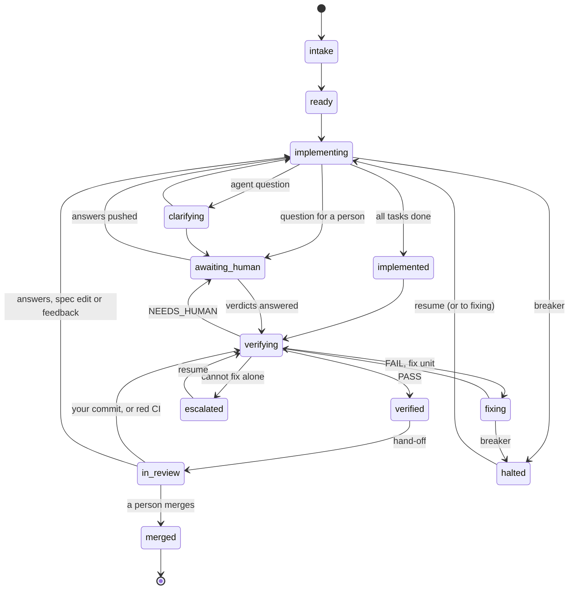

# L4 operations runbook

This runbook tells you how to operate the units of the L4 harness. It shows the states of a unit, how to find why a
unit stopped, and the procedures that make a unit move again.

It applies to harness 0.2.0 on GitHub and on GitLab. The text follows the rules of ASD-STE100 (Simplified
Technical English): short sentences, one instruction in each step, and each warning before its step.

Other documents:
- [quickstart.md](quickstart.md) tells you how to adopt the harness.
- [feedback.md](feedback.md) tells you how to ask for changes to the code of a unit.
- [state-diagram.md](state-diagram.md) shows all the phase transitions.

## Contents

1. [Read this first](#1-read-this-first)
2. [My unit does not move: where to start](#2-my-unit-does-not-move-where-to-start)
3. [The states of a unit](#3-the-states-of-a-unit)
4. [Find the state and the cause](#4-find-the-state-and-the-cause)
5. [Prepare your computer for l4 commands](#5-prepare-your-computer-for-l4-commands)
6. [Start a run](#6-start-a-run)
7. [Procedures for each state](#7-procedures-for-each-state)
8. [How to retry something](#8-how-to-retry-something)
9. [What your push does](#9-what-your-push-does)
10. [Reference](#10-reference)
11. [Known limits of 0.2.0](#11-known-limits-of-020)

## Words used in this runbook

| Word | Meaning |
|---|---|
| unit | One spec change: an OpenSpec change or a Kiro spec. |
| `<unit>` | The unit id: `openspec:<name>` or `kiro:<name>`. |
| `<name>` | The name of the spec folder of the unit. |
| unit folder | `openspec/changes/<name>/` (OpenSpec) or `.kiro/specs/<name>/` (Kiro). |
| `<branch>` | The unit branch: `l4/openspec/<name>` or `l4/kiro/<name>`. |
| `<base>` | The base branch (`forge.base_branch` in `.l4/config.yaml`, default `main`). |
| PR | A GitHub pull request or a GitLab merge request. Each unit has one PR. |
| note | The one comment that the harness keeps on the PR and changes at each step. |
| member | A person with write access (GitHub) or Developer access or higher (GitLab). |
| token | The forge token. The variable that `forge.token_env` names holds it: `L4_FORGE_TOKEN` by default, `GITHUB_TOKEN` in the setup-action form. |
| run | One CI job of the harness, or one `l4 run` command. |

## 1. Read this first

> **CAUTION: A green job does not mean that the unit moves.** On GitHub, a stop that waits for a person (exit 10, 11,
> 12 or 13) gives a green job with a yellow annotation. On GitLab, the job shows `failed (allowed)`. Read the
> annotation or the note.

> **CAUTION: The `l4 status` table does not show why a unit stopped.** It shows the phase only. Read the note or the CI
> log of the run that stopped the unit (section 4).

> **CAUTION: `l4 resume` and the `l4:resume` label do not start a run.** Start a run after them (section 6), or wait
> for the schedule.

> **CAUTION: Do not use `l4 run --unit` to resume a unit or to look at a unit.** On a halted unit it does not resume
> the unit. It pushes a ledger commit and it can remove the `l4:resume` label. On other phases it runs agents from
> your computer.

> **CAUTION: Do not edit the ledger (the `.l4/` folders) or `verification.md`.** The harness owns these files. A
> changed ledger makes the unit `corrupt`, and the harness stops all work on it.

> **CAUTION: Do not increase `verifier.max_fix_rounds` or `feedback.max_rounds` to free one unit.** These values
> apply to all units. Use the flags of `l4 resume` or the label (section 7.3).

> **CAUTION: Do not put a line that starts with `L4-Run:` in your commit messages.** The harness marks its own commits
> with it, and CI does not start for such a push.

> **CAUTION: Do not run the agent CLIs by hand on a runner, and do not copy their logins.** A copied login can make
> the original login stop.

The harness never merges a PR. A person merges it.

## 2. My unit does not move: where to start

Find what you see in the first column. Then go to the procedure.

| What you see | Probable state | Procedure |
|---|---|---|
| The note starts with `### Halted:` | `halted` | [7.2](#72-halted) |
| The note starts with `### Escalated:` | `escalated` | [7.3](#73-escalated) |
| The note has `### Waiting for you: a human answer`, or the PR has the label `l4:needs-answers` | `awaiting_human` | [7.1](#71-awaiting_human-a-question-waits-for-you) |
| The note has `### Waiting for capacity` | `waiting_capacity` | [7.4](#74-waiting_capacity-no-agent-is-available) |
| The note has `### Base merge needed`, and each run exits 1 | `verifying`, with a merge conflict | [7.7](#77-base-merge-conflict) |
| The note has `### Re-verifying after the hand-off` | `verifying` again | [7.5](#75-in_review-the-pr-is-ready) |
| The note has ``### The `l4:resume` label was not honoured`` | `halted` or `escalated` | [7.2](#72-halted), procedure A, step 7 |
| The note has `### The Kiro done-gate did not pass after the merge` | `merged` | [7.6](#76-after-the-merge) |
| The PR is ready for review and has the label `l4:in_review` | `in_review` | [7.5](#75-in_review-the-pr-is-ready) |
| The unit has no PR, and the job is red with exit 14 | rejected | [7.8](#78-rejected-unit-exit-14) |
| `l4 status` shows the phase `corrupt` | corrupt ledger | [7.9](#79-corrupt-ledger) |
| The log has `is locked by another run: skipped` | locked | [7.11](#711-locked-unit) |
| The job is red with exit 1, 2 or 3 | error | [7.12](#712-red-job-exit-1-2-or-3) |
| The job is red with exit 16 | cancelled run | [7.10](#710-cancelled-or-timed-out-run-exit-16) |
| The log says `nothing to do: no unit has a next step`, but you expect work | — | [Section 4](#4-find-the-state-and-the-cause), then [section 9](#9-what-your-push-does) |
| No run started after your push | — | [Section 9](#9-what-your-push-does) |

## 3. The states of a unit

The state of a unit is its phase. The harness writes each phase change as an event in the ledger of the unit. The PR of
the unit has the label `l4:<phase>`.



`waiting_capacity` is not in the diagram. A unit can go there from `ready`, `implementing`, `implemented`, `verifying`
or `fixing`. It returns to the same phase. [state-diagram.md](state-diagram.md) has all the transitions.

| Phase | What it means | Who acts next | Exit code | Procedure |
|---|---|---|---|---|
| `intake` | The harness examines the spec. | Harness | — | — |
| `ready` | The spec is correct. The unit waits for a lease. | Harness | — | — |
| `implementing` | Agents do the tasks test-first: a red step (a test that fails), then a green step (the code). | Harness | 0 or 10 | — |
| `clarifying` | The clarifier agent answers the questions of the implementer agent. | Harness | — | — |
| `awaiting_human` | A question waits for a person. | **Person** | 11 | [7.1](#71-awaiting_human-a-question-waits-for-you) |
| `implemented` | All tasks are done. Verification did not start. | Harness | — | — |
| `verifying` | The verifier examines the full branch: gates, tests and a judge agent. | Harness | — | — |
| `fixing` | A fix unit repairs the findings of a failed verification. | Harness | 10 | — |
| `verified` | Verification passed. The hand-off is next. | Harness | — | — |
| `in_review` | The PR is ready for review. | **Person** | 0 | [7.5](#75-in_review-the-pr-is-ready) |
| `merged` | A person merged the PR. | Harness | 0 | [7.6](#76-after-the-merge) |
| `waiting_capacity` | No agent of a necessary role is available. | Harness, sometimes a **person** | 12 | [7.4](#74-waiting_capacity-no-agent-is-available) |
| `halted` | A breaker stopped the unit. | **Person** | 13 | [7.2](#72-halted) |
| `escalated` | Verification failed, and the harness cannot continue alone. | **Person** | 13 | [7.3](#73-escalated) |

A fix unit is a small unit that the harness writes when verification fails. Its folder is next to the unit folder, with
the name `<name>-fix-<n>`, on the same branch. You never run a fix unit. The harness runs it as part of its parent.

## 4. Find the state and the cause

The cause of a stop is in these places. Examine them in this sequence.

| Place | Halted | Escalated at the fix-round limit | Other escalations |
|---|---|---|---|
| 1. The note on the PR | Yes | Yes, with the findings | Yes |
| 2. The CI log of the run that stopped the unit | Yes | Only the verdict line | Yes |
| 3. `outcome.json` of that run | Yes | A general text: read `verification.md` | Yes |
| 4. `l4 status --json`, field `halt_reason` | Yes | **No** (empty) | Yes |
| 5. `verification.md` on the branch, section `## Fix unit` | — | Yes | Yes |
| 6. The ledger | Yes | Only the phase change | Yes |
| The `l4 status` table | **No** | **No** | **No** |
| The `l4 plan` table | **No** (a fixed text) | **No** | **No** |

### 4.1 Read the note on the PR

1. Open the PR of the unit. Its source branch is `<branch>`.
2. Find the comment of the harness. It starts with a heading of level 3 (`###`).
3. Read the heading.
4. Find the heading in [section 2](#2-my-unit-does-not-move-where-to-start) or in [10.3](#103-headings-of-the-note).
   Go to the procedure.

> **NOTE:** The note is not a permanent record. A resume replaces the text with `Nothing is waiting for a human
> answer.` After a resume, use 4.2 to 4.5.

### 4.2 Read the CI log of the run that stopped the unit

> **CAUTION:** Only the run that stopped the unit has the reason line. Later runs do not work on halted or escalated
> units. They show the unit only in the tables of `l4 plan` and `l4 status`. Examine older runs until you find the
> line `phase … → halted` or `phase … → escalated`.

**On GitHub:**

1. Open the **Actions** tab. Select the workflow `l4`.
2. Find the run that stopped the unit. Its summary page shows a yellow annotation, for example
   `l4 exit 13 (halted): halted: task 1.1: max_task_attempts (3) reached in red; last failure: …`.
3. Read the annotation. It gives the exit code and the reason.
4. Open the job log. Search for `[l4] run:` and for the unit id.

With the GitHub CLI:

```sh
gh run list --workflow l4.yml --limit 20
gh run view <run-id> --log | grep -F '[l4]'
```

**On GitLab:**

1. Open **Build > Pipelines**. Find the pipeline of the run.
2. Open the job `l4`. A designed stop shows as `failed (allowed)`.
3. Find the line `designed stop, not a failure: l4 exit <code> (<name>): <reason>`.
4. Search the log for `[l4] run:` and for the unit id.

To follow a pipeline from a terminal, use
`l4 ci watch --project <group/name> --ref <base> --tail 60` (GitLab) or `l4 ci watch --repo <owner/name>` (GitHub).
A designed stop is a success for `l4 ci watch`.

The important log lines:

| Line | What it tells you |
|---|---|
| `[l4] run: <unit> halted: <reason>` | Why the unit halted. This is the full text. |
| `[l4] <unit> phase <from> → <to> (<trigger>)` | A phase change. |
| `[l4] <unit> task <k> <red\|green> attempt <n> failed: <reason>` | Why one attempt failed. |
| `[l4] <unit> halted: <code> (task <k>)` | The short code of the breaker. |
| `[l4] <unit> verdict <PASS\|FAIL\|NEEDS_HUMAN> (round <n>, …)` | The result of a verification round. |
| `[l4] run: <unit>: waiting_capacity, retry_after <time>: <why>` | No agent is available, and when the harness tries again. |
| `[l4] run: <unit> rejected: <reasons>` | The spec is not correct (exit 14). |
| `[l4] sweeper: <unit>: …` | Merges, archives, CI results and the `l4:resume` label. |
| `[l4] run: nothing to do: no unit has a next step` | No unit needs the harness. |
| `[l4] cli: internal error: <type>: <message>` | The command stopped with an error (exit 1). |

### 4.3 Read the run artifact

Each CI run uploads the folder `.l4-out/` as a job artifact. GitHub keeps it 7 days, and uploads it only when
`ci.upload_artifacts` is `true` (the default). GitLab keeps it 1 week.

1. Download the artifact.
   - GitHub: `gh run download <run-id> -n l4-out`, or the **Artifacts** list on the run page.
   - GitLab: the job page, **Job artifacts > Download**.
2. Open `outcome.json`. For each unit, read `phase_after` and `exit_reason`.
3. Open `l4.env`. Read `L4_EXIT` and `L4_PHASES`.
4. For the full record, read `logs/<run-id>.jsonl`:

   ```sh
   # phase changes, breakers and the end of the run
   jq -c 'select(.stream=="event") | .event | select(.type=="phase.changed" or .type=="breaker.tripped" or .type=="run.finished") | {seq,type,from,to,trigger,reason}' logs/<run-id>.jsonl
   # warnings and errors
   jq -r 'select(.stream=="log" and (.level=="WARNING" or .level=="ERROR")) | "\(.level) \(.logger): \(.msg)"' logs/<run-id>.jsonl
   ```

5. For the work of an agent, read `agent/<run-id>/`. Each step has the prompt (`.prompt.md`), the event stream
   (`.jsonl`) and the error output (`.stderr`).
6. For the gates, read `gates/<run-id>/`. Each gate has one numbered log file.

> **NOTE:** `outcome.json` holds only the units of that run. A unit that halted in an earlier run is not in it.

### 4.4 Use `l4 status` and `l4 plan` on your computer

Do the steps of [section 5](#5-prepare-your-computer-for-l4-commands) first.

> **CAUTION:** Outside CI, `l4` reads only your local copies of the remote branches. If you do not fetch first, the
> result is old or empty.

1. Fetch the unit branches and the lock refs:

   ```sh
   git fetch --prune origin '+refs/heads/l4/*:refs/remotes/origin/l4/*' '+refs/l4/locks/*:refs/l4/locks/*'
   ```

   If `forge.branch_prefix` is not `l4/`, use your prefix in the first refspec.

2. Show all units:

   ```sh
   l4 status
   ```

   | Column | Meaning |
   |---|---|
   | `PHASE` | The phase. `corrupt` means that the ledger cannot be read. `-` means that no run started the unit. |
   | `ITER` | The number of runs that worked on the unit. |
   | `TASKS` | Done and total required tasks of `tasks.md`. |
   | `OPEN-Q` | The ids of open questions. |
   | `VERDICT` | The last verdict: `PASS`, `FAIL` or `NEEDS_HUMAN`. |
   | `SOURCE` | `branch`: from the unit branch. `worktree`: from your checkout (no branch found). |
   | `FEEDBACK` | The count of feedback items in each state. It shows only when a unit has feedback. |

3. Show the full state of one unit:

   ```sh
   l4 status --unit <unit> --json
   ```

   | Field | Meaning |
   |---|---|
   | `halt_reason` | Why the unit halted or escalated. It is empty for an escalation at the fix-round limit. |
   | `previous_phase` | The phase that a resume returns to. |
   | `retry_after` | When the harness tries the agents again (`waiting_capacity`). |
   | `fix_rounds_counted`, `fix_rounds_extra` | Fix rounds used, and rounds added by a resume. The limit is `verifier.max_fix_rounds` (default 3). |
   | `feedback_rounds_used` | Feedback rounds used. The limit is `feedback.max_rounds` (default 5). |
   | `refused_signals` | `l4:resume` labels that the harness did not accept, and why. |
   | `ci_failure` | The red jobs of your own CI on the hand-off commit. |

4. Show the next action of each unit:

   ```sh
   l4 plan
   ```

   The column `NEXT` is `implement`, `clarify`, `verify`, `hand_off`, `follow_up` or `none`. The value `none` means
   that the harness does nothing for this unit. The column `REASON` tells you who must act.

### 4.5 Read the ledger

Use the ledger only when the other places do not give the cause. Do not change it.

- **Before the hand-off**, the ledger is in `<unit folder>/.l4/ledger/<run-id>.jsonl` on `<branch>`, one file for each
  run:

  ```sh
  git show origin/<branch>:<unit folder>/.l4/ledger/
  git show origin/<branch>:<unit folder>/.l4/ledger/<run-id>.jsonl
  ```

- **After the hand-off**, new events go to the lock ref `refs/l4/locks/<framework>/<name>`, in the folder
  `ledger-pending/`:

  ```sh
  git show refs/l4/locks/<framework>/<name>:ledger-pending/
  ```

A halt is a `breaker.tripped` event, then a `phase.changed` event with `"to": "halted"`. Both have the reason.

## 5. Prepare your computer for l4 commands

1. Install `l4` at the same version as the pin of your project.
   - Setup-action form: `uv tool install git+https://github.com/<owner>/<harness repo>@<tag or commit>`.
   - Vendored form: use `.l4/bin/l4` in the project.
   - Fetched form: use `.l4/bin/l4` in the project. It runs `uvx` with the pinned commit.
2. Clone the project.
3. Switch to `<base>`, and pull.
4. Fetch the unit branches and the lock refs (the command of [4.4](#44-use-l4-status-and-l4-plan-on-your-computer),
   step 1).
5. If the command changes the PR (`l4 resume`, `l4 archive`), put the token in the environment.

   > **CAUTION:** Do not write the token in a file or in a command line that the shell keeps in its history.

   ```sh
   read -rs L4_FORGE_TOKEN && export L4_FORGE_TOKEN
   ```

   Use the name that `forge.token_env` gives. The token must be able to push and to edit PRs.

What each command needs:

| Command | Linux with bubblewrap | Agent CLIs | Token |
|---|---|---|---|
| `l4 status`, `l4 plan` | No | No | No |
| `l4 plan --sweep` | No | No | Yes |
| `l4 feedback …` | No | No | No (git only) |
| `l4 resume` | No | No | Yes, so that the note and the labels change |
| `l4 archive` | No | No | Yes |
| `l4 run`, `l4 verify` | **Yes** | **Yes** | Yes |
| `l4 doctor` | No | No | No (`--live` calls the agents) |

> **NOTE:** `l4 run` and `l4 verify` stop with exit 3 on macOS, because they need bubblewrap. Let CI do this work.

## 6. Start a run

Each CI run checks out the head of `<base>`, plans all units and runs the units that have a next action. You cannot
start a CI run for one unit. A run that you start on a unit branch does the same as a run on `<base>`.

**On GitHub:**

- In the browser: **Actions > l4 > Run workflow**, select the branch `<base>`, then **Run workflow**.
- With the GitHub CLI:

  ```sh
  gh workflow run l4.yml --ref <base>
  ```

**On GitLab:**

- In the browser: **Build > Pipelines > Run pipeline**, select `<base>`, then **Run pipeline**.
- With the API: `POST /projects/<id>/pipeline?ref=<base>`, with a token that can run pipelines.

**Other ways that a run starts:**

- The schedule. The default is every 30 minutes (`ci.schedule`). On GitLab, `l4 setup gitlab` makes the schedule.
- A push to `<base>`, for example a merge.
- A push to a unit branch. [Section 9](#9-what-your-push-does) gives the exceptions.

**Rules:**

- Only one run works at a time (`concurrency: l4` on GitHub, `resource_group: l4` on GitLab). A new run waits. GitHub
  keeps only the newest run that waits.
- A run that you start again (**Re-run jobs**, **Retry**) checks out the current head of `<base>`. It is the same as a
  new run.
- A job stops after 180 minutes. When units remain at the end of the time budget, the harness on GitHub starts one more
  run.

## 7. Procedures for each state

### 7.1 `awaiting_human`: a question waits for you

**Causes:**

- An agent cannot continue a task without a decision, and the clarifier agent cannot answer.
- The spec has a contradiction or an open question.
- The verdict is `NEEDS_HUMAN`. The judge cannot decide whether a criterion is met. These are **verdict questions**.

**Procedure:**

1. Switch to `<branch>`, and pull.
2. Open `<unit folder>/questions.md`.

   For a question of a fix unit, open `<unit folder>-fix-<n>/questions.md` on the same branch.

3. Find the section `## Q-NNN: …` of the question.
4. Write your answer under `### Answer`, below the line `<!-- write below this line -->`.
5. Set the line `- **Status:**` of that section to one of these values:
   - `answered`: your own answer.
   - `accepted`: you accept the suggestion of the clarifier as it is written. Use it only when the section has one.
   - `dismissed`: the question is not important now.
6. Do not change the index table at the top, the ids or other sections.
7. Commit and push:

   ```sh
   git add <unit folder>/questions.md
   git commit -m "answer Q-NNN"
   git push
   ```

The push starts a run. The unit moves when your answers free a task. `l4 plan` then shows `answers submitted: Q-NNN`.

**For verdict questions** (`Kind: verdict`, "Criterion C-… is disputed: accept as satisfied?"):

- Start the answer with the word `accept` or `reject`. Then give your reason.
- A `reject` fails the criterion and starts a fix round. To tell the fix what is wrong, end the reason with a sentence
  `WHEN … THEN …`. It becomes a test scenario that the fix must make true.
- Before you reject, make sure that the criterion id is the one that you mean. `verification.md` shows which
  requirement each id is.
- Answer all open verdict questions. The unit moves only when all of them have an answer.

**The harness does not read these:**

- An answer with the Status `open`. The log tells you: `Q-NNN has an answer but its Status is still open`.
- The Status column of the index table. The harness writes that table.
- An `answered` with no text, or an `accepted` with no suggestion.
- A verdict answer that does not start with `accept` or `reject`.
- Answers on `<base>`, and comments on the PR.

> **NOTE:** `l4 questions` is not available in 0.2.0 (exit 2). Edit the file.

### 7.2 `halted`

A breaker stopped the unit during `implementing` or `fixing`. Read the reason (section 4). Then find it in this table.

| The reason starts with | Cause | What to do before you resume |
|---|---|---|
| `task <k>: max_task_attempts (<n>) reached in <red\|green\|single>; last failure: …` | The agent failed the same step `<n>` times (`implementer.max_task_attempts`, default 3). | Read the last failure. Correct its cause: an unclear task or spec, a test environment problem, or a gate configuration. Push the correction to `<branch>`. |
| ``task <k> cannot be selected: its checkbox is not an empty `[ ]` `` | The checkbox of the task in `tasks.md` is not `- [ ]`. | Correct the checkbox on `<branch>`. |
| `the test gate cannot run at the base: …`, `tests do not collect at the base: …` or `the test gate cannot run at the red checkpoint: …` | The test command does not run, or finds no tests, before the agent starts. | Make `gates.test.command` run and collect the tests on `<branch>`. If `<base>` is broken, correct `<base>` first. |
| `secret in the outgoing commits, push blocked: <path> (<kind>)` | The commits of the run contain a secret. | Remove the source of the secret at `<path>`. See the note below. |
| `<unit> is fixing but no fix unit is open`, or `the fix unit <x> is not a fix unit of <unit>` | The fix records do not agree. | Report it as a harness defect. |

> **CAUTION:** If you do not correct the cause, the unit halts again in the next run.

> **NOTE:** A push to a halted branch does not resume the unit. The log then shows
> `halted; a person pushed after the halt: add the label l4:resume to resume`.

> **NOTE:** For a secret, the harness does not push the halt. The next run starts the step again from the last pushed
> commit. If the secret comes from the agent, it can come back.

You can resume in two ways: procedure A (the label) or procedure B (the command). Both give the unit new task attempts.

**Procedure A: the `l4:resume` label (recommended)**

1. Correct the cause. Push the correction.
2. Make sure that you are a member. The bot user of the harness cannot resume.
3. Add the label `l4:resume` to the PR.
4. Start a run on `<base>` (section 6), or wait for the schedule.
5. Make sure that the log of that run has
   `[l4] sweeper: <unit>: resumed by a member's l4:resume label (event <n>)`. The same run then continues the unit.
6. The harness removes the label after the resume. Do not add it again.
7. If the note shows ``### The `l4:resume` label was not honoured``, read the reason under it:
   - `set by a user who is not a member of the project` or `below Developer access`: ask a member.
   - `set by the harness's own user`: a person must add the label.
   - Then remove the label. A member adds it again. Only a new "add" event counts.

**Procedure B: the `l4 resume` command**

1. Do the steps of section 5, with the token.
2. Correct the cause. Push the correction.
3. Resume the unit:

   ```sh
   l4 resume --unit <unit> --reason "<why the unit can continue now>"
   ```

4. Make sure that the output has `resumed: back in implementing` (or `fixing`).

   If it says `back in halted`, another run held the unit. Wait for that run to end. Then do step 3 again.

5. Start a run on `<base>` (section 6), or wait for the schedule.

> **NOTE:** `l4 resume` writes the commit `chore(<name>): resume [skip ci]` to `<branch>`. Its help says "members
> only", but the command does not check membership. Your push permission on `<branch>` decides.

### 7.3 `escalated`

Verification failed, and the harness cannot continue alone. A resume returns the unit to `verifying`.

> **CAUTION:** For the first four causes below, the note headline is always
> `verification failed and no fix round is left (see verification.md)`. Read the section `## Fix unit` of
> `verification.md` on `<branch>` to find the real cause.

| Cause (in `verification.md` or the note) | What to do | How to resume |
|---|---|---|
| `fix rounds used <n>/<m>` | Read `## Findings` and `## Criteria`. Decide whether more fix rounds can help. If the spec is wrong, correct the spec on `<branch>`. | `--extend-fix-rounds <n>`, or the label (one round each time) |
| `no finding of this round can be converted into a fix task` | Read the `not converted` lines. For example, a rejected verdict with no `WHEN … THEN …` needs a new answer with a scenario. | Plain resume, or the label |
| `<framework> has no fix units` | The framework cannot make fix units. | Report it as a harness defect. |
| `the fix unit could not be created: <error>` | Correct the error. | Plain resume, or the label |
| `feedback round limit reached (<n>)` | Feedback items used all rounds (`feedback.max_rounds`). | `--extend-feedback-rounds <n>`, or the label (one round each time) |
| `3 consecutive internal verifier errors` | The verifier or the judge failed three times. Examine their profiles with `l4 doctor --live`. Correct them. | Plain resume, or the label |

**Procedure:**

1. Read the note and `verification.md` on `<branch>`.
2. Correct the cause, if it is necessary. Push the correction.
3. Resume with procedure A or B of [7.2](#72-halted). For procedure B, add the flag from the table:

   ```sh
   l4 resume --unit <unit> --reason "<why>" --extend-fix-rounds 1
   l4 resume --unit <unit> --reason "<why>" --extend-feedback-rounds 1
   ```

   The command refuses a flag that does not agree with the cause. It also refuses a resume without the flag when the
   rounds are all used. The error message tells you the correct flag.

4. Start a run (section 6).

> **CAUTION:** If nothing changed, the next verification fails the same way, and the unit escalates again.

### 7.4 `waiting_capacity`: no agent is available

**Causes:**

- No profile of a necessary role (implementer, verifier, judge) can run: the CLI is not installed, the login is not
  valid, the key is not set, or a usage limit is active.
- `roles.<role>` in the config names no usable profile.

**What you see:** the note `### Waiting for capacity`, with each profile and why it cannot run.

**Procedure:**

1. Read the note. Find the cause for each profile.
2. Correct the cause: the login, the secret of the key, the CLI, or `roles.<role>` in `.l4/config.yaml`.
3. Read the last line of the note.
   - If it says `Capacity is expected back at <time>`, the first run after that time continues the unit. Wait, or
     start a run after that time.
   - If it gives no time, start a run after the correction.
4. Make sure that the unit moves. Run `l4 status`, or read the log of the run.
5. If the unit stays in `waiting_capacity`, do the steps of the next caution.

> **CAUTION:** In two cases a CI run does not continue the unit: the unit came from `fixing`, or the harness recorded
> no time. `l4 plan` then shows `waiting_capacity: M0 does not re-enter on its own`. To continue it, run
> `l4 run --unit <unit>` on a Linux computer with bubblewrap, the agent CLIs and the token. Make sure that no CI run
> works on the unit at that time.

> **NOTE:** The note says "The scheduled `l4 sweep` resumes the unit". There is no `l4 sweep` command. It means the
> scheduled CI run.

On a self-hosted runner, `l4 probe <profile> --role <role> --no-cache` examines one profile again. When the probe
passes, it removes the wait time of that profile.

### 7.5 `in_review`: the PR is ready

The unit passed verification. The PR waits for a person.

- **Merge it.** Use any merge method. The harness never merges.
- **Ask for changes.** Use `l4 feedback add` on `<branch>`, then commit and push. [feedback.md](feedback.md) tells you
  how.
- **Answer or change the spec.** A change in the unit folder after the hand-off sends the unit to `implementing`.
- **Push your own commit.** A commit that is not from the harness sends the unit to `verifying`. The PR becomes a
  draft again, and the note shows `### Re-verifying after the hand-off`. When verification passes, the harness hands
  off again.

  To verify the unit again with no change, push an empty commit:

  ```sh
  git commit --allow-empty -m "verify again"
  git push
  ```

**Your own CI is red on the hand-off commit:** the next run sends the unit to `verifying` (`repository_ci_failed`), and
the fix loop tries to correct it. If the same jobs are also red on `<base>`, the harness records `ci.preexisting` and
does nothing.

**Your own CI did not run on the hand-off commit (GitHub):** the push of the harness used `GITHUB_TOKEN`, and GitHub
starts no workflow for such a push. The log shows `no workflow ran on the hand-off commit`. Use a personal access token
or a GitHub App token as the forge token.

> **CAUTION:** Do not rewrite the history of `<branch>` (no force push). The harness sees that the hand-off commit is
> not on the branch, and it verifies the unit again.

### 7.6 After the merge

The next run on `<base>` sees the merge. A merge is a push to `<base>`, so it starts that run.

- **OpenSpec:** the harness opens an archive PR on the branch `l4/archive/openspec/<name>`. A person merges it. Only one
  archive PR is open at a time. The others wait (`archive pending`).
- **Kiro:** Kiro has no archive step. The harness runs the done-gate on `<base>`. If it fails, the note shows
  `### The Kiro done-gate did not pass after the merge`. Complete the open tasks in `tasks.md` on `<base>`. The
  harness examines the folder again when it changes.
- **The archive failed:** the log shows `the archive failed earlier on these inputs (see its pending ledger); not tried
  again`. The harness tries again when `<base>` or the unit folder changes. To try again now, do the steps of section 5
  with the token. Then run:

  ```sh
  l4 archive --unit <unit> --retry
  ```

- **Feedback after the merge:** the next run makes a follow-up unit `<name>-followup-<n>` with its own branch and PR.
  [feedback.md](feedback.md) tells you how.

### 7.7 Base merge conflict

Verification merges `<base>` into `<branch>` first. When the merge has conflicts, every run exits 1, and the note shows
`### Base merge needed`.

1. Switch to `<branch>`, and pull.
2. Merge the base branch:

   ```sh
   git fetch origin
   git merge origin/<base>
   ```

3. Resolve the conflicts. Do not change the files in `.l4/`.
4. Commit and push. The push starts a run.

The harness resolves conflicts in `questions.md` and `tasks.md` itself. A person resolves all other files.

### 7.8 Rejected unit (exit 14)

The harness refuses the spec. The CI job is red. The log shows `[l4] run: <unit> rejected: <reasons>`. The reasons are:

- `the unit has no tasks`: add tasks to `tasks.md`.
- `gates.test.command is not configured: there is no test oracle`: set `gates.test.command` in `.l4/config.yaml`.
- Kiro validation errors: correct the Kiro files.

Correct the spec or the config on `<base>`. The unit is rejected in each run until you correct it.

### 7.9 Corrupt ledger

`l4 status` shows the phase `corrupt`. `l4 plan` shows `ledger corrupt: <file>:<line> …`. The harness does nothing for
the unit, and its runs exit 1.

The cause is a changed ledger file: a line that is not correct, a sequence number that goes back, or an event of another
unit.

1. Find the commit that changed the ledger file: `git log -- <unit folder>/.l4/ledger/`.
2. If a person made that change, revert that commit (`git revert <commit>`), and push.
3. If the harness made it, report a harness defect. Include the file and the line.

### 7.10 Cancelled or timed-out run (exit 16)

A person cancelled the job, or the job reached its time limit. The run pushes nothing.

- Start a run (section 6). The next run continues from the last pushed state. It can do the step again.
- If one unit is too long for one job (180 minutes), divide its tasks.

### 7.11 Locked unit

The log shows `lock.busy: unit is locked by run <id> (CI job <n>, pid <p>)` and `is locked by another run: skipped`.
Another run on the same computer works on the unit.

- Wait for the other run to end. The lock goes when its process stops.
- `l4 unlock` is not available in 0.2.0 (exit 2). On a self-hosted runner, if the process does not stop, stop the
  process with the pid of the log line.

> **CAUTION:** A run on your computer and a run in CI do not share this lock. Do not run `l4 run` or `l4 verify` on
> your computer while CI works on the same unit. The second push is refused (exit 1), and the work of that run is lost.

### 7.12 Red job: exit 1, 2 or 3

**Exit 1, internal error or infrastructure:**

- `could not read Username`, `HTTP Basic: Access denied`, `401` or `403` in the message: a credential problem. Make
  sure that the job has the token. Run `l4 doctor`.
- `### Base merge needed`: go to [7.7](#77-base-merge-conflict).
- `the branch moved on the forge (non-fast-forward): a human pushed`: a person pushed during the run. The next run
  continues from that push. You do not have to do anything.
- `ledger corrupt`: go to [7.9](#79-corrupt-ledger).
- Other text: a harness defect.
  1. Run the command again with `-v` on your computer, for example `l4 -v status` or `l4 -v plan`. Without `-v`, the
     harness writes no traceback.
  2. Report the defect with the traceback, the run id, `harness_version` and `harness_commit` from `outcome.json`.

**Exit 2, usage or configuration:** read the `[l4] cli:` line. Correct the command or `.l4/config.yaml`.

**Exit 3, the environment is not ready:**

- The token is not set in the job.
- The install of an agent CLI failed.
- The forge refused a push, because of permissions or branch protection.
- `gates.setup` failed.

Run `l4 doctor` (on a self-hosted runner, `l4 doctor --ci`). Correct each row with the status `fail`.

## 8. How to retry something

| I want to | Do this |
|---|---|
| Run the harness again now | Start a run on `<base>` ([section 6](#6-start-a-run)). |
| Run a red job again | Use **Re-run jobs** (GitHub) or **Retry** (GitLab). It is the same as a new run. |
| Retry a task that used all its attempts | The unit is `halted`. Correct the cause, then resume ([7.2](#72-halted)). |
| Continue after I answered a question | Push the answers ([7.1](#71-awaiting_human-a-question-waits-for-you)). The push starts a run. |
| Give an escalated unit more fix rounds | `l4 resume … --extend-fix-rounds <n>`, or the label ([7.3](#73-escalated)). |
| Give an escalated unit more feedback rounds | `l4 resume … --extend-feedback-rounds <n>`, or the label ([7.3](#73-escalated)). |
| Verify a unit in review again | Push a commit to `<branch>`. An empty commit is enough ([7.5](#75-in_review-the-pr-is-ready)). |
| Continue a unit that waits for capacity | Correct the cause, then start a run ([7.4](#74-waiting_capacity-no-agent-is-available)). |
| Try an archive again | `l4 archive --unit <unit> --retry` ([7.6](#76-after-the-merge)). |
| Use a refused `l4:resume` label again | A member removes the label and adds it again ([7.2](#72-halted)). |
| Continue after a cancelled run | Start a run ([7.10](#710-cancelled-or-timed-out-run-exit-16)). |

## 9. What your push does

| Your push | Result | Does a run start? |
|---|---|---|
| A commit to `<branch>` when the unit is `in_review`, outside the unit folder | The unit goes to `verifying`. | Yes |
| A change to the unit folder when the unit is `in_review` (spec, `tasks.md`, `questions.md`, `feedback.md`) | The unit goes to `implementing`. | Yes |
| Answers in `questions.md` when the unit is `awaiting_human` | The unit moves when the answers free a task. | Yes |
| `feedback.md` before the hand-off | The items wait for the next verification. | Yes |
| A push to a `halted` branch | The unit stays `halted`. The log tells you to add `l4:resume`. | Yes, but the unit does not resume |
| A push to `<base>` (a merge also) | The harness examines merges, archives and new units. | Yes |
| A commit message with a line that starts with `L4-Run:` (on a unit branch) | Nothing. | **No** |
| A commit message with `[skip ci]` or `[ci skip]`, or `git push -o ci.skip` (GitLab) | Nothing now. The next run reads the commit. | **No** |
| The `l4:resume` label, or `l4 resume` | The unit is resumed at the next run. | **No** |

> **NOTE:** On GitLab, the rule for unit branches is fixed to the prefix `l4/`. If `forge.branch_prefix` is different,
> a push to a unit branch starts no pipeline.

## 10. Reference

### 10.1 Exit codes

| Code | Name | Meaning | GitHub job | GitLab job | What to do |
|---|---|---|---|---|---|
| 0 | `ok` | Done, or nothing to do. | Green | Green | Nothing. |
| 1 | `internal_error` | A harness defect or an infrastructure problem. | Red | Red | [7.12](#712-red-job-exit-1-2-or-3) |
| 2 | `usage_error` | Incorrect arguments or configuration. | Red | Red | [7.12](#712-red-job-exit-1-2-or-3) |
| 3 | `doctor_failed` | The environment is not ready. | Red | Red | [7.12](#712-red-job-exit-1-2-or-3) |
| 10 | `continue` | Progress. More work is necessary in a next run. | Green, blue notice | `failed (allowed)` | Nothing. |
| 11 | `awaiting_human` | A question waits for a person. | Green, yellow warning | `failed (allowed)` | [7.1](#71-awaiting_human-a-question-waits-for-you) |
| 12 | `waiting_capacity` | No agent of a necessary role is available. | Green, yellow warning | `failed (allowed)` | [7.4](#74-waiting_capacity-no-agent-is-available) |
| 13 | `halted` | A breaker stopped the unit, or the unit escalated. | Green, yellow warning | `failed (allowed)` | [7.2](#72-halted), [7.3](#73-escalated) |
| 14 | `rejected` | The spec is not correct, or no spec framework was found. | Red | Red | [7.8](#78-rejected-unit-exit-14) |
| 15 | `regression` | `l4 eval --compare` found a regression. | Red | Red | Examine the scorecard. |
| 16 | `cancelled` | A signal stopped the run. Nothing was pushed. | Red | Red | [7.10](#710-cancelled-or-timed-out-run-exit-16) |

When a run works on more than one unit, the exit code is the most severe one, in this sequence:
1, 16, 2, 3, 14, 15, 13, 11, 12, 10, 0.

> **NOTE:** Exit 13 does not always mean the phase `halted`. Exit 13 also comes from a secret found during
> verification, and from `l4 archive` after a recorded archive failure. Read `L4_PHASES` in `l4.env`, or `phase_after`
> in `outcome.json`.

### 10.2 Labels

| Label | Who sets it | Meaning |
|---|---|---|
| `l4:<phase>` | Harness | The phase of the unit, for example `l4:halted` or `l4:in_review`. One at a time. |
| `l4:needs-answers` | Harness | The unit has open questions. |
| `l4:resume` | A member | Resume a halted or escalated unit. For an escalation at a limit, it adds one round. The harness removes it after use. |

The prefix `l4:` comes from `forge.labels_prefix`.

### 10.3 Headings of the note

| Heading | Meaning | Procedure |
|---|---|---|
| `### Halted: <reason>` | A breaker stopped the unit. | [7.2](#72-halted) |
| `### Escalated: <reason>` | Verification failed, and the harness cannot continue alone. | [7.3](#73-escalated) |
| `### Escalated: the verifier failed this unit and it cannot be fixed automatically` | The findings of the last round. It comes after the heading above. | [7.3](#73-escalated) |
| `### Waiting for you: a human answer` | Questions wait for you. With `(fix unit …)`, they are in the fix unit. | [7.1](#71-awaiting_human-a-question-waits-for-you) |
| `### Waiting for capacity` | No agent is available. | [7.4](#74-waiting_capacity-no-agent-is-available) |
| `### Base merge needed` | The merge of `<base>` into `<branch>` has conflicts. | [7.7](#77-base-merge-conflict) |
| `### Re-verifying after the hand-off` | A commit after the hand-off, or red CI. The harness verifies again. | [7.5](#75-in_review-the-pr-is-ready) |
| ``### The `l4:resume` label was not honoured`` | The harness refused the label. The reason follows. | [7.2](#72-halted) |
| `### The Kiro done-gate did not pass after the merge` | A required Kiro task is not done on `<base>`. | [7.6](#76-after-the-merge) |
| `### Your feedback` | The state of each feedback item. | [feedback.md](feedback.md) |
| `Nothing is waiting for a human answer.` | No person must act now. | — |

### 10.4 Commands for operation

| Command | What it does | Changes state |
|---|---|---|
| `l4 status [--unit <unit>] [--json]` | Shows the phase of each unit. `--json` shows the full state. | No |
| `l4 plan [--unit <unit>] [--json]` | Shows the next action of each unit, and why. | No |
| `l4 plan --sweep` | Records merges, archives, CI results and `l4:resume` labels. CI runs it. | Yes |
| `l4 doctor [--ci] [--live] [--fix]` | Examines the environment, the config and the agents. | `--fix` installs tools |
| `l4 resume --unit <unit> --reason <text> [--extend-fix-rounds <n> \| --extend-feedback-rounds <n>]` | Resumes a halted or escalated unit. | Yes |
| `l4 archive --unit <unit> [--retry]` | Runs the archive or the done-gate of a merged unit. | Yes |
| `l4 feedback add\|list\|show\|submit\|withdraw` | Writes or shows feedback items. | Edits `feedback.md` only |
| `l4 probe [<profile>] [--role <role>] [--no-cache]` | Examines the availability of agent profiles. | Clears a wait time when the probe passes |
| `l4 ci watch` | Follows a pipeline or a run to its end. | No |
| `l4 run [--unit <unit>]` | Runs units. CI runs it. | Yes |
| `l4 verify --unit <unit>` | Runs only the verification of an `implemented` or `verifying` unit. | Yes |

These commands and options are not available in 0.2.0. They stop with exit 2:
`l4 unlock`, `l4 questions`, `l4 status --rebuild`, `l4 resume --extend-iterations`, `l4 resume --extend-cost`,
`l4 run --time-budget`, `l4 verify --dry-run`.

### 10.5 Files

| File | Where | Can a person edit it? |
|---|---|---|
| `questions.md` | Unit folder, on `<branch>` | Yes: the `### Answer` and the `- **Status:**` line of a question. |
| `feedback.md` | Unit folder, on `<branch>` | Use `l4 feedback`. |
| Spec files and `tasks.md` | Unit folder | Yes. After the hand-off, a change sends the unit to `implementing`. |
| `verification.md` | Unit folder, on `<branch>` | **No.** The harness writes it at each round. |
| `.l4/ledger/*.jsonl` | Unit folder, on `<branch>` | **No.** A change makes the unit `corrupt`. |
| `.l4/evidence/round-<n>/` | Unit folder, on `<branch>` | **No.** The record of each round. |
| `.l4/fix.json`, `.l4/followup.json` | Fix unit or follow-up unit folder | **No.** |
| `ledger-pending/*.jsonl` | Lock ref `refs/l4/locks/<framework>/<name>` | **No.** |
| `.l4/config.yaml` | Project root, on `<base>` | Yes. Run `l4 upgrade` after you change `ci.*` values. |
| `.github/workflows/l4.yml`, `.l4/ci/l4.gitlab-ci.yml` | Project | **No.** `l4 upgrade` writes them. |

## 11. Known limits of 0.2.0

These limits make operation more difficult. Know them before you start.

- The `l4 status` table shows no reason for a stop and no wait time. Use `--json`, the note or the CI log.
- `halt_reason` is empty for an escalation at the fix-round limit. Read `verification.md`.
- The note headline of an escalation says "no fix round is left" also when rounds are left ([7.3](#73-escalated)).
- `l4 plan` gives a fixed text for `halted` and `escalated`. It does not give the cause.
- Only the run that stopped a unit has the reason in its log. Later runs do not mention the cause.
- The harness writes tracebacks only with `-v`. The CI templates do not use `-v`.
- `l4 resume` does not check membership, although its help says "members only".
- A unit that waits for capacity from `fixing`, or with no recorded time, does not continue in CI
  ([7.4](#74-waiting_capacity-no-agent-is-available)).
- The capacity note names an `l4 sweep` command. It does not exist.
- `l4 run --unit` on a halted unit pushes a ledger commit, and it can remove the `l4:resume` label.
- A lock does not protect a local run against a CI run on another computer.
- On GitLab, the pipeline rule for unit branches is fixed to the prefix `l4/`.
- Without the forge credentials, `l4 status` in GitHub Actions stops with `internal error: GitError` instead of a
  clear message.
- `budgets.max_iterations_per_unit`, `budgets.max_cost_usd_per_unit`, `no_progress_iterations` and
  `same_error_repeats` are in the config, but no breaker uses them.
- The commands and options of [10.4](#104-commands-for-operation) that are not available.
