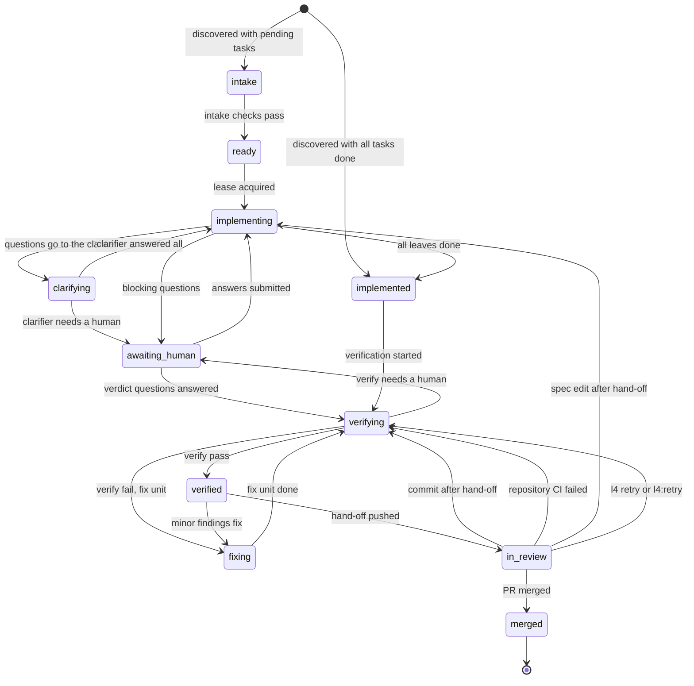
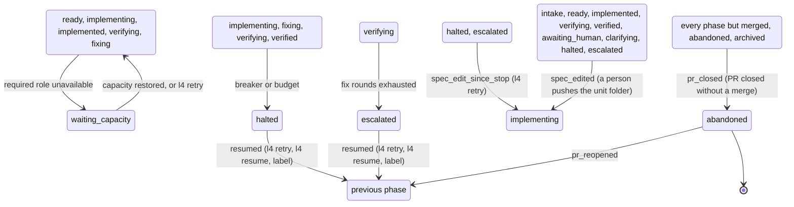
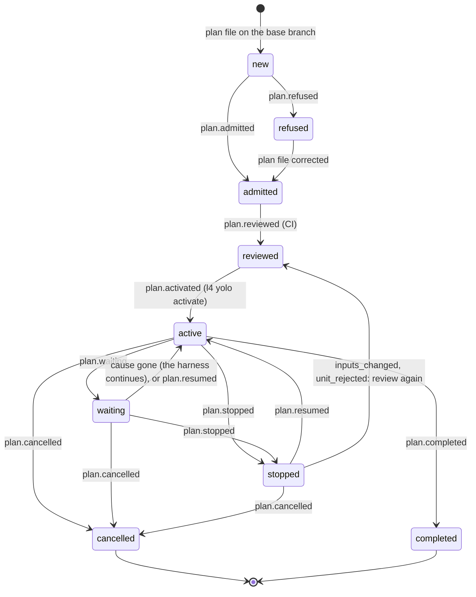

# Unit lifecycle state diagram

A unit is one spec change (an OpenSpec change or a Kiro spec) that the harness carries from discovery to a merged pull
request. Its phase lives in the ledger as `phase.changed` events, and the only code that changes it is `transition()`
in `src/l4/state/lifecycle.py`, which refuses any edge that is not in its `TRANSITIONS` table. The design-level
summary is in [architecture.md section 6](architecture.md#6-unit-lifecycle) and the normative table in
[SPEC 12.0](SPEC.md#120-lifecycle-normative).

This page shows what the code does today, not the full design. The parking edges (waiting for capacity, halted,
escalated, abandoned and their retry) can start from many phases, so they are drawn in a second small diagram instead of the
main one.

What to do in each phase, and how to retry or restart a unit, is in the [operations runbook](runbook.md).

## Main path

A person's push that changes the unit folder (`spec_edited`) re-enters the unit from `intake`, `ready`, `implemented`,
`verifying`, `verified`, `awaiting_human`, `clarifying`, `halted` and `escalated`. It is drawn as one group in the next
diagram, because it has many sources.

## Parking: waiting for capacity, halted, escalated, abandoned

Notes on the second diagram. The grouped boxes stand for the listed source phases; each source has its own edge in the
table. Leaving `waiting_capacity`, `halted` or `escalated` returns the unit to the phase it was parked from
(`previous_phase` in the folded state). `resumed` from `escalated` also needs extra fix rounds when they are used up;
that check lives in `state.resume`, not in the table. `l4 retry` takes the same edges as `l4 resume` for `halted` and
`escalated`, and `capacity_restored` for `waiting_capacity`. If a person changed the unit folder since the stop, it takes
`spec_edit_since_stop` to `implementing` instead. `l4 restart` is not an edge: it creates a new branch with a new ledger,
and the fold reads `unit.restarted` as a new start (no phase). A secret in the outgoing commits takes the
`breaker_or_budget` edge in any of the four listed phases. `spec_edited` from `fixing` is not an edge: the edit is taken
when the fix unit ends and the unit is in `verifying`.

## Phases

| Phase | Meaning | What moves it on |
|---|---|---|
| `intake` | Spec checks run | All checks pass |
| `ready` | Cleared to start, waiting for a lease | Lease acquired |
| `implementing` | Agents work through the tasks test-first | All leaves done, or questions, breaker or budget |
| `clarifying` | The clarifier answers blocking questions | Answered all, or needs a human |
| `awaiting_human` | Parked until a person answers | Answers submitted, verdict questions answered, or a spec push (`spec_edited`) |
| `implemented` | All tasks done, not yet verified | Verification started |
| `verifying` | Verifier checks the whole branch | Pass, fail with a fix unit, needs a human, no fix rounds left, a breaker, or a spec push |
| `fixing` | A fix unit repairs the findings | Fix unit done (back to `verifying`) |
| `verified` | Passed verification | Hand-off pushed, minor findings fix, a breaker (a secret), or a spec push |
| `in_review` | Pull request open for a human | PR merged, a commit or spec edit after hand-off, red repository CI, or `l4 retry` (to `verifying`) |
| `waiting_capacity` | A required role has no usable profile | Capacity restored, or `l4 retry` (previous phase) |
| `halted` | Breaker or budget stopped the unit | `l4 retry`, `l4 resume` or the label `retry` (previous phase), or a spec edit (`implementing`) |
| `escalated` | Verification failed and the harness cannot go on alone | `l4 retry`, `l4 resume` or the label `retry` (`verifying`), or a spec edit (`implementing`) |
| `merged` | Terminal, the PR was merged | Nothing |
| `abandoned` | The PR was closed without a merge | `l4 restart` (a new start), or the PR reopened (previous phase) |
| `rejected`, `archived` | In the `Phase` enum only | No edge enters or leaves them in the code yet |

`archived` and `rejected` appear in the design (architecture.md) but the table has no rows that enter them, so they are
left out of the diagrams. `abandoned` is entered by `pr_closed`; it leaves only by `pr_reopened`, or by a restart, which
begins a new ledger.

_Generated by reading `src/l4/state/lifecycle.py` at commit b4a4edba. If that file changed since, this page may be stale._

## Delivery plan states

A delivery plan (see [yolo-mode.md](yolo-mode.md)) has its own state, folded from the ledger in `refs/l4/plans/<plan-id>`
(`fold_plan` in `src/l4/yolo/state.py`). It is separate from the phase of each unit: the plan reads the phase of its
current unit and decides to dispatch, wait, merge or stop. The unit diagrams above are not changed by a plan.

A `waiting` plan is not stopped: the harness continues by itself when the cause is gone, and `l4 yolo resume` also wakes
it. The plan file and the unit specs are frozen at the activation; a change of either stops an active plan with
`inputs_changed`. A cancelled plan still holds its units while its file is on the target.

The stop reasons and the command that clears each one are in the [runbook, section 12.3](runbook.md#123-procedure-a-plan-is-stopped).
