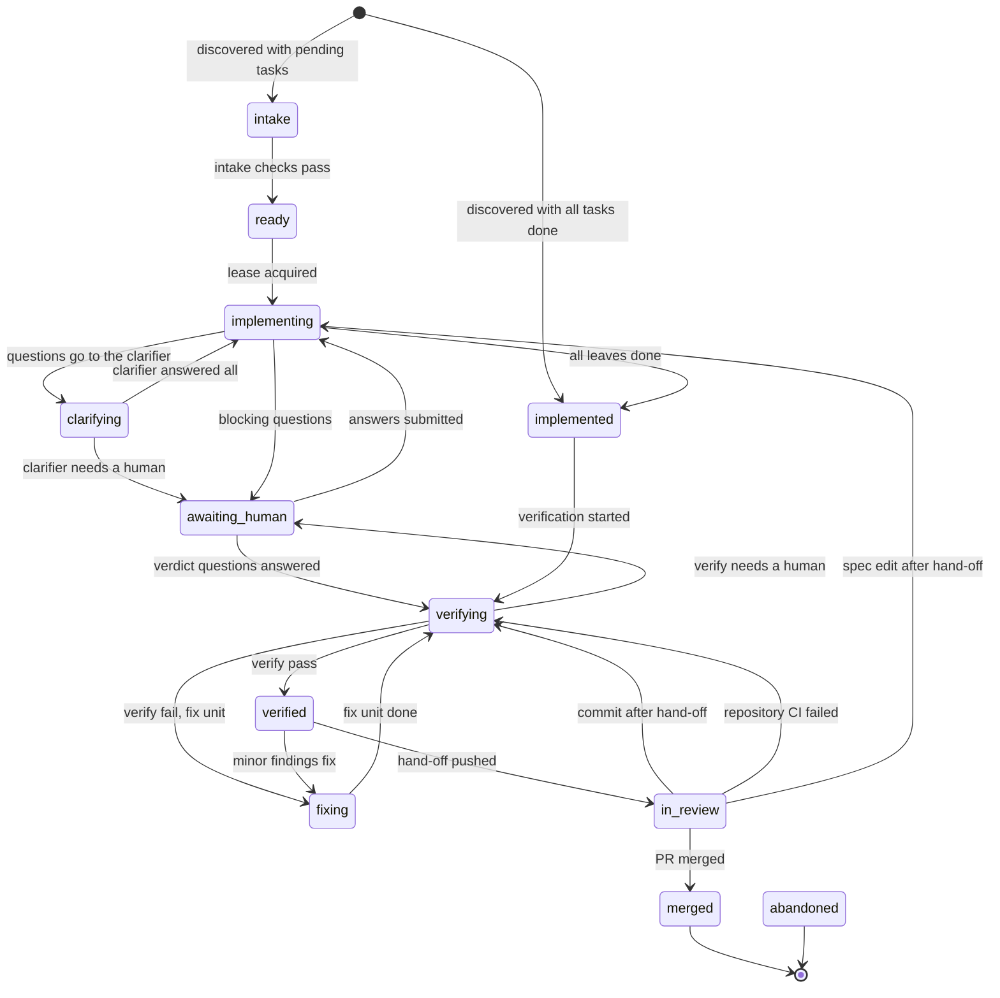
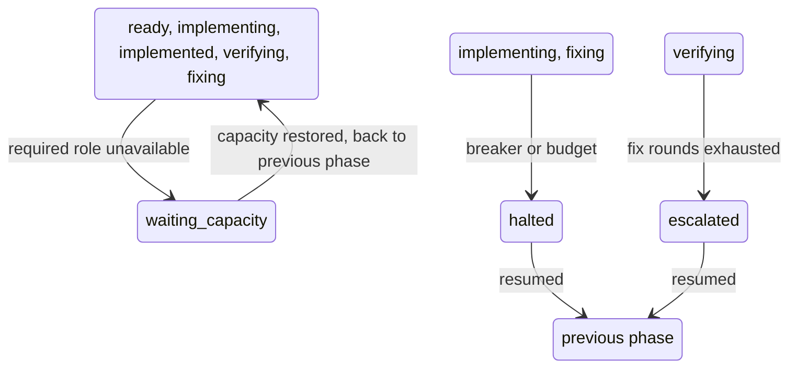

# Unit lifecycle state diagram

A unit is one spec change (an OpenSpec change or a Kiro spec) that the harness carries from discovery to a merged pull
request. Its phase lives in the ledger as `phase.changed` events, and the only code that changes it is `transition()`
in `src/l4/state/lifecycle.py`, which refuses any edge that is not in its `TRANSITIONS` table. The design-level
summary is in [architecture.md section 6](architecture.md#6-unit-lifecycle) and the normative table in
[SPEC 12.0](SPEC.md#120-lifecycle-normative).

This page shows what the code does today, not the full design. The parking edges (waiting for capacity, halted,
escalated and their resume) can start from many phases, so they are drawn in a second small diagram instead of the
main one.

## Main path

## Parking: waiting for capacity, halted, escalated

Notes on the second diagram. The grouped boxes stand for the listed source phases; each source has its own edge in the
table. Leaving `waiting_capacity`, `halted` or `escalated` returns the unit to the phase it was parked from
(`previous_phase` in the folded state). `resumed` from `escalated` also needs extra fix rounds when they are used up;
that check lives in `state.resume`, not in the table.

## Phases

| Phase | Meaning | What moves it on |
|---|---|---|
| `intake` | Spec checks run | All checks pass |
| `ready` | Cleared to start, waiting for a lease | Lease acquired |
| `implementing` | Agents work through the tasks test-first | All leaves done, or questions, breaker or budget |
| `clarifying` | The clarifier answers blocking questions | Answered all, or needs a human |
| `awaiting_human` | Parked until a person answers | Answers submitted, or verdict questions answered |
| `implemented` | All tasks done, not yet verified | Verification started |
| `verifying` | Verifier checks the whole branch | Pass, fail with a fix unit, needs a human, or no fix rounds left |
| `fixing` | A fix unit repairs the findings | Fix unit done (back to `verifying`) |
| `verified` | Passed verification | Hand-off pushed, or minor findings fix |
| `in_review` | Pull request open for a human | PR merged, a commit or spec edit after hand-off, or red repository CI |
| `waiting_capacity` | A required role has no usable profile | Capacity restored (previous phase) |
| `halted` | Breaker or budget stopped the unit | `l4 resume` or a member label (previous phase) |
| `escalated` | Verification failed with no fix round left | `l4 resume` (previous phase) |
| `merged` | Terminal, the PR was merged | Nothing |
| `abandoned` | Terminal | Nothing; no edge enters it in the code yet |
| `rejected`, `archived` | In the `Phase` enum only | No edge enters or leaves them in the code yet |

`abandoned`, `archived` and `rejected` appear in the design (architecture.md) but the table has no rows for them, so
they are left out of the diagrams except `abandoned --> [*]`, which marks it as terminal.

_Generated by reading `src/l4/state/lifecycle.py` at commit 6f71fd2. If that file changed since, this page may be stale._
